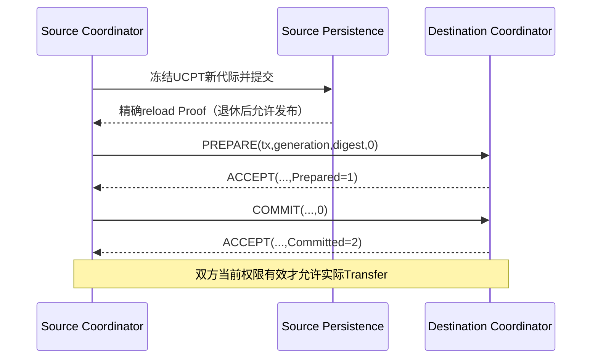

# Parent 发布与传输发送共同合同

## 1. 目的与边界

本合同补齐 C1 Parent 的线上发布，而不把本地持久化成功误当作对端已安装。
用户已授权共同正文及 C/Rust 同步实现；普通 C1/C0 Header、Tag、Fragment Prefix 不增加字段。
低层 Owner 仍只消费 Coordinator 的精确事实；实际 Runtime 必须来自认证 raw frame，
不得对应用公开 `peer_ready=true` 或可伪造的“认证成功”开关。

首版只支持已建立 O1/O2、H0 单 Peer 的 C1 Parent；Flow Parent 使用其独立发布合同，
不把 C1 Parent 的代际或 Transfer-ID 高水位借给 Flow。

## 2. 共同正文与角色

沿用已登记 Opcode 0410/0411/0412/0413，不新增 Opcode。
四种正文均为精确 **32 B**，big-endian；多一字节、少一字节或 reserved 非零均拒绝。

| Offset | 字段 | 长度 | 规则 |
| --- | --- | --- | --- |
| 0 | proposal_transaction | 8 | 非零；PREPARE 等于其外层 C0 transaction，其他阶段回显原值；不是本报文外层 nonce。 |
| 8 | parent_generation | 4 | 非零、checked-next；首次为1，终值允许但禁止下次回绕。 |
| 12 | context_digest | 16 | `canonical_digest("UCN6-C1-PARENT-V1", UCPT[0..76])`；digest 不是认证。 |
| 28 | disposition | 1 | PREPARE/COMMIT=0；ACCEPT=1 Prepared 或2 Committed；ABORT=1..255 reason。 |
| 29 | reserved | 3 | 全零。 |

UCPT 为共同88 B Record规范编码，临时使用high_water=0、transaction=1；前76 B包含
magic/schema/origin、Realm、原Source/目标Principal+Address+Binding、Policy/Session/Key及Parent generation。
高水位和Foundation transaction不进入发布摘要，不因每次Transfer-ID分配重做Parent握手。
Role 分别 Request、Result、Request、Oneway；C0 Kind=Control，BestEffort、Q1、H0。
出站报文使用发送方自身 C0 counter；响应回显 proposal_transaction 只存在正文，
不得复用对端外层 transaction 作为自己的已分配 nonce。

摘要只加速匹配，Pending 必须保存完整规范 Parent；每次实际使用还需逐字段核对当前
Realm、Principal/Binding、Session/Key/Policy、Link generation、最小保护等级与ACL。
碰撞不能使不同 canonical Parent 复用旧 Pending。不能从收到的摘要反推或安装身份。

## 3. 状态与掉电

Source：Durable → PreparePending → CommitPending → Active；
Destination：Empty → Prepared → Active。PREPARE 只能使用已回读的Parent，不消费Transfer-ID。
Source只能在COMMIT已实际提交且收到认证Committed确认后放行发送；
Destination只能在精确COMMIT后放行接收。仅收到Prepared不允许Transfer。

重复PREPARE/COMMIT幂等重发当前对应ACCEPT，不延长最初deadline，不改canonical Parent。
乱序、错误角色/Source、换tx/摘要/代际/路径、过去事务或超时拒绝，不覆盖已有事务。
已进入握手的Parent不可原地改路径；需先围栏，再新Parent generation/新transaction。
固定槽表满不驱逐。deadline半开，所有加法checked，now=0或回退拒绝。
重试间隔、次数及总寿命是固定本地Manifest策略，不由Peer以报文无限扩展。

任何重启、stop、撤权、Session/Key/Policy/Binding/Link变化、握手阶段超时或ABORT，线上许可失效。
握手Deadline不是Active Parent的永久租约；进入Active后，每次发送/接收仍必须通过当前
Session/ACL/Parent门禁。缓存回复不因重复报文续期，不能在握手截止后重新激活失效Source。
磁盘UCPT只能恢复分配高水位和旧Parent历史，不能自行变成线上Active；
新Session需从已验证旧Record取得checked-next Parent代际，再持久化和重新握手。
Destination的Parent表是当前Session内有界soft state；重启必须使用新的耐久Session，
不能恢复旧Session Replay窗口为空并接受旧控制帧。Transfer业务不因此取得at-most-once承诺。

## 4. Adapter与发送义务

每阶段保护一次、缓存精确字节；NOT_SUBMITTED退休本次Token后有限重试；
SUBMITTED必须先获得/退休精确完成，不能凭send返回值收到ACCEPT；UNKNOWN保留Holder。
阶段晋升不能丢弃尚未退休的Token。停止先围栏线上许可，再排空Provider/Adapter义务。
Source Transfer-ID必须实际Foundation提交/回读后签发，Setup/Fragment/Receipt仍使用完整
既有TransferKey；同一Permit只能建立一次Sender，不能Clone或重复分配。

## 5. 自审与门禁

共同32 B四类Golden及两种ACCEPT，native C/Rust/Python独立生产并逐字节比较；
长度±1、tx/gen/digest零、reserved、错误disposition/opcode、alias失败不写输出。
Source未Commit提交前收到Committed、错误tx/Path/Context、低保护/无ACL不得激活。
丢PREPARE/ACCEPT/COMMIT/Committed分别有限收敛；持续丢包超时围栏旧事务。
晚到完成/背压/UNKNOWN、停止及恢复仅保留义务，不重新激活失效Parent。
本合同不代表真实Flash、生产密码或实机GO；每个实现阶段另有证据和自审记录。

## 6. 当前实现边界（2026-10-14）

C/Rust已同步32 B正文Codec、规范UCPT摘要及纯阶段规则；960个Role/Phase/Opcode/
Disposition/Sent组合三方比对。纯阶段规则不认证、不持有Token，也不能单独当线上Owner。
Rust `parent-control`已接实际Foundation/ControlCoordinator/Security/Adapter/缓存回复，
Source动作需借用不可自行构造的 `SourceParentProof`，存活期间不能修改分配器或Foundation。
Source读取当前媒体的Generation、Digest、Schema、Consumer、正文和未退休义务，
不能借旧Owner或仅按摘要相等推进。

Target的本地Parent状态及回复缓存由不同Coordinator子对象持有；整机停止/静止还必须
停止并退休ControlReplies、ControlCoordinator、Adapter RX/TX，单个Parent的quiescent
不证明这些外部对象已静止。当前每个ParentCoordinator只完成一次发布，不自动原地替换。
C production composition 的Parent认证handler/自动调度尚未接通，不能据共同Codec或
纯状态Oracle宣布C完整Runtime GO。Rust统一Node、跨Peer和自动Parent轮换仍为后续软件工作。

## 7. 当前自主Transfer发送子集

`TransferSender<M,N,W>` 只接一次 C1/H0/Reliable/OneWay 传输，`1<=N<=32`，
`128<=W<=4096`；RPC Request/Result、Flow、动态Path与多窗口流水线不能悄悄降级到本子集。
begin需要Active Source Parent及实际当前媒体的借用证明，消费已回读签发的线性TransferPermit；
预检最大Setup/Fragment完整Frame MTU，普通数据头不变。拒绝输入时ID可以烧号，不能复用。

Setup只保护一次并有限重试；每片只分配一次Origin Sequence和保护字节。
轮转选择尚未确认且RTO到期的分片，实际Driver disposition才更新sent/credit。
背压只退休本次Token，不更换Frame；Source Holder未退休不得覆盖。加密失败退款未提交credit，
counter耗尽在准备标记前拒绝。Timer推进必须使原Deadline永久失效，不能用旧now复活。

反馈只能从ControlCoordinator认证队列进入，精确Parent/Setup/Service/摘要/方向复验后合并。
所有SACK位为1仍不是业务交付：等待最终目标Receipt；Receipt丢失时有限重发已缓存的
最后一片，由接收端已确认终态重发原Receipt，不重新交付业务，不额外烧nonce。
stop是本地停止，不证明远端NoEffect；UNKNOWN及已经提交的Token保留到精确物理退休。
TX-only实例不配置RX重组/Receipt数组；缓存成本是固定本地RAM，不是新增线上头开销。
