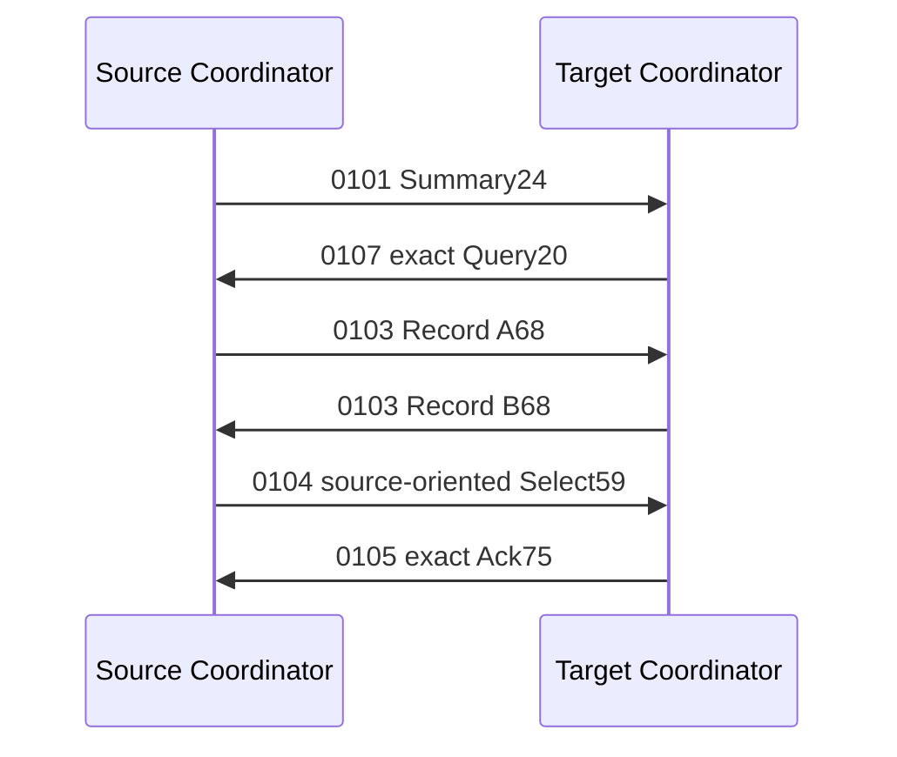

# Capability：认证协商与精确事务共同合同

## 1. 作用、前提和范围

能力协商回答“这两个已认证节点共同支持什么”，供后续 Contract Resolver 选择发送方式。
它不分配地址、不建立 JOIN、不更换密码 Key，也不授予 Endpoint ACL、Cluster Authority
或资源 Reservation。`Confirmed` 只是逻辑阶段，使用时仍须复验当前 Security 和 Capability。

本轮基于实际已经准入、耐久发布的 Session：C 同步 Codec、Catalog、认证 typed 分派；Rust
增加可裁剪 `capability-control` Root，接实际 Security/ACL/Replay、专属 Adapter 和原子 RX。
当前 Rust Root 固定一个直连 H0 Peer、固定本机 Record 与策略。它不是完整动态 Node。
动态 Admission、多 Peer、自动再次协商、C 自动握手 Root 和 Dynamic Route/Flow 仍待实现。

机器合同为 `protocol/contracts/v6-shared-v1.json` 的 `capability_negotiation`。普通 Data 的
Common Header、C1/C2/C3/C4/C5、Tag 和可选业务 Envelope 均不因本合同增大。

## 2. 报文、Role 和费用

能力子协议统一 C0、Control、Q2、BestEffort、HopLimit=1、O1/O2；不保留旧 Capability
Reliable 语义的 fallback。可靠收敛由本节明确的有限重试和缓存确认负责，不叠加第二套可靠层。
H0 静态直连是当前 Rust Root 的范围，C handler 本身也允许已经安装且认证的其他 Hop Context。
后者不证明 C/Rust 多跳握手已完成。

| Opcode | 消息 | Role | Body | 作用 |
| --- | --- | --- | --- | --- |
| 0101 | NeighborHello | OneWay | Summary24 | 提示本机 Record 代际和摘要，不准入节点 |
| 0102 | NeighborKeepalive | OneWay | Summary24 | 同一父域内提示；不是续租证明 |
| 0103 | CapabilityAdvertise | OneWay | Record68 | 认证发布完整能力记录 |
| 0104 | CapabilitySelect | Request | Select59 | 发起方提交双方完整记录的确定交集 |
| 0105 | CapabilityAck | Result | Select59+Transcript16 | 目标确认精确 SELECT 事务 |
| 0106 | CapabilityRevoke | OneWay | Query20 | 撤销精确 generation/digest，保留历史高水位 |
| 0107 | CapabilityQuery | Request | Query20 | 请求完整记录；不再借用 REVOKE Opcode |

新增的 0107 只存在于低频 Control Registry，已登记 Opcode 共 98 个；没有新增普通数据字段。
H0/O1 或 O2、地址宽度 W 的帧开销为 `25+2W+Body+16`，不含 Carrier。

| Body | A0 | A1 | A2 | A3 |
| --- | --- | --- | --- | --- |
| Summary24 | 67 | 69 | 71 | 73 |
| Query20 | 63 | 65 | 67 | 69 |
| Record68 | 111 | 113 | 115 | 117 |
| Select59 | 102 | 104 | 106 | 108 |
| Ack75 | 118 | 120 | 122 | 124 |

当前首次握手六帧为 HELLO、QUERY、两次 ADVERTISE、SELECT、ACK；A1 无丢包共 584 B。
这是低频建立费用，不是每个数据包的费用。120 B 以下的 A1 Link 无法原样承载 ACK；当前
Root 构造时明确拒绝，不假装已经支持小 MTU 控制分片。分片或另一种低开销握手需另立合同。

## 3. 精确字段布局

所有多字节字段 big-endian，禁止序列化 C/Rust struct 内存或 padding。

Summary24：`capability_generation:u32 + link_instance_generation:u32 + record_digest:16`。
Query20：`requested_generation:u32 + known_digest:16`。结构 Codec 允许 `{0,zero_digest}`
表示未知，但本轮 Root 只发送并接受 HELLO 指向的非零精确 Query，不实现通用扫描查询。
REVOKE 必须是非零精确值，不能用未知 Query 撤销整个 Session。

Record68 沿用既有 24 个语义字段：

| Offset | 字段 | 字节 |
| --- | --- | --- |
| 0/4 | Capability/Link Instance generation | 各 4 |
| 8/12/16 | Carrier/Link/Processing Frame MTU | 各 4 |
| 20/22/24/26 | Carrier header/padding/CRC/tag bytes | 各 2 |
| 28/30 | Carrier max fragments/Link flags | 各 2 |
| 32/36 | Nominal rate/timestamp uncertainty | 各 4 |
| 40/44/48 | Feature/Hop Suite/E2E Suite bits | 各 4 |
| 52/54 | RX window/concurrent Transfer | 各 2 |
| 56/57 | Message Class/hardware priority count | 各 1 |
| 58/60/62 | Timestamp bits/Realtime modes/Clock Domain ID | 各 2 |
| 64 | Clock Domain generation | 4 |

Record digest 沿用 `SHA256(精确68字节)[0..16]`，这里是既有专用例外，不改成其他域摘要。
它只用于预筛选；同代际还必须逐字段相同，不能仅凭摘要碰撞相等继承记录。

| Select offset | 字段 | 字节 |
| --- | --- | --- |
| 0/4 | local/peer Capability generation | 各 4 |
| 8/12/16 | Feature/Hop Suite/E2E Suite 交集 | 各 4 |
| 20/22/24 | RX window/concurrent Transfer/Realtime modes | 各 2 |
| 26 | Message Class | 1 |
| 27/43 | local/peer Record digest | 各 16 |

`local` 永远指 SELECT 的发起方，`peer` 指目标。目标在自己的视角计算交集后，只交换双方
generation/digest 再精确比较；对称交集字段不能交换或重新解释。ACK 的前 59 B 原样确认。
Window、最大消息等级和并发数取双方最小；Feature/Suite/Realtime 位取交集，再满足本机
固定 requirements。不满足即拒绝，不因追求连通而降级安全要求。

## 4. SELECT transcript

采用 `SHA256("UCN6-CAPABILITY-SELECT-V1" || u32be(152) || canonical152)[0..16]`。
canonical152 顺序：

```text
realm32
source(address32, binding32, principal16)
destination(address32, binding32, principal16)
session32 / SELECT-source-origin-key-generation32 / policy32 / O-profile8
context-fingerprint16 / original-SELECT-C0-transaction64
service16 / opcode16=0104 / exact-Select59
```

地址在摘要中固定 32 bit 表达，Wire 地址仍按 Realm width；没有增加每帧地址宽度。
摘要来自实际认证命令和当前 Session，纯 DTO/digest 函数不具备认证能力。ACK 的外层
transaction 是 ACK 发送方自己的新控制身份，不能代替摘要中原 SELECT transaction。

Source 只有实际 SELECT 已提交、双方记录仍 live、59 B 和完整摘要都匹配，才能确认；
未发送的 SELECT、错域/Binding/Session/Key/Policy/Service、错摘要和历史确认均不能放行。

## 5. 状态、认证和缓存



每次 RX 的同一完整帧从原子 RX item 领取；Driver Facts 只是原始物理事实。
Coordinator 调实际 Security open、精确 Opcode/Service ACL、Replay，再路由不可变 typed
command；未认证或错 Role/Class/Hop 的帧不能进入 Capability Owner。
对回复先预留固定缓存，业务处理成功后才发布。资源不足保留已接纳命令；永久错误退休命令，
不能让它永远占据唯一 Pending 槽。业务 Owner 不持有其他 Owner 的可写指针。

初始 deadline 从第一次接纳时间形成，不因重复 HELLO、Query、Record 或 ACK 续期。
同一个发送阶段只保护一次；重试保留 exact frame/transaction/Tag，有限间隔和尝试上限。
新阶段/新 Opcode 消耗新的 C0 transaction。丢 Query 可由目标自行重发；丢 Record/ACK
由认证重复命令命中原缓存，不能重复执行或重新烧 nonce。

发送与退休各有独立持久轮转游标；drive 每次访问一类，retire 每次 1～5 次访问。
空槽也计预算。请求、待处理命令和三类固定回复没有严格优先级，不允许 budget=1 永久饿死。
当前不是全节点 Scheduler，不改变基础队列 6:3:2:1。

## 6. 高水位与停止

Capability 失效与父 Session 退休分开。过期/REVOKE 不释放槽或清除 generation；同代际
duplicate 不续 capability lease，被撤销的同代际不能复活。只接受精确 checked-next Record。
到顶不回绕。容量满不驱逐历史，只有可信 Coordinator 围栏并退休真实父 Session 后才能
调用 `invalidate_session` 释放槽。C 维护到期只通知一次，也保留历史记录。

当前 Root 确认后若记录改变，永久 Fence 本实例，不把旧选择授权搬到新记录；重新握手
必须由后续显式新实例/父域恢复流程完成。`selected()` 每次查当前 Session 和 live Catalog，
不是只读 phase 就给许可，过期结果不能用于发送。

stop 关闭专属 RX，不抹掉缓存、Pending 或物理 Token。确定在途发送无法取消时保留 Holder，
下次可重试；UNKNOWN 遵守 Adapter 的 InDoubt/Fault 隔离，不凭迟到事件猜测修好 Driver。
本模块不自动 reopen、reset 或宣布整机 quiescent。只有私有 Pending、RX、回复缓存和
物理 Holder 真实收口，才可报告本地 stopped Root quiescent。

## 7. 未完成的软件与证据边界

本阶段完成已认证直连 Peer 的能力握手，不代表 Dynamic Admission 或 Dynamic Routing
已经接通。下一项仍须明确 JOIN 事务的共同正文、真实持久化发布/换代，以及多跳 RREQ
中原 traffic origin/causal transaction 如何在逐跳发送中保留。不能把 Header 当前 Peer
身份误当原始 Source，也不能把中继重新签发的 C0 transaction 冒充原请求因果键。
这属于软件合同与接线缺口，不是等待实机即可完成的工作。

Host 使用测试密码 Provider 和内存 Foundation，目标 check 只是编译；Flash/Witness 原子性、
生产密码、ESP32 运行、物理 MTU/时间/速率、掉电与长期稳定性均未验证。自审不是外审 GO。
