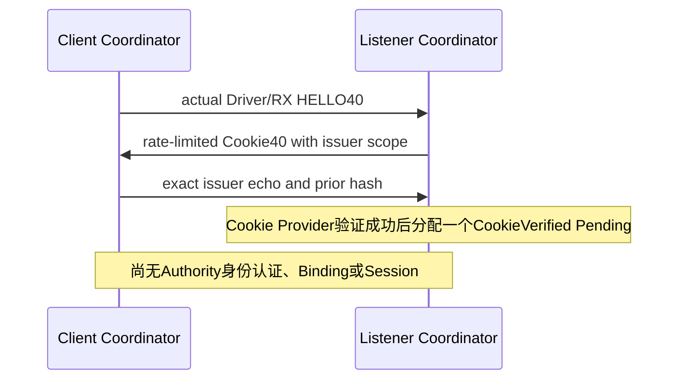

# Bootstrap：原始收发、Cookie 与待审事务共同合同

## 1. 本段解决什么

新设备没有地址和 Peer Session，不能先假设已经认证，再靠普通 HELLO 入网。本段把
`原始 Link RX → C0 Bootstrap 校验 → 无状态 Cookie → 固定 Pending` 接通。
它是动态 JOIN 的前半段，不是完整 JOIN。Cookie 成功仅得到 `CookieVerified`：不能得到
可信 Principal、Address Binding、ADMITTED、Security Session 或 Authority。

C/Rust 沿用同一三个 Opcode 和 Body；C 同步 Codec、Provider SPI、已有 Bootstrap
分派；Rust 增加可裁剪 `bootstrap-runtime`、专属单 Link Client/Listener。
业务 Owner 不持有其他 Owner 的可写指针；跨模块顺序由 Coordinator 编排。
普通数据 Common/C1～C5、Tag 和可选 Envelope 不因本段增加任何字段。

本段是未发布共同控制合同的修订，不承诺旧草案混跑，不保留旧行为 fallback。

## 2. 帧合同和费用

| Opcode | 消息 | Role | Body | 解释 |
| --- | --- | --- | --- | --- |
| 0001 | BOOTSTRAP_HELLO | Request | 40 B | 身份摘要、Device nonce、JOIN transaction；不证明设备身份 |
| 0002 | COOKIE_CHALLENGE | Result | 40 B | 无状态 Cookie、时间桶和签发方本地 Link 域 |
| 0003 | HELLO_COOKIE | Request | 82 B+Cookie，最大98 B | 回显签发方域、Cookie及前序消息摘要 |

三帧统一 C0、Control、Q0、BestEffort、O0/H0、HopLimit=1、固定 Realm，Source=0，
Destination=该地址宽度全1，双方 Binding generation=0。禁止转发，不尝试普通 Session。
外层 C0 transaction 必须等于 Body 的逻辑 JOIN transaction。这里只是认证前 O0 事务；
建立 Session 后的新控制帧仍使用独立、不回绕的 Origin C0 计数域，不能继承或重置它。

完整帧长度为 `25+2×address_width+Body`。当前 Root 使用16 B Cookie：

| 地址类别 | HELLO | Challenge | Echo | 三帧合计 |
| --- | --- | --- | --- | --- |
| A0 | 67 | 67 | 125 | 259 B |
| A1 | 69 | 69 | 127 | 265 B |
| A2 | 71 | 71 | 129 | 271 B |
| A3 | 73 | 73 | 131 | 277 B |

不含 Carrier、重试和后续身份/证书消息。A1/128 B Link 能承载；A2/A3 的128 B Link 不够，
当前 Root 在构造时拒绝，不在此处偷偷截断 Cookie或增加业务分片。后续完整认证事件的
379 B Transcript 和分片仍需独立接线，不能用本段三帧预算代表完整 JOIN 费用。

后续第三段已另接身份校验事件，见[认证事件、分片和范围](08-Bootstrap认证事件分片与身份校验共同合同.md)。
本文仍只描述初始Cookie三帧；不能把后续事件的费用省略，也不能把它们视为完整JOIN已完成。

## 3. 两端 Link 命名空间不能混为一谈

旧草案要求 Echo 携带接收方 Link ID/代际，但 Challenge 没有提供它，TX 又要求它等于
发送方的本地 Link，导致“Client 1/3，Listener 2/9”无法握手。不能依赖两端恰好同编号。

Challenge 保持40 B，使用原有8 B保留区的6 B，剩余2 B继续保留零：

| Offset | 字段 | 字节 |
| --- | --- | --- |
| 0/1/2/3 | schema=1、flow=JOIN、Cookie length、reserved=0 | 各1 |
| 4 | JOIN transaction | 8 |
| 12 | 非零 Cookie time bucket | 4 |
| 16 | opaque Cookie，未使用尾部必须为0 | 16 |
| 32 | issuer-local Link ID | 2 |
| 34 | issuer-local Link generation | 4 |
| 38 | reserved=0 | 2 |

所有多字节整数 big-endian；ID不能为0/65535，generation不能为0、不回绕。
签发方从当前实际 Adapter 读取域，不能信任客户端声称的 Link。客户端只原样回显；其
本地 TX Link 允许与 issuer 不同。接收 Echo 时仍必须与接收端实际当前 Link 完全匹配。
篡改或 reopen 前的旧代际在 Cookie Provider 调用前拒绝。

这些字段不是签发方身份认证；客户端收到 Challenge 仍未建立 Authority 信任。
未来双方各自的实际 Adapter、Binding 和 Session 必须保留各自本地域，不能把这个
issuer-local echo 当成设备侧 Session 的本地 Link 证明。

## 4. 前序摘要、Cookie 验证和可信时间

Echo 的32 B `prior_messages_hash` 唯一定义为：

```text
SHA256("UCN6-BOOTSTRAP-COOKIE-V1"
       || u32be(len(HELLO_frame)+len(CHALLENGE_frame))
       || exact_canonical_HELLO_frame
       || exact_canonical_CHALLENGE_frame)
```

包含完整外层 Header，因而包含 Realm、该宽度编码后的地址、Role、transaction 和 Opcode；
Challenge中的Cookie、桶和issuer域也在摘要内。不使用结构体padding，不只hash Cookie，
不截成16 B。C 的完整SHA-256与既有128位截断共享同一个算法后端，不引入另一套哈希。

Cookie Provider 必须校验本 Realm/宽度、HELLO身份摘要、Device nonce、transaction、
issuer Link、密钥域、时间桶与上述完整前序摘要。服务端不能以“本机有同名缓存”为验证。
测试 Provider 参考格式为 `bucket:u32be + HMAC-SHA256[..12]`，固定16 B；测试固定密钥
不是生产密钥。生产 Provider须有真实密钥隔离、轮换和认证前计算成本上界。

校验 SPI 显式接收 Owner 捕获的 `now_us`，不能在签发或重放时随意换成本地新起点。
Root 采用 `bucket=checked_u32(floor(now_us/bucket_us)+1)`；从启动第一个非零时刻即可
签发，无需等到第一秒、无需每块板配置启动延迟。到顶拒绝、不回绕；示例 Provider 只接受
当前/前一个桶，拒绝未来桶或过旧桶。具体窗口和产品密钥策略必须一起配置并审计。

只有完整验证成功，Admission Owner 才分配 Pending。缓存失效/未收到原 HELLO时，也能
验证仍在窗口内的Cookie；反之，即使有缓存，错MAC、错前序摘要和过期Cookie也不能通过。

## 5. 有界资源与实际收发

当前每个 Rust Root 专属一个实际 Link/Adapter RX队列；Listener内部一个Pending槽和一个
响应缓存，Client固定一份HELLO、freshness nonce和响应状态。不是通用多Peer Node，
不能让业务Root和此Root同时领取同一个RX。配置须保证物理Peer区分值的产品语义；Driver
区分值只做本机去复用，不证明远端Principal。



- 初始HELLO签发有per-Link token bucket；Cookie验证另有固定burst/rate，使用同一
  Provider/Driver callback gate。单次receive最多处理一帧、调用一次Provider。
- 原始RX完整帧与物理metadata原子入队；精确Realm/Role/Class/地址/Hop/长度/Body tx
  先检查，才可能调用Cookie Provider。Driver facts绝不称作authenticated facts。
- Challenge与HELLO同长度，无放大。未证明Cookie前不分配JOIN Pending；响应缓存是
  一个有deadline的固定传输槽，不是无限的已认证邻居表。
- 重复同一HELLO重发缓存Challenge，不重新签发、不刷新原deadline；正在飞行时的重复
  请求留一个requeue闩锁，不能在物理完成时把它覆盖掉。
- Client收到早到Challenge时保留原HELLO Token，待实际退休后才发Echo；未实际提交过
  HELLO、仅NOT_SUBMITTED的状态不能推进。不同Challenge不能替换已冻结的Echo域。
- 所有重试原字节、原JOIN tx、原deadline，受间隔和尝试次数限制。UNKNOWN/Fault不
  猜测完成，取消失败保留Holder。源端Echoing是“排队回显”，不是远端接收或准入成功。
- Pending重复不续租；过期只能显式step推进，不能在坏输入/满表时隐式驱逐旧事务。
  retire每次至多检查一个物理Holder、一个终止Pending和一个停止后的RX项。
- stop不复位Driver，不把旧Link句柄用于停止reopen后的新接纳；当前Faulted Link仍可
  正常进入停止隔离。只有真实排空本地义务才quiescent，不代表全网或产品放行。

Rust使用独立的最多16 B `Cookie`类型，不再为Cookie携带128 B通用Evidence数组。
128 B Evidence只属于后续认证事件；同一Wire上限必须有相应本地容量约束。

## 6. 未闭合的后半段

尚需把双方身份互认证、完整Authority/Device Evidence、Address Offer、设备Commit、
Identity/Foundation实际耐久发布与reload证明、Final Commit以及Security Session发布
接到真实线上事务；还要处理绑定设备的Peer Reauth、失败/重启和多Peer公平性。
当前不能提供伪造bool来跳过这些步骤，也不能把CookieVerified转换成ADMITTED。
Route/Flow多跳原始因果键、其他模块共享调度、完整C↔Rust Runtime互通仍是软件任务。

本轮只做Host软件与目标编译。未操作实机、真实Flash/Witness、生产密码、物理Bearer，
不代表抗断电、时延、栈水位、长期稳定性或生产放行；整体外审/生产继续HOLD。
