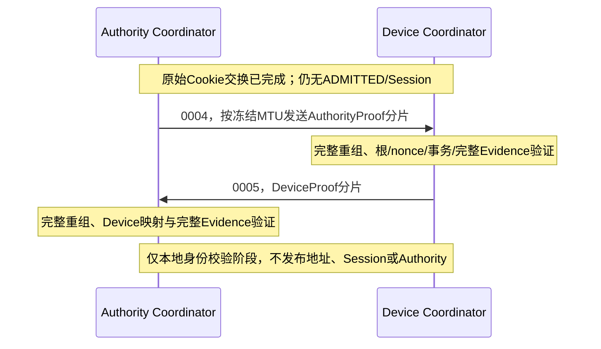

# Bootstrap 认证事件、分片与身份校验共同合同

## 1. 为什么需要这一段

Cookie只防止未经验证的请求无限占用资源，不证明Authority或Device身份。后续认证证据
必须经过真实Link收发、完整重组与产品Verifier，不能把测试构造的Transcript或一个
authenticated布尔值当成已验证消息。另一方面，379 B规范Transcript装不进128 B Link；
固定128 B分片数据再加头部也装不下，因此必须按完整帧预算分块。

本合同接在[原始Cookie共同合同](07-Bootstrap原始收发Cookie与待审事务共同合同.md)之后。
普通Common/C1～C5头、数据Tag及Envelope均不增加字段。Registry仍98项；纠正Rust旧
草案131～136数值，使用现有标准0004～0008，不保留旧值fallback。

本篇第三段的基础 `bootstrap-runtime` 只接 AuthorityProof/DeviceProof，不发布 Binding 或
Session。后续新增的独立 `bootstrap-join` 耐久协调链见
[第09篇](09-Bootstrap耐久发布与Session建立共同合同.md)；不能把基础认证 API 当成耐久发布入口。

## 2. 消息、方向和外层帧

| C0 Opcode | 事件 | 阶段 | 发送方→接收方 | Role |
| --- | --- | --- | --- | --- |
| 0004 | AuthorityProof | 2 AuthorityVerified | Authority→Device | Request |
| 0005 | DeviceProof | 3 DeviceVerified | Device→Authority | Result |
| 0006 | AddressOffer | 4 AddressOffered | Authority→Device | Request |
| 0007 | DeviceCommit | 5 DeviceCommitted | Device→Authority | Result |
| 0008 | FinalDurable | 6 FinalDurable | Authority→Device | Result |

沿用C0/Control/Q0/BestEffort/O0/H0/HopLimit1、固定Realm、Source0、该宽度全1目的地和
双方Binding0。外层transaction、分片transaction和Transcript transaction必须相等。
Opcode位于C0头，不在Payload重复；Payload是下述分片。禁止转发和未经配置的Realm。

O0在这里表示尚无Peer Session，不表示可以跳过身份认证。只有完整逻辑事件的Evidence
由产品Verifier验证成功，才允许推进本地认证阶段。Driver原始字节/metadata始终不可信。

没有登记Bootstrap Abort Wire Opcode。Abort只能由本地stop/原deadline处理；旧136不是
有效Frame Opcode，也不能冒用PeerSessionAbort。C的4～8目前仅标记REGISTERED，
不标记通用Relay或“生产认证终端handler已接通”。

## 3. 逻辑事件：379 B Transcript + Evidence

逻辑事件是 `Transcript379 || evidence_length:u8 || evidence[1..128]`，总长381～508 B。
Evidence不能全零，长度必须精确；其余阶段字段不能提前填入，即使“还不足以构成有效组”
也不能当成该组不存在。C/Rust统一执行此规则。

所有多字节整数big-endian；数组逐字节编码，不包含结构体padding。下表是唯一顺序。
`bootstrap_header_contract=1`是既有Body中的Bootstrap合同标识，**不是**把外层改为C1；
外层仍固定C0。C字段selected_link_id/generation对应Rust的selected_link_instance_id/generation。

| Offset | 字段 | 字节 |
| --- | --- | --- |
| 0 | `protocol_version` | 1 |
| 1 | `bootstrap_header_contract` | 2 |
| 3 | `logical_schema = 1` | 1 |
| 4 | `flow = JOIN(1)` | 1 |
| 5 | `joining_device_principal` | 16 |
| 21 | `joining_device_identity_digest` | 16 |
| 37 | `authority_principal` | 16 |
| 53 | `authority_generation` | 4 |
| 57 | `device_nonce` | 8 |
| 65 | `authority_nonce` | 8 |
| 73 | `transaction_id` | 8 |
| 81 | `lease_freshness_challenge_nonce` | 8 |
| 89 | `realm_id` | 4 |
| 93 | `proposed_address` | 4 |
| 97 | `address_binding_generation` | 4 |
| 101 | `authority_address` | 4 |
| 105 | `authority_binding_generation` | 4 |
| 109 | `selected_link_id` | 2 |
| 111 | `binding_lease_id` | 16 |
| 127 | `binding_lease_duration_us` | 8 |
| 135 | `authority_lease_sequence` | 8 |
| 143 | `authority_lease_duration_us` | 8 |
| 151 | `freshness_max_remaining_lease_us` | 8 |
| 159 | `durable_fence_token` | 16 |
| 175 | `allocation_high_water_digest` | 16 |
| 191 | `quorum_config_digest` | 32 |
| 223 | `signer_set_digest` | 32 |
| 255 | `threshold_proof_digest` | 32 |
| 287 | `freshness_proof_transcript_hash` | 32 |
| 319 | `authority_signer_count` | 2 |
| 321 | `authority_quorum_threshold` | 2 |
| 323 | `binding_mode` | 1 |
| 324 | `selected_hop_suite` | 1 |
| 325 | `selected_hop_key_id` | 2 |
| 327 | `selected_hop_key_generation` | 4 |
| 331 | `selected_e2e_mode` | 1 |
| 332 | `selected_e2e_suite` | 1 |
| 333 | `selected_e2e_key_id` | 2 |
| 335 | `selected_e2e_key_generation` | 4 |
| 339 | `selected_session_generation` | 4 |
| 343 | `selected_link_generation` | 4 |
| 347 | `prior_messages_hash` | 32 |

Authority组只能在阶段2填充，Device/安全候选组只能在阶段3填充，地址/Lease组只能在
阶段4填充；之前完成的组逐字段不可变。阶段5/6不能悄悄换地址、Key或Session候选。
Envelope/租期中声称的remaining并不自己产生权限，真实Identity/Lease Owner还必须验证。

产品Verifier必须绑定事件Opcode和完整379 B canonical Transcript，使用Bootstrap专用
密钥域或等价密码域隔离。必须验证受信Authority根、Device credential到HELLO摘要的精确
映射、Realm、nonces、事务、issuer域及选定策略；不能只比digest或接受调用者的bool。

Bootstrap验证算法/可信根由本Realm产品配置唯一选择，不能从未认证消息自行切Suite。
当前Host回归使用两种角色各自专用的固定HMAC测试密钥，证明完整内容与角色被验证；
不是生产公钥认证、阈值证明、证书链或密钥硬件隔离验收。128 B Evidence有明确上限，
不宣称支持任意长度X.509链或RSA签名；超限必须拒绝，不能截断。

## 4. 36 B 分片前缀与MTU预算

| Offset | 字段 | 字节 |
| --- | --- | --- |
| 0 | schema=1 | 1 |
| 1 | flow=JOIN(1) | 1 |
| 2 | 完成后phase，2～6 | 1 |
| 3 | 从0开始fragment_index | 1 |
| 4 | fragment_count，1～16 | 1 |
| 5 | chunk_bytes，32～128；原保留位现用于冻结分块 | 1 |
| 6 | total_length，381～508 | 2 |
| 8 | fragment_offset | 2 |
| 10 | 本片fragment_length | 2 |
| 12 | JOIN transaction | 8 |
| 20 | HELLO identity_digest | 16 |
| 36 | 本片逻辑数据 | fragment_length |

通用Codec支持 `chunk=min(128,path_frame_mtu-(25+2×address_width)-36)`，小于32直接拒绝。
但认证前尚未完成双方Capability交换，**本机MTU不等于已知path_frame_mtu**。当前Bootstrap
Root只能依赖双方都必须容纳最大Echo正文98 B的共同保证，因此使用
`frame_ceiling=C0_header+98`，默认`chunk=98-36=62 B`，不拿单端较大MTU推断对端能力。
127 B与256 B两端均可使用该基线，不新增MTU协商字段；更大的chunk仅留给以后已有
认证Path预算的实现。接收Root拒绝超过自己冻结预算的chunk。
同一事件的chunk/count/total_length/Opcode/phase与原deadline保持不变。严格要求：

- count=ceil(total_length/chunk)，不超过16；
- offset=index×chunk，index<count；
- length=min(chunk,total_length-offset)，数据尾部未使用区为零；
- 第一片必须index0；之后可乱序、可精确重复；
- 重复index但内容不同拒绝，不能覆盖已接受字节；
- 同一事务不能切chunk或借另一个阶段/Link/Peer的重组证明。

接收端的有界完成位图为16 bit；count=16也不能执行越界移位。Header不增长；
byte5旧草案的0不再合法，不保留两套格式解释。

## 5. 真实运行路径和不可逆阶段交接

Rust客户端必须先实际完成并退休Echo的TX Token，才能借出认证交换；服务端必须有
精确CookieVerified Pending且没有仍被物理持有的Challenge Token。两者都借用现有Io，
不再复制整个Owner，也不因阶段切换删除实际Holder或重置原deadline。

- 本地Proof入队也先验证，而不是调用者传typed Transcript就自动成功。
- 服务端使用实际Admission Owner推进；客户端验证共享不可变字段规则和Verifier。
- 服务端必须实际提交过完整Authority事件，才接受DeviceProof；收到响应时物理完成可能
  仍未退休，响应不能删除这个Token。
- 完整事件精确重复不再调用密码Provider；相同摘要但不同字节不能视为相同事件。
- 完整坏事件/坏MAC丢弃其重组内容，允许完整重发，但不刷新Pending、nonce、deadline
  或密码预算；不能让一份已完成的坏证明永久占住本地重组器。
- Provider回调共用实际CallbackGate，单事务密码调用预算固定；无跨Link全局静态指针。
- 一次drive最多提交一片；只有实际成功完成并退休才推进发送游标。临时NOT_SUBMITTED
  保留原片，UNKNOWN与取消失败保留实际Token，不猜测完成。
- 没有逐片ACK；缺片靠有界整事件原字节重发。Authority收到正确DeviceProof后停止重发；
  Device的下一阶段确认尚未接入，只能有界重发、stop或超时，不能假装已入网。
- drop借用对象不会退休物理Token。原Root不能重新启动Cookie阶段，仍可显式stop/retire。
  reopen后旧Root的receive/retire/stop不得消费新Link的RX或修改其接纳状态。

Runtime持有一个固定重组器和一个固定发送逻辑槽，不在业务Owner间保存可写互调指针。
跨Owner顺序由Coordinator编排；仅提供本地phase/Transcript，不提供ADMITTED或Session
构造接口。

## 6. 费用和资源

以下只计算完整UCN帧，不含Carrier、重试和后续耐久握手。A1默认Root的chunk=62，
完整帧最大127 B，可用于127 B或更大的Link：

| Evidence | 逻辑长度 | 分片 | 每事件UCN字节 |
| --- | --- | --- | --- |
| 1 B | 381 B | 7 | 836 B |
| 32 B | 412 B | 7 | 867 B |
| 128 B | 508 B | 9 | 1093 B |

测试32 B HMAC时，初始Cookie三帧265 B，加双向Proof各867 B，共1999 B，**仍不是完整
JOIN费用**。这些是启动/重认证时低频控制消息，不增加日常数据头或每包必带字段。
A0/A2/A3默认Root也采用62 B；完整最大帧相应125/129/131 B。A2/A3不能拿128 B Link
冒充满足初始Echo合同，构造时仍拒绝；不按设备数量手工配置启动延时。

C解码器使用调用方静态workspace保存typed Transcript/Evidence，不在MCU任务栈放整个
Snapshot。Caller需保证workspace独占、对齐且不与任何输入输出别名；失败不发布输出。
Host编译栈帧门禁和Host sizeof不能替代目标MCU调用链、总RAM或实际任务栈水位。

## 7. 本段与后续耐久协调器的边界

本段不发布AddressOffer，不接受FinalDurable作为“已经落盘”的证明。下一段必须先把
实际Identity/Foundation的挑战、写入、reload、Witness及Session证明接入真实线上因果：
客户端Lease起点要在原新鲜挑战发出前由Owner捕获，不能在迟到Final时重新开始计时。

上述第三段之后，[第09篇](09-Bootstrap耐久发布与Session建立共同合同.md)已经补充Rust
专属单Peer的Offer/Commit/Final耐久协调、各端Session回读和失败/重启回归；基础认证
Root仍不能绕过独立耐久入口。Peer Reauth、多Peer、H1自动接Capability、C完整Root和
整套C↔Rust Runtime互通继续开放；
真实Flash/掉电、生产密码、物理Bearer、目标栈/性能与外审/生产继续HOLD。
