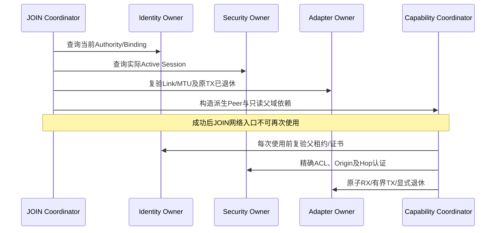

# JOIN后H1能力协商与交接共同合同

> 本篇记录第五段未接分片时的实现边界。2026-10-15第六段已由
> [第11篇](11-小MTU认证能力分片与重组共同合同.md)补齐小MTU分片及异构MTU规则；当前
> 127/128 B已可完成受限Rust链。下文136 B指未分片ACK预算，不再是当前能力Root最低MTU。

## 1. 范围与前提

日期：2026-10-15。接续[第09篇耐久JOIN](09-Bootstrap耐久发布与Session建立共同合同.md)，
把其真实发布的本端H1 Session交给已有能力协商Coordinator。Registry、七种能力消息正文、
普通Data头和C公共ABI均不增加字段。不是另建一套JOIN，也不把能力选择当作权限证明。

本轮Rust接通专属单Peer/单Link路径；C同步Capability缓存的本地/远端Link域规则及回归。
C已有共同Codec仍适用，**不是完整C自动JOIN/Capability Root或C↔Rust运行时互通证明**。
Host HMAC验证链不等于生产密码Provider、真实Flash/掉电或硬件链路认证。

## 2. 交接条件和职责

`BootstrapJoin::handoff_capability()`不接收调用方拼装的认证View。它从自身保存的Session
句柄、精确Final派生候选和当前实际Owner查询中构造Peer输入，角色固定为设备Initiator、
Authority Responder。Owner之间不互调，所有调用仍由Runtime Coordinator编排。

必须同时满足：

1. 本端Session已消费Foundation的精确回读Proof；没有待完成耐久请求。
2. Identity当前Authority和Binding存活、证书与原事务匹配；Security使用同一个实际Gate。
3. 当前Adapter/Link代际匹配；原JOIN没有未退休TX Token，包括UNKNOWN Holder。
4. Capability的本地Record、配置、容量和完整最坏帧预算通过预检。

任一预检失败，不设置交接标记，不关闭RX，不发送消息，不Fence共享Session。成功才一次性
设置不可逆交接标记，返回Capability Coordinator及派生Peer；同一JOIN不能重复交接。
旧JOIN的queue/receive/drive/publish/stop等网络及生命周期入口随后拒绝，避免两个Root争抢
同一原子RX队列。只读Session查询和既有退休职责不冒充新网络许可。

Capability Coordinator借用实际Identity的只读接口；每次发送、接收、选择查询都重新检查
Authority、Binding、Session和Link。安全Rust借用期间不能同时改写这个Identity Owner。
需要修改其Authority/Binding时，应先停止并退休专属Root，再释放借用；本实现不是多Peer
动态Owner装配。退休旧物理义务不要求父租约仍存活，不能因到期而丢Token。



## 3. 原有七类正文保持不变

| Opcode | 角色 | 正文字节 | A1/H1/O1或O2完整UCN帧 |
| --- | --- | --- | --- |
| 0101 HELLO | OneWay | 24 | 85 |
| 0102 KEEPALIVE | OneWay | 24 | 85 |
| 0103 ADVERTISE | OneWay | 68 | 129 |
| 0104 SELECT | Request | 59 | 120 |
| 0105 ACK | Result | 75 | 136 |
| 0106 REVOKE | OneWay | 20 | 81 |
| 0107 QUERY | Request | 20 | 81 |

以上固定C0、Q2、BestEffort、HopLimit=1；角色沿用共同Registry，不通过本地IN/OUT猜测。
SELECT仍精确比较双方Record及要求，ACK绑定实际SELECT事务、方向和152 B canonical上下文。
选择结果只是后续Plan输入，不修改已建立Session的Suite/Key，不授予ACL/Authority。

首次无重传典型序列为HELLO→QUERY→双方ADVERTISE→SELECT→ACK，共680 B；旧H0同序列
584 B，差额96 B是六帧各自已有的H1尾部16 B，不是新增字段。与第09篇A1/Evidence32的
4600 B首次JOIN合计5280 B；不计Carrier/MAC/PHY、证书获取、重传及后续业务。

## 4. 两个Link Generation命名空间

| 值 | 所有者 | 绑定方式 |
| --- | --- | --- |
| AuthenticatedPeerView/PeerCapabilityRef的ingress generation | 接收端本地Adapter | 当前Session、入口Link ID/Generation及实际Owner查询 |
| CapabilityRecord/Summary的link_instance_generation | 发送端本地Link | 认证C0正文及其完整Record摘要/精确字段 |

两个节点分别使用3、9是合法情况，不能跨节点比较数值相等。

首个完整Record绑定远端Link代际；同一精确Session父域内后续Record不得改变该代际，改变
需要重建父Session并显式退休旧缓存。Capability Generation仍只允许exact-next；同代际
精确重复不续租。Summary只与缓存的远端Link代际、Capability Generation和Digest同时
匹配，不拿本地入口代际替代。它只能触发查询，不能创建权限或复活已撤销记录。

C/Rust都执行上述规则；两个Owner都保留已到期/撤销的同Session高水位，不以TTL回收防重放
历史。当前源文件分别是`src/capability/ucn_capability.c`和Rust Capability Owner。

## 5. H1重试不重复执行、不重用Origin Nonce

每个发送方向的同一Session/Link使用一个调用方持有的checked HopSequenceOwner；请求与
回复共享该计数器。`drive_with_hop()`对H1缺计数器、或H0误传计数器在游标变化前拒绝。

```text
首次构造:
    exact live parents + ACL + size preflight
    consume fresh C0 transaction and Hop sequence
    protect Origin once; append Hop sequence/tag
重试:
    require no in-flight physical holder
    revalidate current parents + exact outbound identity + ACL
    keep C0 transaction, payload/ciphertext and Origin tag byte-identical
    consume fresh shared Hop sequence; recompute only Hop trailer
    reserve new physical token; bounded submit
```

`refresh_c0_hop()`仅支持本端当前H1 C0重试；不提供转发他人Source的授权。它验证当前
Session、Realm、双向Binding、Opcode、方向和ACL，不重新计算或背书Origin Tag。接收端
始终独立验证Hop和Origin；有效Hop Tag不能掩盖坏Origin Tag。Provider失败时完整Packet
保持不变，但已暴露的Hop值不可复用；短Scratch/错ACL等预检拒绝不消耗计数。

重复Origin只进入已认证的Pending/缓存回复路径，不能再次dispatch；原始整帧重复仍受Hop
Replay拒绝。固定总截止期、最大Attempt和轮转游标不变。NOT_SUBMITTED只退休本次Token；
UNKNOWN及不确定取消继续保留/隔离Holder，不能改写仍在Driver手里的帧。

缓存回复的seal与submit属于两个调度访问，因此每次实际提交前（包括首次提交）都刷新Hop，
避免等待游标期间共享计数器推进、旧Hop落出接收窗口。初始seal预留的Hop值允许形成空洞；
这是低频控制回复的一次额外本地Tag计算，不增加报文字节，也不影响普通Data发送路径。

## 6. MTU、Scratch与未完成边界

最坏帧预算为`25 + 2×address_bytes + 75 + 16 + (H1 ? 16 : 0)`。

| 地址档 | A0 | A1 | A2 | A3 |
| --- | --- | --- | --- | --- |
| H0最小完整帧MTU | 118 | 120 | 122 | 124 |
| H1最小完整帧MTU | 134 | 136 | 138 | 140 |

本地物理MTU、处理MTU和固定Frame缓冲都必须覆盖该预算；收到对端Record后，也要检查对端
Link/处理MTU，才允许给出选择。当前Root额外保持B≥128的既有静态容量约束。

Crypto Scratch不是线上帧：Hop AAD还需`without_hop_frame + 35` B。A1最大ACK136需要
至少155 B的该缓冲，本轮集成使用调用方静态`SecurityPacketWorkspace<192>`；不能因为
Frame能放进144 B就假设144 B Scratch必然够用。该空间不加到线上报文。

**第五段完成时，A1的127/128 B链路尚不能完成本段未分片H1能力协商；此缺口已由第11篇关闭。**
第五段要求明确Config/NoSpace拒绝，不能删Tag、降H0或偷偷改ACK正文。当前第11篇已补
共同Codec和Rust受限重组Runtime，C自动Root仍待；不能将旧缺口误记成已做实机验证。

Peer Reauth、多Peer/动态Route/Flow、完整C自动Root、生产Provider及独立外审继续HOLD。
验证与逐项/两轮整体自审见[本轮报告](../../../08-实现与验证/版本演进/UCN_V6S_RUST_SW_02_JOIN后H1能力协商自审报告.md)。
