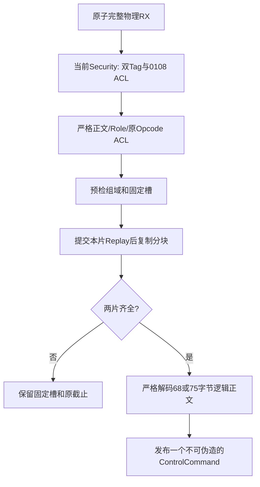

# 小MTU认证能力分片与重组共同合同

## 1. 本段解决什么

日期2026-10-15，接续[第10篇H1交接](10-JOIN后H1能力协商与交接共同合同.md)。普通Data头、
C0公共头、Origin/Hop Tag及七类原Capability正文都不增加字段。只在原ADVERTISE/Ack
放不下时，使用本篇局部双片封装；接收端两片都认证后才发布一条逻辑命令。

本篇修订第10篇的“127/128 B尚不能完成H1能力协商”边界。C/Rust共同Registry新增
`CapabilityFragment=0x0108`，由98项变99项；既有值不改。它仍位于既有Capability/Neighbor
命名空间，不分配普通Data新标志，不增加用户模式选择。本次共同补充仅自审，未继承历史
外审GO，生产及独立外审HOLD；无旧版兼容或静默安全降级。

实现范围：C/Rust严格正文Codec、Registry及独立字节Oracle；Rust单Peer专属Runtime实际
接入。C通用分派仅登记该Opcode，不宣称自动重组/本地终结或允许普通中继；完整C自动Root、
C↔Rust运行时互通仍待。Host实际加密提供方未就绪，本段全链路实测为O1+H1的HMAC测试
Provider；O2继续沿用通用Security的Nonce/Packet接口，不能写成实测生产AEAD。

## 2. 为什么仅拆两类消息

A1地址时C0头29 B、Origin Tag16 B、H1尾部16 B，共61 B。SELECT59的总长120 B，
小于127/128 B；Record68共129 B、ACK75共136 B，只有这两个需要拆分。

HELLO/KEEPALIVE/QUERY/REVOKE/SELECT仍按原单帧发送。每条拆分消息固定两片，正文采用
向上均分：Record为34/34，ACK为38/37。不做动态分片表，不叠加完整内层封套或双重Tag。
每片各自是一个C0/O1或O2/H1消息，有独立C0事务和完整认证。

## 3. 精确布局

外层固定：C0、Control、Q2、BestEffort、HopLimit=1、Opcode0108；保护等级与当前Session
一致且不得O0/H0。ADVERTISE分片使用OneWay，ACK分片使用Result；这两个Role由认证后的
原Opcode决定，不把0108一律解释成Request。

| 片正文Offset | 长度 | 字段 | 合同 |
| --- | --- | --- | --- |
| 0 | 2 | original_opcode | 大端，仅0103或0105 |
| 2 | 2 | total_bytes | 大端，0103必须68，0105必须75 |
| 4 | 1 | index | 0或1 |
| 5 | 1 | count | 必须2，其他值拒绝 |
| 6 | 34/38/37 | chunk | 严格匹配原长度和片号算出的均分区间 |

无隐含填充、无末片零补齐、无可选尾字段。第i片区间：
`half=ceil(total/2); [i*half, min((i+1)*half,total))`。
错误Opcode、长度±1、count/index越界和短输出均拒绝；编码失败不改输出或长度哨兵。
Codec只说明结构，不产生认证凭据。

## 4. 用既有C0事务推导组身份

发送端在一次有界seal访问中预检并保护两片，要求事务精确相邻：`tx0=base; tx1=base+1`。
接收端通过`base=outer_transaction-index`推导组，不增加8 B组ID。base必须非零，末值
不得溢出；每片自身保留唯一Origin Nonce/Tag。

精确组域包含：当前Peer/Session/本地Link、Realm、双向Binding、Origin Fingerprint、
Key/Policy代际、推导base、原Opcode、总长、原Role及配置Service。不能仅凭base归组。
接收端先认证再解释元数据，逐片要求0108及原0103/0105的精确ACL；包装权限不扩大业务权限。
ACL应由产品策略显式配置，Runtime不会为了自动分片暗中放宽授权。

第一片保护成功、第二片密码失败时，整组仍不可发送。已暴露的C0/Hop值全部消耗；下一次
seal从新的base重建整组，不能用旧base补一个新Nonce。Driver从未看到半组候选。
组保护成功后两片Origin字节/事务/Tag冻结；重传仅刷新该片Hop尾部。

## 5. 发送生命周期

```text
创建回复义务
  -> 当前父域/Session/双层ACL/双向MTU与容量预检
  -> 单帧放得下: 沿用原Opcode和正文
  -> 放不下: 两片全部seal成功后才Ready
  -> 当前片预留TX Token -> 有界submit
       NOT_SUBMITTED: 只退休本片Token，原片保留
       未完成/UNKNOWN: 保留或隔离本片Token，不能改帧或发下一片
       第一片成功且Token退休: 下一片Ready
       第二片成功且Token退休: Cached
  -> 精确请求重复: 从第0片重发缓存组，保留总Deadline/Attempt上限
```

第一片物理退休前不提交第二片；一条缓存回复同时最多一个物理Token。Attempt上限统计
实际Driver调用，包含各片和重试；不会因“逻辑只有一条消息”跳过物理预算。
H1握手的物理Attempt上限必须至少2；不足时构造/交接原子拒绝，不发第一片才发现无预算。
两片都未提交前可重建失败候选；一旦有Driver Holder，必须按原状态退休，不覆盖缓存。

## 6. 接收与重组

专属Capability Coordinator只持有一个75 B正文槽、两个封闭PacketEvidence、固定元数据
和高水位。每次原子RX仍是一条完整物理帧，不将帧、Token和认证结果分开排队。



任意顺序都可以，第二片先到不代表完成。未完成组不得被不同新组覆盖；槽忙则拒绝且abort
本片Replay，原槽不变。完成并已发布后才允许更新组；`highest_end=base+1`不回退，旧组
迟到不能覆盖新ACK。精确重复必须匹配已保存的完整片凭据，不接受“同事务不同正文”。

完整正文等待Control队列时仍保留在固定槽内。调度先处理已入队旧命令，再尝试发布完整
重组，避免队列满导致互相堵塞。每次使用仍复验父域/Session；发布使用当前Owner时间和
原握手绝对Deadline，不复用先前到达时刻绕过到期，也不因分片/重复续租。

公开`ControlCommand::is_fragmented()`区分聚合：其`evidence()`是**第0片的真实身份/缓存
键**，不是伪造的全正文PacketEvidence；其Payload Digest不得解释为68/75 B全文Digest。
完整正文授权来自Coordinator私有固定槽内两份实际认证凭据，外部没有assembled DTO入口。
原ACK75内的SELECT及152 B上下文Digest仍独立精确核对，不受分片组事务替代。

停止/围栏后不发布聚合；有界退休清理易失重组及缓存并保留高水位。物理Holder仍分别退休，
`quiescent()`还要求重组槽清空，不能因清了逻辑位图便假报物理空闲。

## 7. 自动选取MTU，不能猜对端

协商前不拿本机MTU当对端能力：上限采用既有Bootstrap Echo98加C0头的共同接收档，A1
为127 B。因此首次未知对端的H1 Record仍拆两片，不新增MTU探测字段。独立静态Capability
Root的最低控制接收档是120 B，拆片最多105 B，同样不会因该上限发送过大Record。

拿到认证Record后，发送上限取实际本机Link、固定缓冲、对端Link和对端Processing MTU
的最小值。127↔136 B异构链路仍对小接收端分片，不能因本机136 B而发送129/136 B整帧。

| A1消息 | 小MTU路径 | 完整帧字节 |
| --- | --- | --- |
| HELLO24 | 单帧 | 85 |
| QUERY20 | 单帧 | 81 |
| Record68 | 两片 | 101 + 101 = 202 |
| SELECT59 | 单帧 | 120 |
| ACK75 | 两片 | 105 + 104 = 209 |

127/128 B、无丢包典型能力交换为9个物理帧，共`85+81+202+202+120+209=899 B`。
纯单帧且已知双方MTU时为680 B，差219 B仅发生在本轮控制交换，不是每条业务数据增加。
冷启动双方136 B时，首次Record因未知对端仍拆片；后续Record/Ack可单帧，典型753 B。
这三个数字都有前提，不能把理论680 B当当前冷启动默认值。

能力Root的A0/A1/A2/A3最低完整控制帧为118/120/122/124 B；完整JOIN还需容纳Echo98，
对应125/127/129/131 B。当前正式端到端回归覆盖A1的127/128及127↔136 B，且前两者
使用真实128 B Adapter/Runtime缓冲，不借大缓冲掩盖超限。Crypto Scratch单独静态192 B，
它不在线上。未增加普通Data、Frame通用字段或Tag长度。

## 8. 资源、裁剪和验收边界

Capability关闭时不编译重组及第二片状态。开启时，通用ControlReplies每槽静态预留第二
帧B及少量索引/长度；不是“用了分片才占RAM”。这是固定容量取舍，不能把Host sizeof
当完整MCU任务栈、峰值RAM或Flash。未引入堆、阻塞I/O、Host特权或可写全局状态。

C Codec/Registry、四条三方raw Oracle及负向测试同步；Rust真实Foundation→JOIN→H1→
能力协商含丢QUERY/ACK、乱序、第二片背压/UNKNOWN、坏Tag、有效认证坏元数据、竞争组、
旧组迟到、原Opcode/包装ACL、密码失败无半发布、Deadline和停止退休。

详见[本轮逐项与整体自审](../../../08-实现与验证/版本演进/UCN_V6S_RUST_SW_02_小MTU认证控制分片自审报告.md)。
本篇不是通用大消息Transfer或全部Group/Cluster控制分片的完成声明；Peer Reauth、
多Peer、C自动Root、动态Route/Flow、生产密码、真实Flash/物理Bearer及独立外审仍待。
