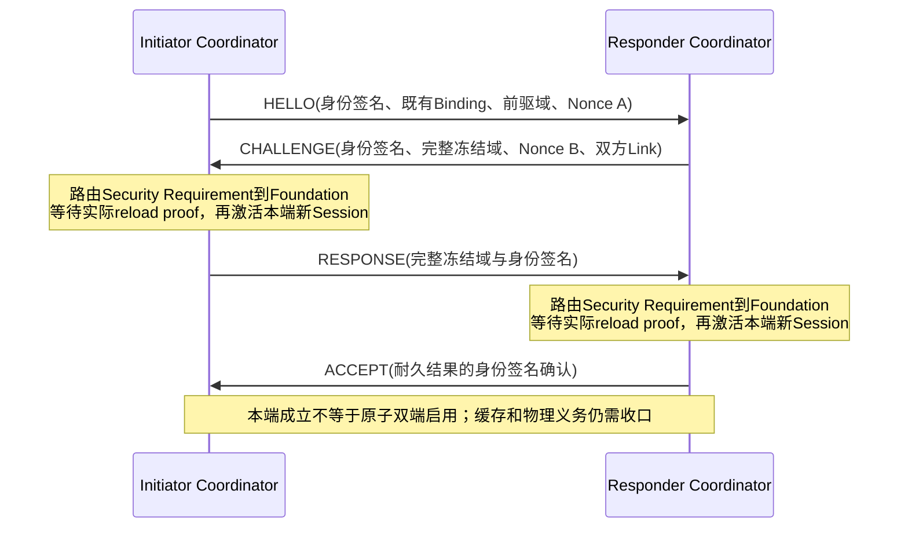

# Peer Reauth 邻接重新认证共同合同

> 历史切片：本篇156 B/V1及共同前驱限制已由[第13篇V2](13-Reauth能力交接与耐久分歧恢复共同合同.md)
> 取代。保留它用于对应上一轮不可变证据；当前源码仅实现208 B/V2，不提供V1兼容路径。

## 1. 目标、前提与本段边界

本篇接续[小MTU能力分片](11-小MTU认证能力分片与重组共同合同.md)，日期2026-10-15。
它解决的是：**双方已有有效Binding和真实耐久Session历史，但旧邻接已停止，需要在当前
Link上重新确认身份、推进Session/Key代际，再恢复受保护通信**。不是首次JOIN、地址更新、
重新授权所有业务，也不重新运行地址分配或延长Binding/Authority租约。

当前实现是固定单已知Peer的软件切片：C/Rust共同正文及结构分片Codec；Rust接实际
Identity、Foundation、Security、Adapter、身份签名Provider，建立后继Session。C自动Root、
跨语言Runtime互通、自动Reauth→Capability交接和多Peer仍待；独立外审、生产及实机HOLD。
本篇未继承旧合同外审GO，详见[本段自审报告](../../../08-实现与验证/版本演进/UCN_V6S_RUST_SW_02_Peer_Reauth邻接重新认证自审报告.md)。

强制前提：

- Coordinator持有同一实际Identity Owner的两个live Binding handle，分别对应本端和对端；
  两份证书均属于当前Realm Authority。每次推进及查询都复验完整View和Authority。
- Session基线必须从实际Foundation Ready域正文及Digest构造，不接受Factory空域代替。
  从历史正文提取的候选只说明高水位，不是当前认证View。
- 同一身份对的旧Session均已Fence；Adapter RX已禁用并排空，所有TX Token（包括完成
  但未退休的Token）均已退休。构造成功后由Coordinator开启RX。UNKNOWN不能靠清零跳过。
- 本段只能用于预配置的已知身份对和专属Link/Adapter，不允许任意输入分配新Peer表项。

MCU-first、固定内存、非阻塞Driver、Host无隐式特权不变；本轮只读知识库核对这些原则，
具体语义以本篇、共同JSON和当前源码为准，不采用旧v5功能状态。

## 2. 为什么不把JOIN改名复用

JOIN会签发新的Binding、Offer/Commit/Final及相应持久化义务；Reauth必须保持原Binding、
地址和租约不变。因此它只复用底层有界物理IO，不调用Admission Owner、不制造ADMITTED。

本段入口是已配置的固定身份对，HELLO本身就带身份签名。只有验证签名、精确历史域及
当前Binding之后才允许回复；不为未认证陌生节点建立发现Pending。它不取代面向未知设备
的JOIN Cookie防耗尽流程。固定单槽、原绝对Deadline、Provider回调预算和物理提交预算
共同限制本段负荷；动态未知Peer入口仍必须另行实现Cookie/配额，不能直接复用此入口。

## 3. 四类消息及发布顺序

| Stage | Opcode | Role | 发送者 | 必须先成立 |
| --- | --- | --- | --- | --- |
| 0 HELLO | 0010 PeerReauthHello | Request | Initiator | 本地Nonce、事务、双Binding和真实前驱冻结；签名成功 |
| 1 CHALLENGE | 0011 PeerReauthChallenge | Result | Responder | 完整验证HELLO，添加本端Nonce与本地Link域 |
| 2 RESPONSE | 0012 PeerReauthResponse | Request | Initiator | 完整验证CHALLENGE，双证明核验及本端新Session真实回读激活 |
| 3 ACCEPT | 0014 PeerSessionAccept | Result | Responder | 完整验证RESPONSE，本端新Session真实回读激活 |

Initiator收到有效ACCEPT之前，公开`session()`拒绝给出新Peer。Responder回读后先进入
`PublishingAccept`，只有ACCEPT三片全部发送成功、物理Token退休，才进入Established并
提供本端结果；它不证明对端已收到ACCEPT。
保留Reauth实例及缓存至原握手Deadline以响应丢失确认的重试，不能立刻丢掉缓存来假报收口。

Established是已发布的本端耐久结果。后续确认缓存重试耗尽、握手TTL到达只停止握手网络
工作，不能把既有结果改回未建立；`session()`仍按**当前**双Binding、Authority、Link、
Policy和Session实际到期检查。主动stop仍Fence Session；合法Session寿命不因握手TTL
结束而缩短，也不能在其真正截止时继续返回成功。

本段无两端原子提交承诺。若一端Session已耐久推进而另一端尚未推进就掉电，恢复后双方
前驱代际/摘要不同会fail-closed；**跨不对称提交的自动对账仍待软件实现**，禁止回滚代际、
重用旧Key或把该限制写成“只剩硬件”。

## 4. 外层与固定156 B正文

外层为C0/O0/H0、Control/Q2、BestEffort、HopLimit=1，Source/Destination都是已绑定地址
且Binding Generation非零；不是未绑定全零地址，也不是普通转发帧。O0/H0仅承载尚未建立
新Session的身份签名握手，**不意味着普通业务降级成无认证**。Driver只提供原始字节和
物理区分值，必须在完整逻辑签名校验后才产生可信握手事实。

全部多字节整数大端；Address字段在正文中统一为32 bit，`address_width`编码实际字节数
1/2/3/4（对应A0/A1/A2/A3），不允许超出Realm地址宽度。

| Offset | 字节 | 字段 |
| --- | --- | --- |
| 0 | 1 | version=1 |
| 1 | 1 | stage=0..3，必须与外层Opcode/Role一致 |
| 2 | 1 | address_width=1..4 |
| 3 | 1 | reserved=0 |
| 4 | 4 | Realm |
| 8 | 24 | Initiator：address32、binding32、Principal16 |
| 32 | 24 | Responder：address32、binding32、Principal16 |
| 56 | 4 | previous_session_generation |
| 60 | 4 | next_session_generation，必须精确previous+1 |
| 64 | 1 | Origin Suite，必须与历史Session相同 |
| 65 | 1 | Hop Suite=16 |
| 66 | 2 | Origin正向Key ID；反向=base+1 |
| 68 | 2 | Hop正向Key ID；反向=base+1 |
| 70 | 2 | reserved=0 |
| 72 | 4 | 新Origin Key Generation |
| 76 | 4 | 新Hop Key Generation |
| 80 | 2 | Initiator本地Link ID |
| 82 | 2 | Responder本地Link ID |
| 84 | 4 | Initiator本地Link Generation |
| 88 | 4 | Responder本地Link Generation |
| 92 | 8 | 原事务ID |
| 100 | 8 | Initiator新鲜Nonce |
| 108 | 8 | Responder新鲜Nonce |
| 116 | 8 | 本轮最大Session寿命/us，不是租约续期 |
| 124 | 32 | 完整历史Session transcript digest |

HELLO中的Responder Link ID/Generation与Nonce必须全部为0；CHALLENGE之后必须非零并
冻结，不能把两个节点各自的Link Generation直接比较为相等。当前本地Link仍通过实际
Adapter handle逐次验证；历史Link不需要存活，否则断链后就无法重认证。

两端Principal/地址不得相同或平凡，Binding不得为0；所有序号checked无回绕。合法终值与
“还能分配下一个值”分开：前驱已经到顶则拒绝新事务，不能回绕到1。

## 5. 身份签名、密钥与历史绑定

完整逻辑消息：`record156 || proof_length:u8 || exact_identity_signature`。产品Manifest
固定身份签名算法、每Principal唯一身份Key解析及精确签名长度，长度在16..64 B之间，
双方必须采用同一产品合同；不尝试多算法/旧Key fallback，也不在本轮添加Suite协商字段。

签名输入精确为：`ASCII("UCN6-PEER-REAUTH-V1") || record156`。Stage参与签名，不能把
Challenge签名当Response或Accept。当前Host使用实际HMAC测试身份Provider，不等于生产
Ed25519/硬件密码Provider已经通过；产品Provider还必须处理撤销与身份Key生命周期。

旧Session摘要必须完整32 B相等；双方Binding逐字段相等。Session及Origin/Hop Key代际
分别精确前驱+1；原双向Key ID须组成固定相邻槽对、同Suite及同代际，本轮保持槽ID不变，
不允许顺带换Suite、降低O级别或重用前代Context。实际新Key的派生/安装属于生产Provider，
不能把仅检查Key Generation当作已证明密钥材料轮换。

Security的双向证明为固定长度`challenge_signature || response_signature`，最多128 B，
与现有C证明容量一致；单条Wire消息仍有自己的精确proof_length。Identity签名Provider和
Security Session proof Provider均在同一实际Callback Gate下有界调用。

最终Context：把正文Stage规范化为2，计算
`SHA256(signature_domain || canonical_record156)`；前16 B为Origin Fingerprint，后16 B为
Hop Fingerprint。两端方向相反但Context相同，方向Key选择分别为base/base+1。
结构Codec、历史候选、只读Record均不是认证View，不能取代两端实际证明或Foundation回读。

新Session不会自动继承旧Fingerprint的Endpoint ACL。业务授权仍需当前产品策略明确绑定
新Context；本轮数据回归显式配置新Context的精确ACL，没有把Reauth当作ACL提权入口。

## 6. 固定三片与物理生命周期

逻辑长度为173..221 B，统一切为80 B块，因此恰好三片。每片局部前缀18 B：

`version8=1 / stage8 / index8 / count8=3 / total16 / offset16 / chunk8=80 /
reserved8=0 / transaction64 / exact_data`。

offset必须等于index×80，非末片80 B、末片精确剩余长度，禁止尾部填充。最大片正文98 B，
正好沿用既有Echo98+C0头的共同接收保证；A1最大127 B，正式Host测试为真实128 B缓冲、
两端物理MTU127/128 B。Codec只校验结构，三片全部到齐、完整签名正确之前不推进认证状态。

一个固定重组槽、一条固定缓存逻辑消息、同时最多一个实际TX Token。不支持乱序片内
拼接；丢失/乱序时按原消息从第0片重试，所有字节及签名保持不变。组域含固定Peer/Link、
Stage和事务，禁止混拼。完整坏证明可以重试，但不能刷新总Deadline。

每个消息阶段的物理提交总上限包含每片、重试及NOT_SUBMITTED；重复消息不重置上限。
NOT_SUBMITTED退休本次Token后保留原片；UNKNOWN/取消失败保留精确Holder，不能推进下一片。
停止时围栏新Session并禁用RX；Foundation Pending也要保留至真实终态，再显式退休Proof。

## 7. 时间、预算与开销

构造时捕获本地原始start与产品新鲜Nonce；不从迟到的Challenge/Response/Accept重建起点。
握手截止期是本地start+握手TTL、两个Binding截止、Authority截止和Foundation请求截止
的最小值，采用半开区间。新Session寿命独立于握手TTL，截止为
`min(original_start+session_max_duration, local Binding deadlines, local Authority deadline)`。
全部加法checked；未知/失效父域拒绝，不写新的Binding/Authority正文。

固定Peer须显式配置同一Session最大时长及签名长度；本段不是动态策略协商器。Provider
回调次数和每阶段物理提交次数都有固定上限，单次驱动最多一次Driver提交，不做阻塞循环。

A1、32 B签名、无丢失时，每条逻辑消息189 B，三个物理帧为127/127/76 B，共330 B；四条
消息合计12帧、1320 B。64 B签名时每条362 B、合计1448 B。这些是重认证控制交换的费用，
不含后续能力协商、Bearer封装或丢包重传；**普通Data/C1头新增0 B**，数据回归C1头仍13 B。

## 8. 实现映射、裁剪和验收

- `ucn-security/src/reauth.rs`：规范Record、片Codec、身份Provider SPI和纯候选派生；
  不调用其他Owner，不分配地址或自行写Flash。
- `ucn-runtime/src/bootstrap_runtime/reauth.rs`：Coordinator路由实际Identity、Security、
  Foundation和Adapter，复用有界物理IO，不让业务Owner互相直接调用。
- C `internal/ucn_security.h`与`security/ucn_security_session.c`同步结构Codec，返回的
  canonical DTO只说明格式，不能发布Authenticated Peer；C自动Root尚未实现。
- `peer-reauth`可选Feature当前依赖`bootstrap-join`复用IO/基座；关闭后无该Runtime，
  不把Reauth带入最小Core。它不是完全脱离Bootstrap crate的独立部署包。
- 独立C/Rust/Python Oracle含四条Record和三条Fragment。正式Runtime回归还覆盖六种
  有效签名但域不匹配输入、丢Challenge/Accept、背压预算、UNKNOWN、回调门、损坏回读、
  迟到证明、Pending停止、Factory拒绝、双Binding及旧TX义务，最后使用新Session收发C1。

仍待软件工作：Reauth与Capability的自动无丢帧交接、多Peer共享RX分派、跨不对称耐久
提交的恢复协议、C完整Root和C↔Rust Runtime互通。硬件、掉电、生产密码、栈水位与外审
另行验收；Host测试或ESP32交叉编译不构成开发板测试。
