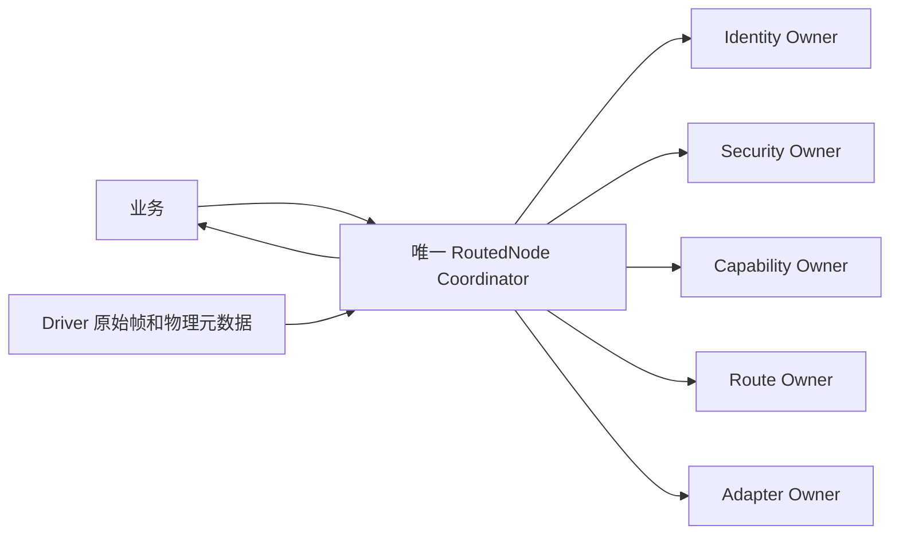

# 自动多跳 Data 协调器与本地下一跳合同

状态：2026-10-18 软件实施、自审候选；不是外审、实机或生产 GO。本篇不新增 Wire 字段、
Opcode 或正文。C/Rust 遵守同一线上合同，当前新增的自动协调器只在 Rust 实现，不能据此
声称 C 的自动多 Peer Root 或两语言 Runtime 互通已经完成。

## 1. 给普通调用方的最短路径

本段解决“底层原语都有了，但每发一条消息还要应用自己寻路、开包和退休”的接线缺口。
产品启动阶段安装真实 Identity、耐久 Session、邻居 Capability 和本地 Endpoint 策略。
普通业务随后只需要 Endpoint Handle、Payload、Traffic Class 和本地绝对 Deadline：

```text
application:
    handle = node.send(endpoint, payload, options)
    periodically call node.step(budget)
    message = node.receive_datagram(output)
    optionally query/forget(handle)
```

上面是逻辑表达，不是 Rust 函数签名。当前 `send` 还显式接收实际 Identity/Security 和可信
now，`step` 还接收实际 Capability/Adapter/Provider/counter bank/workspace。由产品装配层
提供这些对象，不由业务伪造认证事实；隐藏这些参数的全 Node 用户 Facade 尚未完成。

`send()`先校验并复制到固定槽；路径未知时由后续 step 自动发现，不让用户选择下一跳、
手工构造 C0/RREQ 或为每一跳重新封装 Origin。当前仅支持尽力而为单向 Data，不因此承诺
Reliable、Transfer、RPC、远端执行或耐久业务结果。

## 2. 唯一入口和所有权



Owner 之间不互调。协调器只领取一次真实原子 RX，保留完整 bytes、RX Token、Link 和
发送邻居 discriminator；按照实际 Common Header 分派给 C0 路由控制或 C1 Data。Driver
事实不是密码认证事实；必须经过真实 Session、ACL、Tag 和 Replay 验证。

RX 退休暂时失败时，协调器仍保留精确 claim 和字节，不领取下一帧覆盖。调用方不能把自己
构造的 `OpenedPacket` 或裸三元组当作实际接收证明。错误 Adapter 或不同共享 Gate 在领取
前拒绝。Root 不操作硬件端口，不提供隐式 reset/flush 来抹除外部义务。

## 3. 为什么需要本地下一跳提示

同一串口、射频接口或共享物理 Link 可能对应多个邻居。C1 Header 的 Destination 是最终
目标，不一定是下一跳；把它交给 Driver 猜地址，会在三节点链上把 A→C 错发为直接 C。

本地 SPI 因此明确传入 `LinkHandle + peer_locator + exact_frame + TxToken`。locator 是注册
邻居时由产品 Adapter 映射的本地承载定位值，与 RX discriminator 属于对应的本地映射。
它不上 Wire、不参与端到端身份命名，也不是授权凭据。Driver 必须真正支持该定位；不提供
悄悄丢弃 locator 的默认实现。不同承载如何将 locator 映射为 MAC、端口或收发地址，归其
适配实现验收，本段 Host Driver 只是可重复的模拟。

Rust 对应 `PeerTxDriver::submit_peer()`。C 将来接入同样语义时必须修改本地适配接线，
不能靠新增普通业务 Header 字段补救；当前 C API 尚未据此自动升级。

## 4. 路由、Origin 与 Hop 的边界

非邻居目标的源端必须取得精确 `RouteDomain` 的当前动态路由和 RREP 回执；校验当前 Identity、Session、
Capability、完整帧 MTU 和下一跳，再消耗 Origin/Hop 计数器。没有匹配路由时启动/合并
同一目标和相同需求的发现，原请求 Deadline 不重置。

精确已认证邻居的直连快捷路径由[合同18](18-直连多跳统一Origin与HopContext接线合同.md)
补充：完整目标Binding匹配且当前Session/Capability/MTU/ACL均满足时不分配RREQ。
这不是把RREQ返回提示当作全路径，也不能供中继绕过路由证明。

特别注意：RREQ 在每个中继学到的返回提示，其 Origin 是该中继的本地身份，不代表新业务
Origin 的全路径。C 要向 A 回发业务，不能仅因为 C 本地存在 C→A 返回提示就跳过发现；
仍需 C 的精确 RREP 回执，使 B 也建立 C→A 域。反向发送测试能够区分这类半路径黑洞。

中继只接受唯一匹配原始 Source/Destination 的有效完整域回执；出现同地址但不同 Binding、
Session scope 或路径歧义时拒绝，不猜选第一项。实际出站前再次核对 Route 和邻居事实。
当前不自动使用静态通配 fallback，也不实现 Flow 路径切换。

本篇原三节点fixture使用已发布的独立 H0 Origin Session，AB/BC 使用各自 H1 邻居 Session；
该fixture不是强制两个Session的规范。合同18现已允许直连在真实H1 Session上分别处理
Origin/Hop，不改变单Peer单ACTIVE规则。中继只验
邻居、TTL、当前路由和本地容量，不解密业务。目标必须另验原始 Principal、Binding、
Service ACL 和 Origin Replay，不能把 B 的认证当成 A 的业务授权。端到端 Session 的
动态跨路建立与邻居热续接仍是后续软件任务；已发布Origin后继的本地registry交接见
[合同17](17-Origin登记围栏排空与耐久后继交接合同.md)，不能视为线上握手已完成。

## 5. 帧开销不变

| 项目 | A1 字节数 |
| --- | --- |
| C1 普通头 | 13 |
| 既有 O1/O2 Origin Tag | 16 |
| 既有 H1 尾部：Sequence4 + Tag12 | 16 |
| 本篇新增线上字节 | 0 |

因此 N 字节业务在本段受保护路径上为 `45 + N` 字节 UCN 完整帧；14 B 测试业务是59 B。
不含承载头、物理 CRC 或填充。中继只改变 TTL 和 H1 尾部，Origin 内容/Tag 原样保留。
127 B 控制链路使用既有 0206 局部分片；不是给普通 Data 加分片字段。

## 6. 有界调度与失败语义

step 的六类访问是 RX、加权 TX、Control 退休、Data 退休、父域/路由维护、Data 清理/准备。
每次 budget 为1～64，每类有持久游标；TX 使用既有6:3:2:1表，类内轮转。业务 Q0 拒绝，
本地 Endpoint 决定允许的最高类别；不接受远端调度提权。

budget 限制访问次数，不是已测量的微秒 WCET。单个访问仍包含编译期有界的表扫描和密码
Provider 工作；本段不保证恶意流量下的空口接入公平性或硬实时 Deadline。

所有 peer、Endpoint、Control job、Data job、App receive、raw 和 scratch 容量均静态确定。
不分配堆、不复制完整 Owner 到自动栈。Profile/const generic 的具体大小必须分别测量，
固定容量不等于“总 RAM 很小”。

| 情况 | 行为 |
| --- | --- |
| 无路由、发现竞争 | 保留请求，有限 step 继续，原 Deadline 不续期 |
| Driver 明确 NOT_SUBMITTED | 退休本次 Token，保留完全相同帧/Origin/Hop 序号，受总次数和 Deadline 限制重试 |
| Driver 已接纳后报告失败 | 形成尽力发送本地失败，不伪装成可靠重传 |
| Unknown/矛盾 completion | 保留精确物理 Holder，停止不能删除，也不能再次 submit |
| Link reopen | 只失效旧实例，不证明硬件已完成；仍等待精确旧 Token completion |
| 本地 success | 仅说明本地 Driver 成功，不是目标收到或业务执行证明 |
| 坏 Tag/Replay/TTL/容量/ACL | 不发布业务，不把失败输出交给应用 |
| 业务输出太短 | 原消息保留、输出不写；随后可用足够缓冲再取 |

普通 Origin 序号按精确端到端 Session 共享，不按 Service 重置。Hop/C0 使用相邻 Session
的共享 bank。重新封装与原缓存重发不同：明确未提交时重试原帧，不再消耗密码计数器；
新内容必须取得新序号。Unknown 的逻辑回执与物理退休分开，迟到完成不追认端到端成功。

## 7. 验收边界

实际三节点测试使用真实 Foundation 回读发布 Identity/Session、实际 Capability、共享
物理 Link 的两个 Peer、真实 Adapter 提交/原子 RX 与10类定向回归。成功路径仅调用公开
Node API，不由测试手工构造认证输出。HMAC 是 Host Provider，不是生产密码验收。

本段 O1 成功交付不证明 O2 AEAD Provider、真正 MCU 栈、射频、Flash/Witness 或掉电。
完整 Control/Service/Journal/Time/Admission 仍未全部装进同一个生产 Node；Reliable/Flow、
Group/Cluster、C 自动 Root 与跨语言 Runtime 互通也仍是软件待办。
