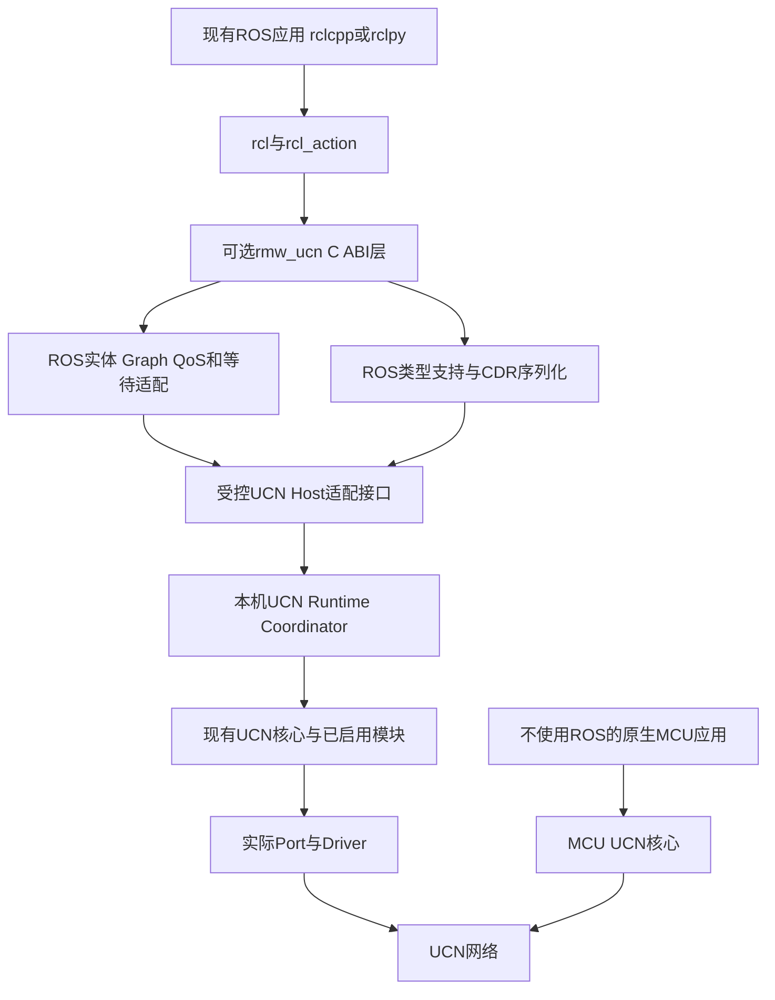
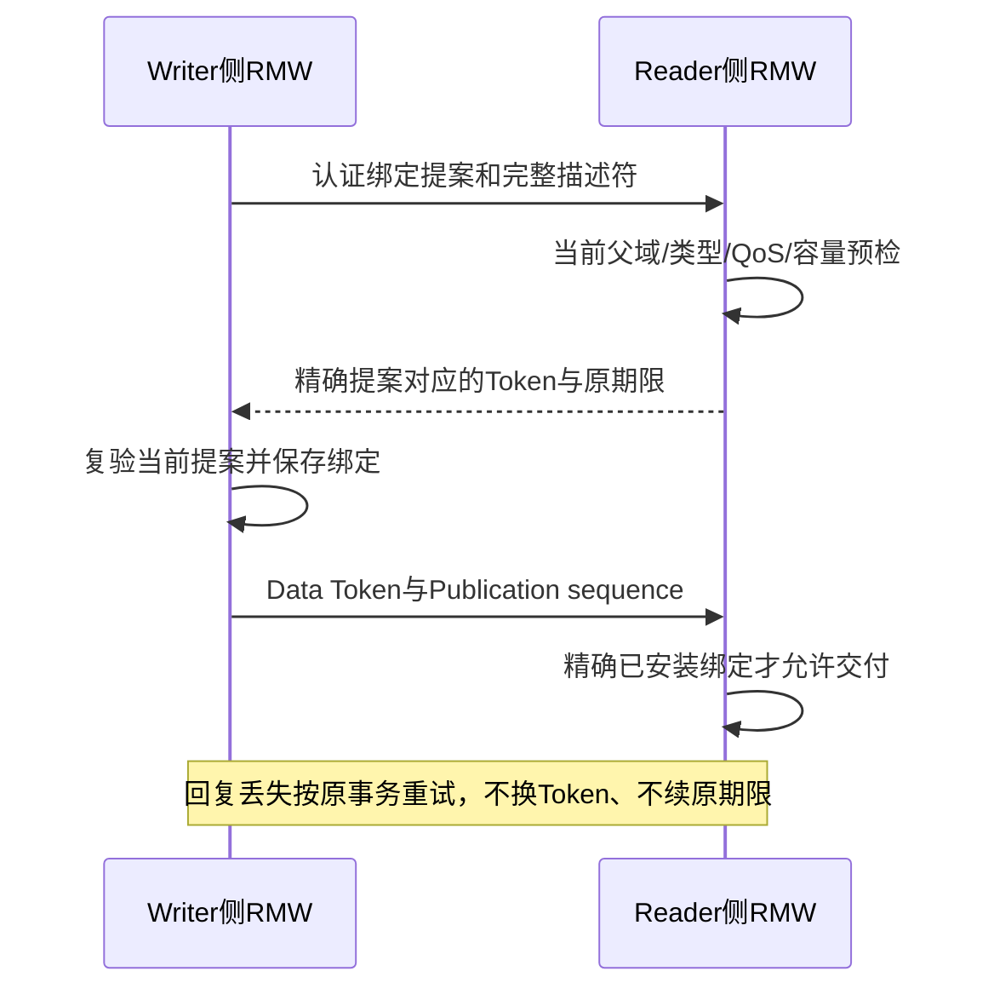

# UCN v6：rmw_ucn ROS 2 中间件后端详细设计方案

> 日期：2026-11-06。
> 状态：DESIGN PROPOSAL / SELF-REVIEWED / AWAITING USER REVIEW / NOT IMPLEMENTED。
> 用户选择：实现可选 `rmw_ucn` 后端，保留正常 ROS 2 接口；不是重写 DDS 标准。
> 本轮只写方案，不修改代码、API/ABI、Wire、Registry、CMake、依赖、测试或固件。
> 不操作实机，不安装 ROS，不暂存/提交/推送；普通 UCN 协议头新增 **0 B**。

## 1. 目标与可交付边界

### 1.1 用户最终怎样使用

应用继续用 `rclcpp`/`rclpy` 的 Publisher、Subscription、Service、Client、Action 和
Executor。安装并验收后，通过ROS的RMW选择机制选用候选实现 `rmw_ucn`，数据走UCN。
用户不需要把每个 `publish()` 改成 `ucn_publish()`，也不需要理解C/H/O组合。

以下仅为未来使用示意，当前仓库没有此可运行包：

```bash
# DESIGN ONLY：包安装并完成对应功能验收之后才成立。
export RMW_IMPLEMENTATION=rmw_ucn
ros2 run demo_nodes_cpp talker
```

“正常接口”限定在明确支持的发行版、消息类型、QoS和功能范围内。仅有talker/listener
不能称完整ROS兼容；未知功能必须按对应RMW函数合同拒绝，不能返回假成功或缺少动态符号。

### 1.2 本方案不做什么

- 不实现DDS/RTPS线上兼容，不承诺直接连接Fast DDS/Cyclone DDS节点。
- 不修改rclcpp/rclpy/rcl的正常业务接口，不把自定义UCN API伪装成ROS接口。
- 不让普通MCU安装ROS/DDS、保存完整ROS Graph或解析Topic字符串。
- 不把Linux、网关、目录服务或Cluster Head设为MCU通信的唯一中心。
- 不把协议可靠ACK、ROS Service返回或Action接纳当作物理动作完成。
- 不承诺低于DDS的固定延迟、零拷贝、无限节点、任意类型或硬实时；须分别测量。

RMW抽象与非DDS实现路径由[ROS 2官方实现指南](https://raw.githubusercontent.com/ros2/ros2_documentation/rolling/source/ROS-Framework/client-libraries/Working-with-Client-Libraries/Creating-An-RMW-Implementation.rst)
说明；已有[rmw_zenoh](https://github.com/ros2/rmw_zenoh)可作接口实现参考，不作为UCN功能完成证据。

## 2. 为什么选RMW，而不是给核心塞一套ROS

| 路线 | 优点 | 代价与结论 |
| --- | --- | --- |
| 显式ROS语义网关 | 易限定设备和业务，适合已有系统 | 用户仍要配置业务映射；保留为设备接入路径 |
| 独立rmw_ucn | 应用继续使用ROS接口，后端统一复用UCN | 要实现ROS通信语义；本次用户选择的长期方向 |
| 重写DDS/RTPS | 可追求DDS生态线上互通 | 范围和负担远超目标，本方案不采用 |

保持两种可选接法并不保留两套UCN协议：ROS后端和设备网关使用同一UCN核心、身份、
路由和安全合同。MAVLink仍是外部设备协议，不能因为有rmw_ucn就省略其业务与安全适配。

与[设备详细对接方案](UCN_v6_无人机机器人与其他设备详细对接方案.md)的关系：该文拥有
设备业务Schema、控制权与MAVLink/ROS语义网关；本文拥有ROS RMW后端，不改其设备安全规则。

与[原生发布订阅及统一用户API方案](UCN_v6_原生发布订阅与统一用户API简化详细设计方案.md)
的关系：原生MCU采用Publisher/Subscription优先、保留最小send，先固定通道与紧凑Codec。
原生API与RMW共享窄通信引擎/Host SPI，不强迫RMW继承原生Latest默认值、同Service的
Writer别名或静态匹配限制；RMW的CDR/GID/QoS/20 B专用元数据仍由本文负责。
原生普通消息不因此支付ROS前缀。两份文档目前均为候选，不表示API或RMW代码已实现。

## 3. 当前基线、选择和未完成的前置条件

核对基线：`v6-simplified-rust@03eb7eb03098bfc7abd63f16e911e9d8fe45d26f`加完整工作树。
当前没有rmw_ucn、ament包、ROS类型支持适配或ROS安装消费门禁。C/Rust基础模块和部分
Runtime链路可以复用，但不能用内部Owner单测代替完整Host后端。

本方案的初始工程选择是作者建议，待用户评审，不代表用户指定了这些平台：

| 项目 | 候选选择 | 理由与边界 |
| --- | --- | --- |
| 首个ROS基线 | ROS 2 Jazzy，Linux x86_64 | 固定API基线；其他发行版独立适配，Rolling文档只帮助理解 |
| RMW语言 | C++，对外导出发行版要求的C ABI | 接ROS生态和序列化库，不给UCN核心引入C++依赖 |
| 首个协议后端 | 受控Host适配接口接C实现 | 易于C ABI消费；完整高级C Runtime未闭合前阻塞对应能力 |
| Rust关系 | 按同合同作为线上对端或后续可替换后端 | 不同时写第二套RMW，不以FFI重用C冒充Rust独立协议 |
| 序列化格式 | 全RMW统一CDR，固定CDR1封装配置 | 方便ROS序列化接口和工具；不宣称因此支持DDS/RTPS |
| 第一网络拓扑 | 两个预配置且已认证的Host Peer，直连 | 先做完整语义；多跳/MCU/自动发现扩展单独验收 |
| 发现方式 | 已授权Peer间的有界目录交换 | 不要求MCU转发节点保存ROS Graph，不强制中央daemon |

实施前必须关闭以下真实差距：

1. 定义窄Host适配接口：提交、认证收取、精确身份/会话上下文、回执、取消、排空、事件；
   当前C公共Endpoint DTO的来源地址不是完整授权证明，不能直接拿它作为RMW信任根。
2. 当前只有内部高级Runtime和私有Owner SPI的路径，须通过产品Coordinator接入；
   rmw_ucn不得直接include私有Security/Route/Persistence头绕过所有权。
3. 首个Host Bearer、调度和生产密码Provider必须明确。Fake/内存Link只用于软件实验，
   POSIX UDP/UART等正式Port不因本文存在就自动完成。
4. 核心基础、Host适配、RMW和设备消息的版本/Manifest分别登记，旧外审签字不能继承。

源事实：[C公共API](../../../include/ucn/ucn_core.h)、[Driver边界](../../../include/ucn/ucn_driver.h)、
[Rust Runtime](../../../rust/crates/ucn-runtime/src/lib.rs)、[当前任务表](../../00-项目管理/00-任务表.md)。

## 4. 总体架构和模块依赖



| 模块候选 | 状态所有者 | 可以依赖 | 不能依赖或做的事 |
| --- | --- | --- | --- |
| rmw_ucn | ROS ABI对象、参数检查、错误映射 | ROS RMW ABI和内部适配 | 改UCN Owner字段、从回调执行用户代码 |
| ucn_ros_model | Context/Node/Endpoint、Graph、匹配、队列 | 纯类型、配置、Host事件 | 链接Driver或自己管理第二套UCN Session |
| ucn_ros_typesupport | 类型描述、CDR、序列化边界 | ROSIDL和审查后的CDR库 | memcpy任意C/C++结构体、给Core引入ROS类型 |
| ucn_ros_transport | 绑定、fanout、请求关联、退役账 | 窄Host适配接口 | 直接调用其他Owner或自建Replay/路由旁路 |
| ucn_host_runtime_adapter | 产品装配与受控交接 | 本机唯一Coordinator | 将不可信地址/布尔值提升为认证事实 |
| ucn_device_adapter，可选 | 原生Schema与ROS语义映射 | 普通ROS API及产品通信边界 | 给原生设备伪造ROS类型或原用户密码身份 |
| Core及各Owner | 原有身份/帧/安全/路由/传输状态 | 既有最小依赖 | 导入ROS、DDS、CDR、Topic或RMW句柄 |

这些名称是职责划分，不要求按表各建一个库。实现时先用一个RMW包内清楚的源文件，
只有被两个真实消费者复用的部分才拆target，避免为了“模块化”增加层层包装函数。

## 5. Host进程、MCU与ROS实体不是同一层级

### 5.1 映射关系

- 一个物理MCU通常一个UCN Node，多个应用Service，不等于多个ROS Node。
- 一个Host进程可以有多个ROS Context/Node；不能为每个Publisher启动一个UCN Root。
- 同一物理Adapter/Security域由一个受控Runtime持有，多个ROS实体通过Host适配共享。
- 不同Host进程第一阶段各用独立Host Link/身份配置；不能同时直接拥有同一个串口/CAN
  Driver。确需共享物理设备时采用明确的本地broker/SPI，但它不是全网必需中心。
- 不同ROS Domain互相隔离；ROS Domain ID不等于UCN Realm或设备地址。

### 5.2 不要求全网发现依赖一个daemon

基础部署配置有界的可信Host Peer集合；目录同步在这些Peer之间完成，底层路由可穿过
只懂UCN的MCU。没有ROS的MCU不参与Topic匹配，只按既有UCN规则转发。

可选目录汇聚可以减少控制流量，但不是授权根。它只能传递原所有者可验证的描述，不能
自称其他Principal的Publisher。汇聚失效不能破坏已有MCU路径；新发现暂停应如实报告。

首版仅接纳当前认证 Origin 所授权 host_id 自己的 catalog/Graph。UCN 中继可原样
路由其端到端受保护消息；第三方 Host 把别人公告重新作为自己的 Payload 发送，不能
继承原所有者身份。第三方可验证的公告格式/原期限/撤销证明未另审前，禁用这种
应用层汇聚，不以“邻居已认证”替代原发布者证明，不新增普通 Header。

首版不承诺未知Host零配置发现。以后可在UCN准入/寻址能力上增加有界目录定位，不能
通过匿名广播整张Graph破坏安全和资源上限。

## 6. ROS接口逐项怎样映射

本表中的函数族以Jazzy头文件为基线。实施RMW-00时必须从完整安装头生成逐符号清单；
不能以本表是摘要为由漏导出符号。函数的返回值、线程安全、分配和错误写回以对应ABI为准。

| ROS功能 | 典型RMW入口/函数族 | rmw_ucn职责 | UCN复用与缺口 |
| --- | --- | --- | --- |
| 选后端 | implementation identifier、serialization format | 返回唯一实现标识及统一cdr格式，注册共享库 | 不改Core |
| 初始化 | init_options、rmw_init/shutdown/context_fini | Context资源/域/安全策略和生命周期 | Host装配/排空接口需正式接线 |
| Node | create/destroy_node | 名称、namespace、Context所属关系、Graph记录 | 不新建每Topic UCN节点 |
| Publisher | create/destroy_publisher、publish | Writer对象、序号、匹配读者、序列化与fanout | 复用Data和已支持传输 |
| Subscription | create/destroy_subscription、take/take_with_info | Reader固定历史与正确元数据，逐次取数据 | 认证交接后才入队 |
| 序列化 | serialize/deserialize、publish_serialized/take_serialized | 同一种CDR及类型支持，支持工具链消费 | Core仅见不透明业务Payload |
| 等待 | wait set、rmw_wait、guard condition | 无丢唤醒等待、timeout、销毁并发 | Host线程/条件变量，不占MCU任务 |
| Graph | node/topic/service names/types、endpoint info | 当前有界Graph和匹配计数，触发graph guard | 通过可选应用目录交换 |
| Client | create/destroy_client、send_request/take_response | ROS请求ID和UCN事务精确关联 | 不把两套ID强转相等 |
| Server | create/destroy_service、take_request/send_response | 请求排队、回传关联、原始响应字节 | 普通ROS服务不自动承诺耐久执行 |
| Action | 由rcl_action在Topic/Service之上构成 | 保证底层Topic/Service的身份/次序/唤醒语义 | 不新增“ROS Action协议头” |
| QoS | compatibility、actual QoS、event | 协商/拒绝、历史、可靠、deadline/liveliness事件 | 不能把Q0～Q3当DDS QoS的直接枚举 |
| GID与信息 | publisher GID、compare、message/request info | 远近一致的实体身份、发布序号、时间 | 通过绑定映射，不逐包重复GID |
| 回调/事件 | on-new-message、service/client/event callbacks | 依ABI报告ready数量，线程安全与注销屏障 | 不等同执行用户Subscription回调 |
| Loan/内容过滤等 | 对应能力查询与入口 | 初版明确不支持，正确返回并保留ABI符号 | 不伪称零拷贝或软件过滤已完成 |

`rmw_send_request()`接纳、UCN发送完成、对端`take_request()`和业务副作用仍是不同层级。
ROS API保持不变不代表其业务可以绕过UCN产品安全、资源和时效策略。

## 7. 类型支持与序列化：不能为省字节悄悄丢语义

### 7.1 ROS到ROS采用一种标准格式

Jazzy的`rmw_get_serialization_format()`是全实现级格式声明，不是每Topic任选一种。
本方案选择`cdr`，初版固定CDR1的明确encapsulation/端序配置，序列化和反序列化需独立
Golden。类型支持先使用C/C++ introspection及审查后的库适配；是否需专用生成器后置评估。

不能对某Topic内部改成自定义紧凑格式，却让serialized API和rosbag把它当标准CDR。
UCN自身Header和RMW应用前缀仍big-endian；CDR正文遵守自己的encapsulation，二者不混读。

固定数组、bounded string/sequence可预计算上限。无界字符串/序列在Host端可以有限接纳，
但产品必须配置最大serialized bytes、元素数、嵌套深度和分配总额；不支持的类型创建时拒绝，
不能直到消息到达后才无限扩容。输出对象按ROS生成类型的初始化/释放合同处理。

### 7.2 类型匹配

匹配至少比较：实际ROS Domain、解析后的完整Topic/Service名、实体角色、完整类型名、
ROSIDL类型Hash版本/值、序列化格式、QoS兼容性及产品权限。类型名相同但定义不同不得配对。
Hash只是规范类型身份的一部分，不得用另一个随意截断摘要替代整个匹配键。

初版只接纳有确定类型描述/Hash的消息包；版本unset或缺必要类型支持时明确不支持。
需兼容无Hash的旧生成包时另审严格静态Manifest方式，不增加猜测解析fallback。

### 7.3 ROS到原生MCU是另一条显式映射路径

MCU可以继续用12 B定点向量或16 B健康摘要，不要求解析CDR/ROS Graph。可选设备适配
把它们转换成标准ROS消息，转换者进入信任边界，必须声明单位、量程、坐标与误差。

但它不等于RMW可以任意删掉ROS消息字段：同一种ROS消息中的协方差、frame_id、精度、
header.stamp等只要被该类型定义，就不能悄悄消失。精简原生Schema的映射和信息损失
按[设备对接方案第6/13章](UCN_v6_无人机机器人与其他设备详细对接方案.md)单独审核。

设备适配若使用同一Host Link，仍通过同一个Coordinator/Ingress，不与rmw_ucn抢RX。

## 8. 实体身份、域和无ABA规则

### 8.1 候选16 B GID布局

Jazzy的`RMW_GID_STORAGE_SIZE`为16 B，见[当前头文件](https://raw.githubusercontent.com/ros2/rmw/jazzy/rmw/include/rmw/types.h)。
本方案采用不靠64位Hash猜唯一的候选布局：

| offset | 字节 | 字段 | 规则 |
| ---: | ---: | --- | --- |
| 0 | 8 | host_id:u64be | 部署Manifest分配，在整个ROS域内唯一，绑定当前UCN Principal |
| 8 | 4 | context_generation:u32be | 共享Host分配器耐久保留后才用，跨进程/重启不复用 |
| 12 | 4 | entity_id:u32be | 当前Context单调分配，0保留，Node/Writer/Reader/Client/Server共用空间 |

`ContextId`是前12 B，不是另一个随机UUID。GID是逻辑实体身份，不等于密码Principal；
接收端还须验证声明者被授权使用该host_id，冲突时隔离，不能“谁先宣布就信谁”。

Host分配器是可选应用的耐久需求，使用现有Foundation原则；不把新Schema塞进普通Core。
多个进程创建Context必须经同一Host持久高水位服务/锁定Provider串行保留，不能各自读旧值+1。
损坏、耗尽或无法证明唯一时初始化失败；不临时fallback随机号或重新从1开始。

这份额外持久化只由ROS Host部署承担。软件PoC可用显式测试分配器，但不能据此声明
重启安全。`rmw_context_t.instance_id`是ROS进程本地字段，不代替上述线上ContextId。

### 8.2 其他域不得混用

| 身份 | 所属 | 不可用来替代 |
| --- | --- | --- |
| ROS GID/Request sequence | RMW实体/请求 | UCN地址、Session、Driver Token |
| UCN Principal/Binding | 协议认证身份/地址绑定 | ROS node_name、Topic字符串 |
| Publication sequence:u64 | 一个Writer的每次发布 | 可能重封装的逐跳/Origin计数器 |
| UCN OperationId | 既有RPC去重/耐久域 | 任意ROS Client sequence的强转 |
| Graph revision/Binding token | RMW应用目录/接纳上下文 | 网络Authority、Cluster Epoch |

ROS Domain候选编码u32be，初始化把默认域解析成确定产品值（初版默认0）；超界拒绝。
ROS域到UCN Realm由配置明确绑定，多个ROS域共用Realm时匹配/权限仍逐域隔离，不串话。

### 8.3 多Context不能用“只保留最大Context”处理

较新Context创建不意味着同Host较早但仍live的Context失效。为避免和多Context承诺
冲突，Host维护一个有界Context catalog：`catalog_revision + allocated_high_water +
active_contexts[固定容量]`；同host_id只能有一个同步的发布者，与Host分配器共同管理。
活跃集合可同时含多个generation，不能仅比较数字大小把较早live Context删掉。

新Context在预检后以新分配值原子加入catalog并发布；已被更高已发布高水位越过而未
加入的保留值作废，重取新值，不能以后补插一个未列出的旧generation。删除从活跃
集合移除，但高水位不回退，因此完整历史不需无限集合。catalog损坏/冲突则关闭接纳。

接收端先验证最新完整catalog的revision/高水位/当前集合，再接受其中各Context自己的
Graph revision。已从当前集合删除的Context不能靠迟到自身公告复活。新catalog缺页/
无法证明完整时不部分更新，不能只信带更大数字的单条消息。

首版每个Host runtime内的Context catalog由本机唯一Coordinator持有。多个进程如果
共享一个host_id/分配域，必须有相同的受控Host服务/同步域；否则配置不同host_id，
不能各自维护一份同名catalog。该本机协调不是MCU网络或跨Host的中央发现依赖。

同一host_id的catalog revision也受共享耐久发布高水位保护：更新在发布前保留/回读，
删除不回退，重启不从1开始，耗尽或恢复无法证明连续性则停止新公告。Host目录Owner
重启后，不能把磁盘中旧active集合直接视为当前live；首版围栏受影响Context，并用
新分配generation重新建立其对象/目录。只有仍在原Host Owner同步域内被明确证明live
的Context才可继续，不让“目录服务重启”偷偷复活已结束实体。具体Record Body在
RMW-00冻结，继续遵循Foundation防回退，不把这份Host持久化加到MCU Core。

## 9. 发现、Graph与匹配的共同流程

### 9.1 目录只描述ROS实体，不承担UCN组网

UCN先具备合法Peer、身份、安全与路径，RMW目录才交换ROS实体。Endpoint公告不授予
UCN Session、路由或设备控制权；Graph里“看见一个节点”不代表允许向它发送任意内容。

候选固定应用Service分别承载目录/绑定和RMW数据，Service数值由产品Manifest分配。
目录使用既有Data RPC或Transfer，不新增Core Protocol Opcode或修改原Decoder。

### 9.2 描述符的必要字段

| 字段组 | 必含内容 |
| --- | --- |
| 所有者 | ContextId、Node/Endpoint GID、当前认证UCN父域 |
| 名称/类型 | Domain、完整node namespace/name、Topic/Service名、类型名/规范Hash |
| 角色 | Publisher/Subscription/Client/Server，不靠名字猜角色 |
| 语义 | 精确QoS、序列化格式、serialized上限、产品映射配置代际 |
| 生命周期 | 单调Graph revision、实体有效/删除状态、原始租约/交接事实 |
| 安全 | 允许的Peer/角色与当前Policy绑定，不通过Payload自称管理员 |

所有字符串/数组有配置上限，长度checked后才复制；描述符完整比较，不只比较64位摘要。
源码阶段前在RMW-00冻结各应用Verb的offset/长度、合法组合、状态机和独立raw向量；
本表不是宣称这些控制Body已经注册或可以立即编码。

### 9.3 同步和撤销

初版使用有界Peer目录快照，不做无限gossip。每个Context的快照revision严格递增；
同revision精确重复幂等，不同内容拒绝；增量存在缺口就请求完整快照，不拼半张Graph。
先在有限staging中完整校验/预留再发布，失败不污染旧Graph。

每个可信Host保留8.3的catalog及有限活跃Context表，再分别保存Graph revision和实体
历史。没有在当前catalog中的旧Context/已删除实体不能被迟到公告恢复；同时live的
较早Context不因另一个新Context创建而失效。未知Peer表满不驱逐已有历史。目录租约
只代表可见性提示，不证明业务Authority或源端新鲜度。

删除发布者先停止接纳，取消其后续逻辑工作，保留实际未退休Token；订阅者删除后迟到
消息不能命中新订阅者。匹配变化更新Graph，再触发guard，不在内部锁中调用ROS用户回调。

## 10. 按匹配建立短绑定，长名称不逐帧传

### 10.1 Binding的作用

在一个具体Writer到Reader的方向上，把长名称、类型、QoS、GID、当前UCN父域和资源
约束绑定成接收端分配的`binding_token:u32`。数据帧只带短Token和必要样本信息。

Token不是全网ID，分配器由接收Host Runtime共享，在同一接收Root内跨所有本地Context
单调分配不重复值；不能让两个Context都从1开始，而数据中却没有区分它们的字段。
数据查找键为接收Root、精确认证Origin Session及Token，命中的记录再给出双方Context/
Endpoint GID、Principal、配置和QoS。不能只按裸Token全局查找，也不需要逐帧加ContextId。

### 10.2 安装状态机与失败关闭



接收端先安装有限槽，再返回同一提案的幂等结果；发送端只有拿到精确确认才发数据。
绑定提前安装不表示已收到任何消息。控制事务Body必须绑定完整提案和双方GID，不用
“同Topic”或digest-only确认。带副作用安装按既有RPC去重/保持回执规则执行。

Token只从共享分配器单调高水位分配，删除不回收稀疏空洞。耗尽停止新绑定，不能只换
某个Peer就将整个共享计数器清零；须旧Root真实排空、全部受影响安全父域换代并重新
匹配，才可初始化新分配域。该恢复路径未实现时保持Exhausted，不靠重建Root绕过Holder。
更换UCN Session时所有旧Token失效，重新认证/绑定后才发；不从旧缓存直接改Session。
跨会话仍保留Writer的Publication sequence，不能把ROS Writer重启伪装成同GID续接。

销毁单个ROS Context不得重置共享Token分配器。共享Root完全重启后，必须先建立能
拒绝旧帧的真实新安全父域，才可在新域重新初始化分配器；不能沿用旧Session和旧Replay
域却把Token从1重新开始。全部物理Holder仍按原Root的退休合同处理。

有效期限在接收端可信单调时钟捕获的原绑定事务起点构造，不能从延迟确认到达时重计。
续约需新鲜事务、当前父域和有界时钟误差；重复不续租、未来起点和溢出拒绝。具体计时
采用已有checked-time合同，不能忽略量化误差。到期先撤销交付权限，Holder仍精确退休。

### 10.3 为什么不重用Core Service ID作每个Topic号

Core Service是产品业务命名空间，不应随每个ROS Publisher/Reader动态创建无限值。
本方案用少量固定应用Service + 有界Token表；ROS名字只在目录和绑定阶段出现。
原生设备Service继续独立使用，不被ROS Graph接管，也不会被强迫携带RMW前缀。

## 11. 数据平面候选布局与精确字节费用

### 11.1 Topic样本应用前缀，20 B

下面是RMW专用应用协议候选，不是新增Core Header。必须在RMW-00以独立Golden冻结
后才能写Codec；不加入当前协议Registry或C/Rust生产源码。

| offset | 字节 | 字段 | 作用 |
| ---: | ---: | --- | --- |
| 0 | 4 | binding_token:u32be | 找精确Reader/Writer与父域绑定 |
| 4 | 8 | publication_sequence:u64be | 对应Writer的真实发布序号，fanout不重复分配 |
| 12 | 8 | source_timestamp_ns:i64be | ROS发布元数据时间；不是UCN同步证明 |
| 20 | L | serialized_message | 全实现统一CDR，包含其自身encapsulation |

整条消息长度来自既有UCN完整Message，不再重复Magic、总Length、Topic、类型Hash或GID。
布局版本在已认证绑定中固定，不按Payload长度猜协议。Token/GID/元数据都必须被当前
Origin认证覆盖；Hop只认证邻居，不能替代真正的源端绑定。

`publication_sequence`初值1，合法范围为`1..UINT64_MAX-1`，checked递增；`UINT64_MAX`
是Jazzy信息接口的UNSUPPORTED哨兵，不能作正常序号。精确重传用同序号/同CDR与原
发布时间；Token、逐跳包装、重传时间不是样本内容。保留内容时精确比较，不能只凭
截断摘要判断同内容。发生序号耗尽时停止该Writer，不回绕。

每个Reader按完整`{Reader GID, Writer GID}`持有有界接纳窗口、`last_taken`和必要的
可靠义务；短Token/Session只是当前传输权限，换Token或Session不清空这些样本水位。
已经take过100，再重绑定收到100/99不能再次take。新Reader确实使用新GID时才能按
自身历史策略重新取样，不靠同对象重新建Token伪装新Reader。

同Writer对外take的publication sequence必须严格递增：BestEffort可跳过较旧/丢失
样本，Reliable按已冻结的有界重排/缺口/超时策略处理，不能先交付较新值又交付旧值。
有限窗口外的旧消息直接拒绝，不为无限历史保留每个Payload；没有保留原字节时也不能
伪造“内容相同”的缓存结果。精确重复不再入历史，必要确认仍按原可靠合同进行。

`rmw_message_info`的reception sequence由本地Subscription统一分配，成功取样时按
线性化顺序递增，跨Writer共用，batch逐样本一致；保留`UINT64_MAX`哨兵。接收时间
在首次真实接纳时捕获，不在take/重传时刷新；`from_intra_process`仅对真实同进程
本地交付成立，不因两端位于同主机就置真。规则依据[Jazzy types.h](https://raw.githubusercontent.com/ros2/rmw/jazzy/rmw/include/rmw/types.h)，
精确ABI输出与失败语义在RMW-00生成测试，不只实现Publisher序号一项。

### 11.2 不以省8 B破坏ROS信息接口

当前设计先保留20 B前缀。若未来要省source timestamp，必须另审可声明的元数据语义、
支持的RMW信息接口、绑定版本和测量收益，不能在同一绑定中时有时无或填伪造采样时间。
CDR格式接口不包含这20 B；`take_serialized`返回的是纯CDR，不把内部前缀泄漏给rosbag。

### 11.3 开销公式

当前C1头为`9 + 2*w`，w为地址字节数；A1下13 B。以C1/O1/H1为例，已有安全费用
16 B Origin Tag和16 B Hop部分，共45 B固定费用，见[当前Codec](../../../rust/crates/ucn-wire/src/c1.rs)
和[Origin/Hop共同合同](UCN_v6_C_Rust共用合同收口/18-直连多跳统一Origin与HopContext接线合同.md)。

| 消息 | 逻辑字节数，A1 C1/O1/H1单帧 |
| --- | ---: |
| 原生OneWay，业务P | 45 + P |
| RMW Topic，CDR实际长度L | 45 + 20 + L |
| RMW Topic再启用既有Timed Envelope | 45 + 16 + 20 + L |
| RMW Request，采用下文20 B请求元数据 | 45 + 9 + 20 + L |
| RMW Response，采用下文20 B响应元数据 | 45 + 11 + 20 + L |

例如固定`std_msgs/msg/UInt32`的候选CDR1向量为4 B encapsulation+4 B数值，L=8；
此RMW Topic为73 B，而同语义原生u32业务为49 B，差24 B。它们可以共用普通UCN头，
但不能宣称ROS兼容只付原生4 B。CDR长度必须由实际独立向量确认，不能按C++sizeof计算。

本表不含PHY/Carrier、匹配握手、反向ACK、丢包重试或Transfer。普通头新增0 B，
RMW样本元数据20 B、CDR及可选语义字段则明确计费；非ROS消息不支付这些费用。

## 12. 发布订阅、fanout、可靠与历史

### 12.1 一次publish的顺序

```text
rmw_publish:
    验证Writer/Context当前有效、类型与大小、QoS和资源
    序列化到有界池，冻结本次发布内容
    保留一次Publication sequence，不按每个Reader另分配
    遍历已匹配Reader快照，分别生成精确Token绑定的传输任务
    依函数合同返回本地接纳或错误，不报告所有订阅者已执行

Host worker:
    通过唯一Coordinator发送/接收/重试/退休
    对端认证、Token与样本身份通过后写Reader历史并标ready

rmw_take:
    取得候选与精确依赖，经Host适配复验当前交付权限和原期限
    在Reader同步域内按实体/许可generation原子领取；过期或撤销则清理而不交付
    保持同Writer last_taken单调，分配本Reader的reception sequence
    输出ROS消息与真实Writer GID/序号/元数据，按ABI处理失败
```

没有匹配Reader的Volatile发布无需无限缓存。Reliable多Reader时在第一次实际发送前
预留产品要求的fanout/历史资源；失败不能对外伪称原子撤销已经发生的部分发送。
即使一个publish后返回错误，也不能据此保证所有Peer均未收到；诊断区分接纳/部分提交。

### 12.2 初版采用有界单播fanout

一个Topic有N个远端Reader时，先用N个明确的单播绑定，而不依赖尚未完成的C5/H3/Tree。
CDR可以序列化一次，传输和安全上下文仍各自绑定；跨不同Peer不能直接复用同一密文。
同一Context多个本地Reader可共享不可变样本引用，但必须避免本地路径和回环网络双投。

网络费用约为每个目标路径实际费用的求和，不因ROS称Pub/Sub就自动变成一次广播。
后续组播优化必须保持GID、顺序、QoS与安全语义，不是初版必要依赖。

### 12.3 Reliable不等于一帧ACK

Publisher保留已接纳样本的有界历史和各Reader的未确认义务；按原Deadline/重试预算
推进。对端确认点必须冻结为样本进入其受控Reader接纳/历史，而不是Driver发出。
`wait_for_all_acked`等接口等待的是定义的匹配Reader义务集合，不是设备动作完成。

初版可拒绝无法满足的历史深度/阻塞时间和组合。不能把需要Reliable的Reader悄悄接到
BestEffort、或为了队列腾空间丢弃尚未履行的可靠义务。保持有限资源与明确错误，
接口细节按冻结发行版的RMW与一致性测试决定，而不是承诺无限网络分区仍无损。

### 12.4 TransientLocal后置

TransientLocal要求迟加入Reader得到符合QoS的历史，不等于必须写Flash，也不等于
设备动作可以重放。支持前要冻结历史深度、资源、writer生命周期及首批历史和live数据
的顺序边界；初版明确拒绝此QoS，而不是创建成功却不给历史。

## 13. Service、请求ID与Action

### 13.1 两套事务身份不能无条件合并

ROS请求身份由Client GID及请求sequence等信息组成；UCN RPC有自己的OperationId、
Flags、Session/Service/请求摘要域。当前共同合同的易失ID生成规则不能随意改为ROS的
任意64位序号，见[共同RPC合同](UCN_v6_C_Rust共用合同收口/README.md)。

采用显式本地双向关联，不为省8 B强转身份。候选请求/响应RMW应用前缀仍为20 B：

| offset | 字节 | Request/Response的含义 |
| ---: | ---: | --- |
| 0 | 4 | 当前方向的Service绑定Token，确定Client/Server GID与父域 |
| 4 | 8 | ROS request_sequence:i64be，初版由RMW在1..INT64_MAX分配 |
| 12 | 8 | 当前方向source_timestamp_ns:i64be |
| 20 | L | 请求或响应的CDR |

外层仍使用既有UCN Request9/Result11 B条件Envelope；响应须匹配其精确原请求。
Client GID不逐次重复发送，来自安装绑定；响应Token绑定原Client和Server，不能只按
request_sequence查任意Client。重封装/重试保留ROS请求和UCN Operation的原始关联。

### 13.2 Server选择和生命周期

初版每个Service名/类型只匹配一个被授权Server；发现多个符合者时显式冲突，不随机
将同请求发送给多个执行器。若未来支持多Server选择，必须先冻结选取/故障切换语义。

请求入Server队列后`take_request`输出原Client GID与sequence；应用`send_response`
必须携带这个request header，映射到仍存在的精确UCN事务。过期、已退休或错GID的
响应拒绝，不能误写重用槽。取消Client future不等于撤销Server已发生的业务副作用。

普通Service初版使用易失去重，不能宣称跨进程重启exactly-once。确需耐久Operation
必须应用显式选择并具备执行器对账，不能让所有ROS Service默认写Flash。

### 13.4 Session后继不自动恢复旧易失请求

原ROS Client GID/request sequence保持可查询，不等于原UCN Operation可以改Session。
已可能提交到旧Session的易失事务保留完整原键及关联，停发并等待原合同允许的结果/
超时；不得仅因新绑定已好就以新Operation或旧ID重发。Server已取走的请求也不能把
旧Reply关联换一个Token，向新Session伪造普通Result。

确证从未提交、也没有任何可见网络副作用的命令，才可在明确策略下重新接纳为新
UCN事务，同时保留ROS原请求和旧尝试的关系；Unknown不满足这条前提。原身份已
不能合法返回结果时，普通ROS Service没有统一的IN_DOUBT业务字段：RMW只记录有界
本地不确定诊断、停止该发送并按已声明超时/错误规则收口，不制造成功Response、
不给任意服务类型塞自定义错误正文，也不把设备响应改成重试建议。

耐久操作仅在应用显式选择、已有Journal/执行器恢复证明与当前父域满足时走既有
Resume/结果观察合同，不重新执行原动作。缺该闭环就保持不确定，不能为了自动
恢复让所有Service都写Journal。精确规则还须通过共同RPC的跨Session负向向量。

### 13.3 Action无需另造一套Core协议

ROS Action由rcl_action建立在Service/Topic上，不是RMW里一个独立的动作执行器。
先实现其依赖的普通通信，再用标准Action client/server验证goal、feedback、status、
cancel和result。若所需QoS或服务尚未支持，明确不声明Action可用。

Action Result或取消反馈由应用定义；网络ACK、RMW ready、UCN Journal都不能自动
证明机器人动作已完成。目标设备控制权与安全门仍按设备对接方案执行。

## 14. QoS兼容性和首版支持矩阵

QoS在创建对象和匹配时同时核查；已请求的语义不能被“自动优化”静默变弱。枚举合法
但产品不支持时，用对应RMW错误/事件报告；所有API符号仍必须存在。

| QoS/能力 | 最小原型 | 可称常规ROS基础后端的门槛 | 后续完整范围 |
| --- | --- | --- | --- |
| BestEffort + Volatile + KeepLast | 支持固定容量 | 支持并测满载/丢包 | 多Reader及多跳扩大 |
| Reliable + Volatile + KeepLast | 可先拒绝 | 必须支持基础组合，否则默认ROS样例可能创建失败 | ACK/历史/分区/资源合同深化 |
| History depth | 正数且不超过配置 | 创建/取样/溢出语义与目标ABI一致 | KeepAll按资源合同后置 |
| TransientLocal | 拒绝 | 默认rosout依赖它，未完成前不能称未修改默认Node可用 | 有界历史与迟加入顺序 |
| Deadline | 初版仅默认无限 | 有限时需正确检测发布间隔/事件 | 不等于执行Deadline |
| Lifespan | 初版仅默认无限 | 默认rosout的有限值也要支持，且需可信源年龄/映射 | 跨跳误差与过期测试 |
| Automatic liveliness | 有界实例存活模型 | 正确事件/租约与Context结束 | ManualByTopic另验 |
| Loaned/共享内存 | 不支持 | 正确报告，不假零拷贝 | 单独优化和生命周期验证 |
| 内容过滤、动态类型等 | 明确不支持 | 正确返回与能力声明 | 按真实需求增量实现 |

`SystemDefault`必须解析成确定的实现默认值并可查询，不能随对端或重试变动。
ROS默认节点可能建立参数服务、日志和事件通信；“只写一个Topic收发函数”不保证
未修改的标准talker就能启动，见第23章的阶段边界。

特别是Jazzy默认开启rosout，其默认QoS含Reliable、TransientLocal、depth=1000、
Lifespan=10s，见[logging_rosout.h](https://raw.githubusercontent.com/ros2/rcl/jazzy/rcl/include/rcl/logging_rosout.h)
与[node_options.h](https://raw.githubusercontent.com/ros2/rcl/jazzy/rcl/include/rcl/node_options.h)。
因此RMW-03只能验收显式关闭/配置了相关内置功能的受控测试节点，不能宣传“原样
talker/listener已可用”。未修改默认节点的验收放到RMW-07完成这些实际依赖之后；
不得在后端偷偷关闭rosout、把TransientLocal降成Volatile或把10s改成无限。

ROS QoS Deadline是发布间隔，Lifespan是样本寿命，见[官方说明](https://raw.githubusercontent.com/ros2/ros2_documentation/jazzy/source/Concepts/Intermediate/About-Quality-of-Service-Settings.rst)。
UCN Q0～Q3仅为调度与资源类别，不能与ROS Reliability/Durability按枚举一一强转。
外部ROS业务不占用Core Q0保留通道，优先级由产品上限和配额约束。

## 15. 等待、Executor、线程与销毁

### 15.1 单写协议运行时，多线程ROS入口

ROS线程可以并发publish/take/query，但所有跨Owner协议操作由Host适配排队给唯一
Runtime Coordinator。每个对象有同步与generation，不能用普通静态Owner指针做重入门。
网络线程只发布数据ready、Graph/event和错误事实，不直接调用ROS用户回调。

Reader历史到`take*`的所有权交接采用Host/Coordinator核发的精确当前许可，再在
Reader同步域校验版本并线性化领取；若期间发生撤权、close或绑定换代则重新验证/
丢弃，不持有协议Owner锁去调用ROS。回调通知同样不允许绕过注销屏障或取得Owner
写权。这与原生Facade的应用dispatch采用同一底层交接原则，不是复制一个协议Executor。

`on_new_message`等RMW通知回调也必须严格按该接口合同执行，注销/销毁有屏障；
不能把“不能直接调用用户Subscription回调”误读成“可以不实现必要ready通知接口”。

### 15.2 无丢唤醒的rmw_wait

```text
wait(entities, timeout):
    在共享同步域下验证对象仍live，记录generation并登记waiter
    检查ready predicate和wake revision
    若无ready，原子释放锁并等待条件变量/事件
    醒来后重新在锁下检查ready、shutdown、generation和monotonic timeout
    只返回真正ready实体；其余按ABI置空，不以一次脉冲当持久ready

producer:
    在同一同步域下发布完整样本/event
    更新ready与wake revision，通知已登记waiter
```

支持合法的多个wait set/并发等待，所有waiter有容量与生命周期。zero timeout只检查，
无限等待必须能被guard/shutdown唤醒；ROS模拟时间跳变不改变Host等待的单调时钟。
“先检查再无保护sleep”会丢唤醒，不是可接受实现。

### 15.3 对象销毁不等于物理Token退休

停止接纳、撤销匹配/唤醒、断开ROS回调引用、逻辑销毁、网络Holder退休分别进行。
若发行版API要求fini释放/清空对象，未决Driver缓冲转由有界独立退役arena持有，
不得仍引用已释放的rcl对象或用户内存，也不得伪报发送已取消。

arena归本机Host适配生命周期管理，带精确token/Session/generation和不可变字节；
限额耗尽时拒绝新资源，不无限泄漏。真实Root在全部物理义务退休前不能销毁或换槽。
Host进程退出也不证明远端动作未发生，本地设备失联安全继续独立生效。

## 16. 时钟、元数据与有限Lifespan

`source_timestamp_ns`是RMW发布元数据，不能无条件当传感器capture_time、ROS
`header.stamp`或UCN Domain time。RMW不得重写用户消息中的header.stamp来伪造新鲜度。

| 时间 | 用途 | 不可推导 |
| --- | --- | --- |
| Host单调时钟 | wait、局部队列年龄、原始事务期限 | 跨Host绝对年龄 |
| RMW source/receive timestamp | ABI要求的发布/接收信息 | 物理采样和端到端确定性 |
| ROS消息header.stamp | 应用消息定义 | 可信Domain或密码授权 |
| UCNTimed Domain/uncertainty | 经证明的跨节点时间约束 | 未测的硬件精度 |

初版Lifespan仅支持默认无限。以后有限Lifespan必须有可验证的源时钟映射，或者通过
已支持的UCNTimed组合传递对应发布时间并计入uncertainty；无证明时创建/匹配拒绝，
不能用“刚收到”重置源端寿命。Timed会多付既有16 B费用，不假装已经藏在20 B元数据里。

每个已接纳样本保存原source timestamp/可信发布时间、映射或Domain generation、
接纳时保守年龄上界及接收方单调时刻。有限Lifespan用既有checked-time规则求
`age_upper_now = age_upper_at_anchor + elapsed_upper_since_anchor`，检查
`age_upper_now < lifespan`；等于即过期，未知/溢出/非法未来时刻失败关闭。
单调经过时间须包含慢钟、量化与读取误差的保守上界，不能只加粗粒度tick读数。

入历史、`take*`、重传、未来TransientLocal历史补发和设备桥真正交接时都复验原年龄
与当前授权。锁内清理过期样本，并一致更新ready，不能把已被可靠接纳的样本“取消
成从未收到”，更不能因为需要重传而刷新原期限。先接纳、后过期是可观测的独立事实。
新Session/Token不能重置时钟锚点或延长原样本寿命。

普通RMW source timestamp只作发布元数据，不能直接代替可信时钟映射。某消息选用
Timed时，capture基准是同一次原始发布事件而不是每次重发；长期缓存/重传所需的
Envelope重新生成能力必须在原年龄/实际发送状态合同内证明，无法证明则拒绝该
有限Lifespan组合。支持默认rosout可以选择已验证的Host时钟映射，不强制所有MCU
启用Realtime；无任何可行证明时，RMW-07仍阻塞。

发布间隔Deadline事件可用本地单调计时维护，但不承诺消息必在该时长内执行。
动态路由/源时钟失锁、模拟时间倒退/暂停对各时间域的影响须分别测试。

## 17. 发现和数据的安全模型

### 17.1 RMW不是DDS，不自动继承DDS-Security

ROS有enclave/security options，但自定义UCN后端不能声称直接复用了DDS安全插件。
需实现“ROS身份/策略 -> 允许的UCN Principal、host_id、Context、Topic/Service权限”的
可验证映射，并验证私钥、证书/信任根、策略和Domain一致。

初版如果不能满足security-required/Enforce，`rmw_init`失败，不关闭安全继续启动。
不要求安全的实验只能在显式隔离软件环境中进行，不能转为飞控/执行器产品权限。
仅有UCN链路加密也不能当作ROS逐发布者权限已经落实。

### 17.2 权限检查位置

1. Context创建时认证身份并核对允许的Host ID/域/资源。
2. Endpoint创建时核对创建、发布、订阅或服务调用权限。
3. 公告与绑定时复核双方所有者、类型、角色、QoS和当前父域。
4. 每次发送/交付时检查实际Session/Binding/Policy、绑定Token、期限和队列资格。
5. 设备应用执行前再检查控制权/值域/本地状态。

没有由真实Host适配提供的当前认证上下文时，不能用Topic名、消息里的user字段或
`ucn_endpoint_message_t.source_address`推断权限。类型描述和目录数据也不可信，必须限长。

### 17.3 同进程信任与多租户

同一进程/安全上下文中的多个ROS节点不构成强隔离边界。若需要区分不互信操作者，
使用独立进程、凭据/UCN Principal及访问策略，不能让所有人共享一个Host密钥后宣称
端到端区分每个node_name。设备控制权与Cluster网络Authority仍是不同的授权轴。

## 18. 与DDS节点、现有工具和设备网关共存

| 情形 | 结果与条件 |
| --- | --- |
| 两端都用已验收rmw_ucn | 使用UCN通信，仍需域/类型/QoS/权限匹配 |
| 一端DDS一端rmw_ucn | 不自动互通，需要明确的进程/应用桥 |
| RViz/rosbag/ros2 CLI选rmw_ucn | 只有依赖的serialized/Graph/Service/QoS均支持时才可用 |
| ROS节点与原生MCU | 可选设备语义映射，不假定MCU会CDR |
| MAVLink设备 | 继续使用已定义的MAVLink适配，不因RMW自动理解飞控 |

工具进程和ROS daemon也要使用一致RMW/域/配置；不同后端的Graph缓存不能混用。
实施验证在独立测试环境中启动对应daemon，不在用户环境随意结束ROS进程。
不为“兼容DDS”在UCN核心保留双Decoder或复制旧协议。

## 19. 消息、控制平面和总体资源账

### 19.1 四类费用分开

| 账本 | 具体费用 | 谁承担 |
| --- | --- | --- |
| Core固定费用 | 已有Contract、安全、路由和Carrier | 使用相应UCN组合的流量 |
| RMW每消息 | 20 B样本/请求前缀、CDR、现有条件Envelope | ROS业务，不是所有MCU Data |
| RMW控制平面 | 名称/类型、Graph快照、匹配、撤销、租约/ACK | 启用ROS的Host Peer |
| Host资源 | 表/历史/队列/CDR池/线程/退役arena/可选耐久分配 | 安装rmw_ucn的产品 |

变量控制Body不能写成0 B。定义`A`为一次完整公告字节、`B`为一次绑定往返字节、
`T`为续约周期，则稳态成本至少包括实际公告/续约次数与匹配数；初次启动单列，不能
只测空闲时每帧20 B就宣布总体节省。每个控制Body的精确大小在RMW-00冻结后计入Golden。

### 19.2 fanout示例

在11.3同一假设下，L=8的Topic样本为73 B。10 Hz发给3个不同远端Reader，基础数据
发送量是`73*10*3=2190 B/s`，不是730 B/s；还没计各路径跳数、ACK/重试和PHY。
能否同Host合并发送或组播优化须实际实现并单独计量，不能预先扣掉这部分。

### 19.3 有界内存公式

```text
Host预算 = Context/Node/Endpoint表
         + 有界Graph快照与高水位
         + Channel绑定/请求关联/退役arena
         + Writer与Reader历史池
         + CDR最大scratch与池
         + UCN Runtime/Driver/Provider资源
         + worker/ROS executor栈与余量
```

所有乘法、serialized长度、depth、fanout先checked再分配。Host可使用ROS allocator，
但总量、对象数、消息大小、等待/重试有产品上限；不能把Host allocator说成MCU零动态内存。
关闭rmw_ucn时上述状态/依赖/线程/持久Schema全部不进入普通Core发布面。

## 20. 简化实现原则与目录候选

### 20.1 少的是真实机制，不是把缺的功能藏进万能函数

建议保留少量清晰的内部动作：`validate -> reserve -> submit -> observe -> retire`。
不同RMW ABI入口可以共享这些机制，但每个入口仍按自己的参数/线程/错误合同检查。
不用一个巨大switch混合所有Owner，也不为每个Topic写一套网络状态机。

协议生命周期只有现有Coordinator一套；RMW拥有ROS实体生命周期和应用Channel，
不是再造Session/Route/Replay。序列化/Graph/QoS都在Host可选层，普通MCU最短路径不变。

### 20.2 将来代码归属，当前不创建

```text
可选ROS集成工作区（路径待实施计划固定）
  rmw_ucn/                 ROS ABI与有限内部组件
  ucn_ros_tests/           RMW一致性、跨进程、工具和故障测试
  ucn_device_adapter/      可选原生设备Schema映射

UCN仓库
  现有C/Rust核心           不依赖上面的ROS包
  受控Host适配             经Coordinator复用核心，不暴露Owner布局
  共同消息/Oracle          两语言同字节，不保留Rust专用Wire
```

不先建几十个空crate/target。是否单独Host SPI库，以实际安装消费者和生命周期需求决定；
包名、导出符号、版本/可见性、ABI和Feature OFF按当前工程规则审查，不能从文档直接猜实现。

## 21. 完整调用与失败路径伪代码

以下不是已实现API，也不授权写代码。

### 21.1 创建Publisher

```text
create_publisher(node, type_support, topic, qos):
    validate exact Context/Node, resolved name, type and QoS support
    preflight bounded storage, serialized size and security policy
    allocate never-reused Entity GID from current Context
    construct immutable endpoint candidate
    commit local object and new Graph revision
    enqueue bounded announcement; announce only supported semantics
    return actual rmw handle
```

### 21.2 接收样本

```text
on_host_authenticated_message(message, current_evidence):
    lookup token under exact Origin Session/Context and receiver
    validate binding active, Writer GID, schema, size and QoS
    check publication sequence/content/reliability and required time policy
    reserve Reader history before consuming delivery evidence
    commit complete owned sample and metadata under Reader synchronization
    mark ready and wake waiters, then retire actual UCN receive obligation
```

### 21.3 下线与恢复

```text
shutdown_context(context):
    reject new calls; revoke endpoint/binding admission
    wake every waiter and unregister notifications safely
    publish bounded removal where possible, but do not depend on remote ACK to stay safe
    detach logical ROS objects according to ABI
    keep physical tokens/bytes in bounded retirement ownership until exact retirement

on_actual_session_successor():
    follow existing fence/drain/authenticated Capability/hot-adoption contract
    invalidate all old RMW channel tokens
    rematch current entities with new exact bindings
    preserve live Writer sequence, Reader last_taken/dedup and original pending request keys
    stop uncertain old-session volatile RPC; do not transplant its Operation to the new session
    durable operations may only use the existing proven Resume/result-observation path
    do not refresh cached sample age or replay uncertain external operations as new requests
```

Context重启使用新的耐久generation和新GID，不恢复旧ROS对象假装其生命周期未结束。
同一活Context只换UCN Session时，不重置其Writer序号或ROS请求号。设备控制权则与
普通RMW连续性分开：父Session变化时撤销并重新授权，不继承旧设备授权/控制租期。

## 22. 故障与安全行为矩阵

| 反例 | 正确行为 |
| --- | --- |
| 同Topic不同类型Hash | 不匹配，不按长度猜类型 |
| 同GID不同认证Principal | 隔离，不能覆盖Graph |
| 撤销后旧公告/数据迟到 | 高水位/父域/Token拒绝，不复活实体 |
| 同Host并存多个Context | catalog保留所有当前live实例，不因较大generation误删较早实例 |
| 两个本地Context同时建Reader | 共享Token分配器不碰撞，20 B前缀可唯一查绑定 |
| Token槽删除后新绑定 | 不复用旧值，父域/实体精确绑定 |
| BIND确认丢失/重复 | 同提案幂等，期限不刷新，不分配第二Token |
| 一条样本多Reader | Publication sequence相同，UCN传输/安全各自精确绑定 |
| Reliable历史满或分区 | 按有限资源合同拒绝/超时，不伪造ACK或静默降级 |
| Reader慢、历史或应用队列满 | 按声明QoS处理，ready/取样/错误一致 |
| 同样本序号异内容 | 拒绝且不污染已接纳样本 |
| take过100后Token/Session换代又收到100/99 | Reader/Writer GID水位保留，不重复或倒序take |
| Publication/Reception接近UINT64_MAX | 保留UNSUPPORTED哨兵，耗尽明确停用，不当正常序号 |
| 多Writer并发take、batch、本地/远端消息 | reception序号与真实取样一致，from_intra_process不伪造 |
| 入Reader缓存时有效，take/历史补发时已过期 | 原年龄和授权复验，不重盖source timestamp或Timed时间 |
| 旧易失请求可能已发送后Session换代 | 原键保留且停发，无新Operation重做、无伪造业务Response |
| 第三方重新封装别人Graph但无原所有者证明 | 首版拒绝，不把转发Host的认证提升为实体所有者 |
| Host目录Owner重启后catalog revision回退或旧active复活 | 耐久发布高水位拒绝回退；无当前live证明则围栏并重新分配Context |
| wait与入队/销毁并发 | 无丢唤醒、无悬空句柄，guard/shutdown可唤醒 |
| 未实现loan/content filter | 符号存在，明确不支持，不宣称已优化 |
| Client sequence碰撞或旧响应 | 按GID/绑定/UCN事务精确拒绝 |
| 多Server同名 | 初版冲突明确，不向多设备执行同请求 |
| ROS模拟时钟倒退 | 不改变Host单调等待，不洗样本新鲜度 |
| Security Enforce但无安全映射 | init失败，不无安全继续启动 |
| Driver Unknown+对象destroy | 有界独立Holder保留，旧物理工作不命中新对象 |
| rmw_ucn关闭 | Core Wire、符号、依赖、存储和任务不增加 |
| 默认rosout所需QoS未实现 | 默认Node创建按真实不支持处理，不能静默禁用日志后声称兼容 |
| Session后继保持同ROS Writer | 发布序号不回零，但设备控制权撤销并重授 |
| Host目录不可达 | 已有MCU通信不依赖它，新ROS匹配如实不可用 |

## 23. 分阶段实现，不把PoC说成完整替代

各阶段都需小项自审、整体验证、精确候选哈希和不支持清单。以下为建议任务，不改变
当前IMPL/RUST-SW状态，不是本轮代码实施授权。

| 阶段 | 内容 | 验收及硬边界 |
| --- | --- | --- |
| RMW-00 | 固定Jazzy API/符号、类型/CDR、Host SPI、安全域、应用Body和资源合同 | 编码前冻结全部实际使用Verb/布局/Golden；关闭Host前置差距 |
| RMW-01 | 包/共享库、Context/GID分配、Node生命周期、单进程Fake Host | 全符号存在、失败释放正确；仅接口PoC，不承诺标准ROS应用可运行 |
| RMW-02 | 类型支持/CDR、Graph、短绑定、wait/guard、BestEffort Topic | C/C++消息独立Golden、并发、负向、跨进程受控Peer；仍非完整常规后端 |
| RMW-03 | 基础Reliable/Volatile、Service请求响应和内置依赖盘点 | 显式配置测试Node关闭尚不支持的rosout等功能；基础Service运行，不宣称未修改默认样例兼容 |
| RMW-04 | Graph/serialized接口、Action依赖、实际QoS/event查询 | 受控测试的Graph/序列化/服务/Action与重启回归；真实CLI/rosbag未修改验收受其默认依赖阻塞 |
| RMW-05 | ROS身份/策略到UCN安全映射、权限/Enforce、Provider | 非Fake密码路径与权限负向通过前，不用于有风险设备 |
| RMW-06 | 可选MCU消息映射、C/Rust对端、多跳和热续接 | 原生MCU不运行ROS；实际Root/Adapter/认证链，不伪造Opened DTO |
| RMW-07 | 补默认rosout所需可靠历史/depth/10s Lifespan、liveliness及资源门禁 | 未修改talker/listener、默认Node、CLI/rosbag/Action按支持矩阵验收；其他高级QoS独立放行 |
| RMW-08 | 安装消费、发行版/ABI、系统矩阵和外部候选 | test_rmw_implementation、完整应用矩阵、无未声明行为；不能继承Core单测签字 |
| RMW-09 | 用户另行授权的Host/MCU实机、链路/掉电/资源/长稳 | 真设备/固件/配置/原始日志绑定；软件PoC不代替 |

推荐首轮正常使用目标是有限遥测/状态、参数查询及软件里的简单服务，而不是直接飞控
解锁/底盘运动。实时执行器安全仍是独立产品工程，ROS接口兼容也不等于动作安全验收。

与API/DEV的共同依赖按[接口方案第21.1节](UCN_v6_原生发布订阅与统一用户API简化详细设计方案.md)
核对。RMW-06的原生C/Rust设备对端仍走显式Schema映射，不能用它证明未实现的另一套
完整ROS后端；普通设备网关也不必等待rmw_ucn全部完成。

### 23.1 不能省掉的一致性与安装测试

- 使用冻结发行版的`test_rmw_implementation`与真实C/C++/Python消费程序，不跑空CTest。
- 动态RMW加载逐符号核对；所有未实现入口有正确行为，不等调用时才缺符号。
- 不同GID/Context、namespace/remap、同名节点、多Publisher/Reader、匹配/撤销。
- 独立CDR字节向量、serialized API、bounded/unbounded上限、坏长度/嵌套/错误类型。
- 默认Node的参数服务、rosout、事件；不能只在关闭所有内置功能的特制节点上通过。
- Fanout/历史、服务迟到响应、Action取消、模拟时钟、对象销毁、ThreadSanitizer。
- 实际安装包的include/link/run、Feature OFF和Core无ROS依赖；证明头0新增与完整开销。
- 同一RMW的Host↔Host、C↔Rust线上互操作、MCU映射分别建门禁，不混为一次roundtrip。

## 24. 本轮自审、权威关系和待产品冻结项

### 24.1 自审重点

1. RMW不是DDS实现；ROS API保留不等于DDS节点线上互通。
2. 标准ROS类型、serialized格式与精简MCU业务分开；全RMW一种CDR格式。
3. Node/GID/样本序号/ROS请求/UCN事务分别有域与高水位，不靠短Hash或重建对象去重。
4. 核心Header零增量，20 B可选RMW应用前缀、CDR、控制平面和fanout费用不隐瞒。
5. Discovery/Graph不授Authority，旧Token/公告/配置不能在新父域获得新解释。
6. Ready/传输ACK/业务结果/物理副作用分层；Unknown和退役arena不被destroy抹掉。
7. wait/guard/Graph事件、基础Service和默认Node依赖进入验收，不把Topic PoC当全实现。
8. ROS安全未映射时Enforce失败，MCU自主通信不依赖Host目录；普通Core不链接ROS。

整体自查额外收紧两项：同Host的活跃Context必须由有界catalog管理，不能只留一个最大
generation；短Token必须跨共享Root的所有Context统一分配，不能省了Context字段后
又允许Token碰撞。相关规则和反例见8.3、10.1和22章。

独立只读实施检查指出默认rosout的QoS不能省略，已核对Jazzy源码并将“未修改默认
ROS样例可用”移至对应依赖完成后的RMW-07；早期受控测试节点不冒充这一目标。
同时区分网络Session续接与设备控制权：前者不重置ROS序号，后者仍须撤销重授。

2026-11-06追加三方案联合自审，收紧Reader水位跨Token、完整取样元数据、缓存用时
门禁、旧易失RPC停发与首版目录所有者规则；初次内部检查不代表跨文档永远零问题。
详见[联合自审报告](../../09-审计与整改/UCN_V6_原生API_RMW_设备对接三方案联合自审报告.md)。

上述阶段调整已经独立只读复核消歧；这是内部设计检查，不是外审GO。机械检查另行
显式扫描新方案和相关导航/台账，因为旧文档检查器的glob不自动收录本文件；覆盖表格、
本地链接、24章连续、RMW-00～09、代码围栏和示例字节/fanout算术。500个当前源码/
构建/协议/测试文件编辑前后指纹一致，真实Git暂存区未变。本轮没有运行CTest/Cargo或
RMW测试，没有安装依赖；这些门禁须在后续代码阶段实际运行，不能借用旧Core测试数字。

本方案内的格式、模块、阶段与配置均为设计候选。RMW-00还须形成逐字段机器可检
合同和独立raw/typed向量，未经授权不开始RMW-01或修改现有Core。

### 24.2 待实施计划冻结，不影响分层方向的选择

外部依赖的精确commit、Host Bearer、Linux版本、C++标准/CDR库、Host接口正式签名、
Peer/Domain/Host ID部署、表/历史/样本容量、具体首批消息/工具、密钥与策略格式、
源码安装目录均在实施计划中冻结；不同决定须重新核对费用和支持矩阵。

其中任何决定若要求新增Core Header、隐藏ROS依赖、无界状态或削弱QoS/安全，必须
回到本设计评审，不能由实现者当“小优化”偷偷加入。

### 24.3 参考资料与事实边界

核对日期2026-11-06。Rolling指南用于了解RMW总体要求，实际ABI以冻结的Jazzy头为准；
两者不能混成一个不存在的发行版。ROS文档站访问防护时使用官方GitHub源文件。
外部资料会变化，实施计划必须记录实际commit，不以活动分支替代候选证明。

- [ROS 2创建RMW实现的官方源指南](https://raw.githubusercontent.com/ros2/ros2_documentation/rolling/source/ROS-Framework/client-libraries/Working-with-Client-Libraries/Creating-An-RMW-Implementation.rst)。
- [Jazzy rmw.h](https://raw.githubusercontent.com/ros2/rmw/jazzy/rmw/include/rmw/rmw.h)、
  [init.h](https://raw.githubusercontent.com/ros2/rmw/jazzy/rmw/include/rmw/init.h)、
  [types.h](https://raw.githubusercontent.com/ros2/rmw/jazzy/rmw/include/rmw/types.h)、
  [ret_types.h](https://raw.githubusercontent.com/ros2/rmw/jazzy/rmw/include/rmw/ret_types.h)。
- [ROSIDL类型Hash](https://raw.githubusercontent.com/ros2/rosidl/jazzy/rosidl_runtime_c/include/rosidl_runtime_c/type_hash.h)。
- [Jazzy默认rosout QoS](https://raw.githubusercontent.com/ros2/rcl/jazzy/rcl/include/rcl/logging_rosout.h)、
  [Node默认选项](https://raw.githubusercontent.com/ros2/rcl/jazzy/rcl/include/rcl/node_options.h)。
- [Jazzy QoS官方说明](https://raw.githubusercontent.com/ros2/ros2_documentation/jazzy/source/Concepts/Intermediate/About-Quality-of-Service-Settings.rst)。
- [Jazzy安全官方说明](https://raw.githubusercontent.com/ros2/ros2_documentation/jazzy/source/Concepts/Intermediate/About-Security.rst)：DDS背景不能当自定义UCN后端已完成安全。
- [rmw_zenoh Jazzy](https://github.com/ros2/rmw_zenoh/tree/jazzy)：参考非DDS实现方式，不复制其默认拓扑为UCN的必需中心。
- [UCN模块边界](UCN_v6_可裁剪模块边界依赖资源与静态装配详细设计.md)、
  [公共API与内部SPI](UCN_v6_逻辑模型与伪代码/25-统一公共API与内部SPI冻结候选.md)、
  [C/Rust共同合同](UCN_v6_C_Rust共用合同收口/README.md)、
  [邻居真实排空/后继](UCN_v6_C_Rust共用合同收口/19-邻居围栏真实排空与耐久后继Capability热交接合同.md)。
