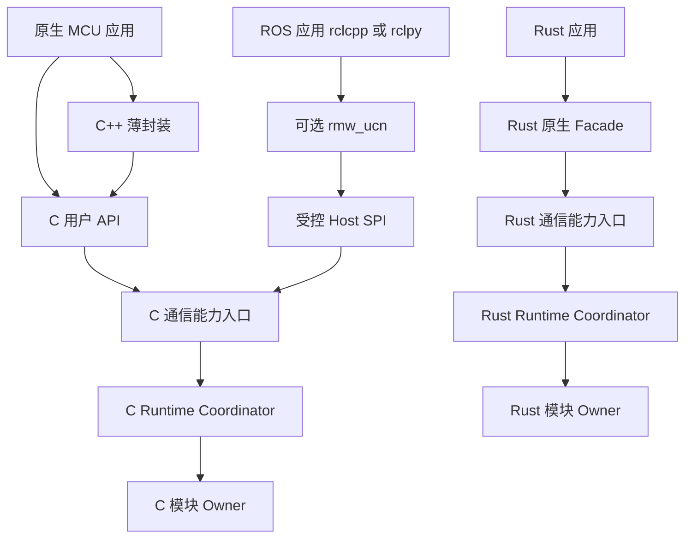
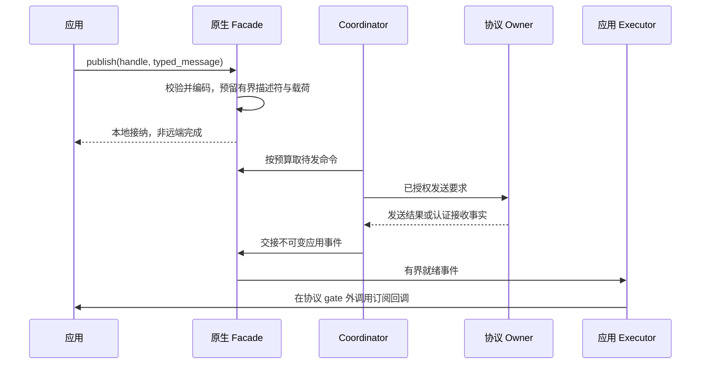

# UCN v6：原生发布订阅与统一用户 API 简化详细设计方案

> 日期：2026-11-06。
> 状态：DESIGN PROPOSAL / SELF-REVIEWED / AWAITING USER REVIEW / NOT IMPLEMENTED。
> 用户已选择：原生 MCU 优先发布订阅，保留最小点对点发送；C/C++/Rust 共用通信语义。
> 本文只提出接口、分层和实施方案，不修改代码、API/ABI、Wire、Registry、配置或测试。
> 不操作实机、不安装依赖、不执行 Git 暂存/提交/推送；普通协议头新增 **0 B**。
> 下文所有新函数、类型、生成文件和配置片段均为候选伪代码，不是当前可直接编译的 SDK。

## 1. 先说最终用户怎样使用

普通用户首先看到业务，而不是 C1、O1、Hop Context、Candidate 或某个内部 Owner：

```text
配置一次节点和通信策略
    创建发布者 / 订阅者
    发布状态 / 接收消息
    需要应答时创建 Client / Service
    个别场景直接 send 给指定设备
    周期推进协议，按预算分发应用回调
```

机器人电机节点发布状态，控制器订阅；控制器发布控制目标，电机订阅。
配置、校准等需要明确结果的操作使用请求/响应，不把收到控制目标误认为动作完成。
无人机遥测同样优先发布订阅，飞行安全和控制权仍由设备业务合同决定。

用户默认不选择具体 Wire 组合。协议按照已安装的通道、策略、目标能力、路径和安全
要求选择允许的组合；达不到要求就明确失败，不偷偷变成不可靠、不认证或不实时。

本文推荐的是“薄原生 SDK + 既有协议模块 + 独立可选 ROS RMW”，不是再建一套协议。
ROS 用户继续使用 rclcpp/rclpy；原生 MCU 不需要引入 ROS、CDR 或完整 ROS Graph。

## 2. 依据、当前事实与目标差距

核对基线为 `v6-simplified-rust@03eb7eb03098bfc7abd63f16e911e9d8fe45d26f`
加继承工作树。本文不把以前某次外审 GO 当作本方案已经实现的证据。

| 当前核对入口 | 现在具有什么 | 本方案拟补什么 |
| --- | --- | --- |
| [C 公共 API](../../../include/ucn/ucn_core.h) | Node 生命周期、Endpoint、静态 Path、目标式 ucn_publish、查询和统计 | 面向用户的通道 Publisher/Subscription、最小 send、清晰的应用分发 |
| [C 配置](../../../include/ucn/ucn_config.h) | Profile、容量、Layout/Manifest 检查 | 将 Facade 的容量、通道表和 ABI 纳入同样的核对，不绕过检查 |
| [C Driver](../../../include/ucn/ucn_driver.h) | 非阻塞 Driver、Token 与完成事实 | 继续复用，不让用户发布接口直接操作 Driver |
| [Rust Runtime](../../../rust/crates/ucn-runtime/src/lib.rs) | 多个模块和部分 Runtime 协调链 | 隐藏产品装配与 Owner 泛型细节，提供原生 typed facade |
| [公共 API/SPI 合同](UCN_v6_逻辑模型与伪代码/25-统一公共API与内部SPI冻结候选.md) | Owner、回调、生命周期和有界要求 | 明确 SDK 与应用 Executor 的接法，不放宽底层回调重入 |
| [rmw_ucn 方案](UCN_v6_rmw_ucn_ROS2中间件后端详细设计方案.md) | ROS 接口映射与独立 Host 后端设计 | 共享窄通信能力，保持 ROS 元数据、QoS 和原生默认值分离 |
| [设备接入方案](UCN_v6_无人机机器人与其他设备详细对接方案.md) | Schema、控制权、MAVLink/ROS 网关和动作安全 | 给原生设备提供更容易调用的入口，不替代业务安全合同 |

当前 C 的 `ucn_publish(node, target, ...)` 本质是指定目标的发送，不是完整 Topic
发现或多订阅者匹配。目标名称中出现 publish，不能作为已经有发布订阅的证明。
当前 Endpoint DTO 只有地址/Binding 等信息，不等于完整的已认证 Principal/Session
证明；受控 SDK 接收路径必须从合法 Runtime 取得认证事实，不能由业务回调自行声明。

## 3. 三种接口路线与选择

| 路线 | 可以简化什么 | 不能解决什么 | 结论 |
| --- | --- | --- | --- |
| 只把现有函数改名 | 少量名称和参数 | 通道匹配、类型、回调、资源归属仍让用户处理 | 不够，不能把目标式 send 冒充 Pub/Sub |
| 薄原生 SDK，复用通信引擎 | 声明通道、发布订阅、请求响应、默认策略、语言封装 | 仍需实现有界通道表与应用交接 | 推荐，先静态再动态 |
| 所有 MCU 都直接采用 ROS 对象与消息封装 | ROS 使用风格统一 | Graph/CDR/元数据/运行库费用明显上升 | 不采用；ROS 需求交给可选 rmw_ucn |

“接口少”指用户需要理解的概念少，不是强行把全部功能塞入一个万能函数。
生命周期、错误处理和资源释放必须仍能明确表达。不能为了少两个函数，隐藏阻塞等待、
堆分配、失败重试、重复执行或物理资源尚未退休的事实。

## 4. 总体分层与唯一状态所有权



图中的跨模块操作由各自 Coordinator 路由，不表示 Facade 可以直接操作私有 Owner。
C 与 Rust 是独立实现同一合同；Rust 不必须链接 C，C++ 初期只薄封装 C，不再造第三套
协议状态机。rmw_ucn 初期按已有方案使用 C 后端，未来切换 Rust 后端须另验收 Host SPI。

| 层 | 唯一负责的状态 | 不应拥有的状态 |
| --- | --- | --- |
| 原生 Facade | 本地实体句柄、静态通道映射、应用回调登记和有界待交付描述符 | 不复制路由表、Session、Replay、Journal 或 TX Token 状态机 |
| 应用 Executor | 已交接应用事件、回调预算、应用对象生命期 | 不自行推进协议 Owner、不伪造认证结果 |
| Coordinator/通信入口 | 校验命令、选择既有能力、跨 Owner 的异步交接 | 不凭 API 名称跳过持久化或准入 |
| 各协议 Owner | 路由、安全、可靠性、业务 Journal、实时与物理退休的原有状态 | 不引入 ROS Topic 字符串或 C++ 对象依赖 |
| rmw_ucn | ROS Graph、GID、CDR、ROS QoS、等待和 ROS 专用映射 | 不独立持有第二份 UCN Replay/Route/Token |
| 产品/设备业务 | Schema、控制权、参数合法性、动作状态与真实硬件结果 | 不把链路 ACK 升格为动作完成 |

## 5. 用户应理解的六组概念

| 概念 | 用户用途 | 初始版本是否需要 |
| --- | --- | --- |
| Node | 本设备的通信实例；初始化、推进、停止 | 必需 |
| Publisher | 向某个已声明通道发布数据 | Pub/Sub 开启时 |
| Subscription | 接收某个通道，并限定来源与交付策略 | Pub/Sub 开启时 |
| Client / Service | 发出业务请求 / 接收请求并返回结果 | RPC 可选 |
| Target + send | 明确向一个设备的一个 Service 发送字节 | 最小底座保留 |
| Receipt / ReplyHandle | 查询发送进度、保存异步应答权限 | 需要跟踪或延迟应答时 |

业务常态只需要 `publish(message)`。高级用户仍可选择固定路径、可信或加密、实时
策略、组目标等，但在创建实体时配置，避免每次发送传十几个低层参数。
高级配置只能在产品授权范围内选择；一次调用不能把已要求认证的通道降成明文无认证。

## 6. 通道是什么：先固定映射，不制造隐式发现

### 6.1 静态通道的精确定义

初期采用编译期产品通道表。一个通道规范包含：

```text
ChannelSpec = {
    product_namespace, channel_local_id, service_id,
    schema_revision, schema_codec,
    allowed_producer_selector, allowed_consumer_set,
    delivery_profile, security_minimum, time_requirement,
    max_payload, fixed_subscriber_capacity
}
```

这些字段大部分是本地 Manifest/控制面配置，不是每帧 Header。
`"motor/state"` 等文字是本地可读标签；同名不自动代表跨设备同一通道，更不能仅凭
字符串相同授权。线上的原生通道以既有 Service 及精确来源/会话上下文识别。

同一个产品入站 Service 的同一方向/Interaction Role 初期只能对应一个原生 Schema；
OneWay 通道不与其他用途混用。RPC Service 则固定成一组 Request Schema 与 Result/
Error Schema，依现有 Role 和已绑定事务精确区分，不要求请求和结果长得相同，也不
在业务正文另加通用类型位。不能在同一分派键里混入两种无法区分的格式。
Schema 更改必须使用新的分配或已有精确上下文更新流程，
不可“发送端先换格式，接收端猜长度”。动态 Schema 绑定属于后续可选控制面。

### 6.2 订阅怎样生效

静态模式下，发送端已有固定订阅目的表；接收端创建 Subscription 只安装本地交付规则。
它不自动通知任意远端，也不自动创建 Group、发现服务器或全网广播。

例如 A 发布电机状态给 B 和 C：

```text
A 的 Manifest：motor/state → B 的 Service S、C 的 Service S
B 的 Manifest：允许 A 的当前认证身份/Binding/Session → 本机 S
C 的 Manifest：允许 A 的当前认证身份/Binding/Session → 本机 S
```

若 B 暂未创建 Subscription，B 按明确策略拒绝/丢弃或仅保留本地有界 Latest，不把
“A 发送成功”谎报成“B 的应用已读取”。静态产品更新必须同步校验两端 Manifest。

### 6.3 原生发布者身份的限制

同一 Node、同一原生 Service 上创建两个 Publisher 句柄，初期视为同一数据流的两个
本地别名，不具有两个独立线上 Writer 身份。不同设备的生产者可由现有认证 Origin
身份、Binding、Session 和 Service 区分。

别名只能复用同一份 canonical ChannelSpec：Schema、方向/Role、目标集合、安全下限、
时效和交付策略须精确一致。创建冲突别名时拒绝，不采用最后写入者的配置，也不为
每个别名各建一份相互矛盾的 Latest/去重历史。摘要只作查找预筛选。

如果要求同一 Node/Service 的多个 Writer 各自有独立 History、序号或单独匹配，必须
分配不同 Service，或将可选 Writer Context 放入业务/专用封装。不能声称无需任何
字段就能恢复 Wire 中从未传递的区分信息；ROS Writer 则按 rmw_ucn 的专用合同处理。

## 7. 发布订阅的运行流程



接收先经过 Wire 长度、Security/Replay、来源和业务 Schema 绑定检查，再成为可交付
事件。适配层只提交原始字节与物理元数据，不能把 Driver 接收称为已认证消息。

入队不是永久授权。事件必须保存精确身份/Binding/Session、Capability/策略版本及原
接收/采样时刻等不可变依赖；dispatch 向业务交接之前，由受控通信入口按当前状态
复验。撤权、旧 Session、目标失效或时限到期就取消受保护交付，不把出队时刻当作
新年龄起点。最终执行副作用前仍由设备应用复验控制权、数值与时间要求。
允许读取已失效来源历史遥测的产品须显式选择历史数据模式，标出历史身份、授权和
时效已失效，不可用它产生当前控制动作或宣称当前可信新鲜 Sample。

同机多个 Subscription 可共享同一入站 Service，但必须在登记时计算固定扇出上限。
一条入站消息交付给几个回调、是否共享只读载荷、谁持有最后一个引用都必须有界。
不允许用一个慢回调无限阻塞其他订阅者或长期占用唯一 RX 槽。

应用 SampleInfo 至少区分本机/远端来源、精确 Principal/Binding/Session、Service、
实际交付语义和时间信息的有效性；这些值来自通信入口，不接受应用填写的 authenticated
布尔值作为证明。没有可证明的来源字段时不能交付要求该字段授权的业务。
同机交付可省去 Wire 编码/发送，但仍检查类型、产品授权、时效与队列容量，使用本机
Origin 事实，不借此绕过控制权或伪造远端身份。

Latest 的覆盖单位为精确来源流，而不是单个 Service 下所有生产者混成一个槽。
每个允许来源有固定容量；公平分发受 per-source cap 和持久轮转游标约束。
同一会话/流内还要比较已认证 Origin Sequence 或产品已冻结的样本顺序，较旧但尚在
Replay 窗口内的消息不能覆盖新 Latest 或刷新看门狗。它不同于 ROS 的 Writer 跨
Session 序号；控制流另外检查设备 Schema 的 control_epoch/setpoint_sequence。

## 8. 最小点对点发送保留什么

候选 `ucn_send()` 对一个明确 Target/Service 发送字节。Pub/Sub 关闭时仍可运行，
不必建立 Publisher、Subscription、目录或 Topic 字符串表。

```c
/* DESIGN ONLY：候选签名，非当前头文件。 */
ucn_result_t ucn_send(
    ucn_node_t *node,
    const ucn_target_t *target,
    const void *bytes, size_t length,
    const ucn_send_options_t *options,
    ucn_receipt_t *optional_receipt);
```

`options == NULL` 只能选择产品已定义的目标/Service 默认策略，不能自动采用不安全
最低配置。`optional_receipt == NULL` 表示无需逐次查询；仍有有界的错误计数与事件策略。

现有目标式 `ucn_publish()` 未来迁为 `ucn_send()`；新的 `ucn_publish()` 接受 Publisher
句柄。当前为测试阶段，建议一次性更新头文件、调用者、例程和文档，不保留两种含义的
兼容别名。本文没有实际改名，也不据此认定现有应用已迁移。

## 9. 公共 API 分组与参数简化

| 分组 | 候选操作 | 简化方式 |
| --- | --- | --- |
| 生命周期 | init/start/step/dispatch/stop/deinit | 沿用显式推进，产品生成器可封装初始化，不隐藏线程 |
| 实体 | publisher/subscription/client/service create 与 close | 通道和策略创建时绑定；句柄带实例与 generation |
| 常态数据 | publish、send | 发布仅传句柄和数据；send 保留明确 Target |
| 请求结果 | request_async、reply、receipt_query/cancel/release | Operation 和状态由模块处理，业务只持精确句柄 |
| 高级功能 | buffer loan、特定 Path、Timed、Group、诊断 | 单独可选接口，不塞入每次普通 publish |

不承诺只有八个导出函数。C 需要明确的创建/释放和错误返回；C++/Rust 可把相同操作
收进对象方法。内部可以共用短路径，但公共层不采用一个 `void* + opcode` 万能接口
让用户自行猜参数类型。

普通发送的调用方无需手动传：Origin Sequence、Hop Sequence、Session Key、Route
Epoch、Token、内部 Snapshot 或 Coordinator。产品接入者配置 Ports/Provider 是另一层
工作，不应扩散到每个电机业务函数里。

## 10. C99 调用示例：固定存储、发布订阅和直接发送

### 10.1 启动和发布

下面的 `robot_product.h`、`RobotStorage`、通道常量和消息 Codec 都是未来生成物示意。
初始化助手仍必须执行 Layout、完整 Manifest Hash、容量和对齐检查，不得绕过 `ucn_init()`。

```c
/* DESIGN ONLY：不是当前可编译工程。 */
#include "robot_product.h"

static RobotStorage storage;       /* 编译期确定，不从任务栈创建完整 Owner */
static ucn_node_t *node;
static ucn_publisher_t state_pub;
static ucn_subscription_t target_sub;

static void on_target(const ucn_sample_t *sample, void *user)
{
    MotorTarget target;
    (void)user;
    if (motor_target_decode(sample->bytes, sample->length, &target) != UCN_OK)
        return;
    /* 交给本地控制任务；控制权、取值和时效仍由设备业务检查。 */
    motor_control_post_checked(&target, &sample->source);
}

ucn_result_t robot_comm_open(const robot_ports_t *ports, uint64_t now_us)
{
    ucn_result_t r = robot_product_open(&storage, ports, &node);
    if (r != UCN_OK) return r;
    r = ucn_publisher_create(node, ROBOT_CHANNEL_MOTOR_STATE, &state_pub);
    if (r != UCN_OK) goto fail;
    r = ucn_subscription_create(node, ROBOT_CHANNEL_MOTOR_TARGET,
                                on_target, NULL, &target_sub);
    if (r != UCN_OK) goto fail;
    r = ucn_start(node, now_us);
    if (r == UCN_OK) return r;
fail:
    /* 不能假定 start 返回错误就绝对未提交；Root 接管未决注册与退休责任。 */
    robot_product_close_open_or_running(node);
    return r;
}

ucn_result_t publish_state(const MotorState *state)
{
    uint8_t bytes[MOTOR_STATE_WIRE_BYTES];
    ucn_result_t r = motor_state_encode(state, bytes, sizeof bytes);
    if (r != UCN_OK) return r;
    /* 默认复制；成功返回后栈上 bytes 可立即失效。 */
    return ucn_publish(node, state_pub, bytes, sizeof bytes);
}
```

用户也可选择生成的 `robot_publish_motor_state(node, state_pub, &state)`，把上面的
固定 Codec 和常规长度检查合并成一行。C99 不依赖 C11 `_Generic`，不直接发送 C
结构体的内存布局：Padding、Endian、enum 宽度和指针对象都不是通信 Schema。
示例设备 `post_*` 同样是“返回前复制到固定业务槽”的约定，不得保存指向临时解码
结构体或 SampleInfo 的指针；业务槽满必须明确报告，不能静默当作控制目标已生效。

### 10.2 驱动协议与应用事件

```c
/* DESIGN ONLY：budget 来自产品配置，now_us 来自可信本地单调钟。 */
void robot_comm_tick(uint64_t now_us)
{
    ucn_step_result_t step_result;
    ucn_dispatch_result_t app_result;
    if (ucn_step(node, now_us, ROBOT_STEP_BUDGET, &step_result) != UCN_OK)
        robot_comm_report_fault();
    /* 协议推进已退出 gate，才调用应用回调；最多分发本次预算数。 */
    if (ucn_dispatch(node, ROBOT_APP_BUDGET, &app_result) != UCN_OK)
        robot_comm_report_fault();
}
```

`ucn_dispatch()` 是候选新交付入口，不是让应用在既有受限 Endpoint callback 中
重入 `ucn_step()`。RTOS 可以把协议推进和业务分发放在不同任务，裸机也可顺序执行。
单个回调仍要有产品规定的执行时间；“最多四个回调”不证明每次只消耗固定微秒。

### 10.3 直接向一个设备发送

```c
/* DESIGN ONLY：目标身份绑定来自已校验产品配置或合法运行期解析。 */
ucn_target_t target = robot_diagnostic_target();
uint8_t request_bytes[2] = { 0x01, 0x00 };
ucn_receipt_t receipt;
ucn_result_t r = ucn_send(node, &target, request_bytes, sizeof request_bytes,
                         NULL, &receipt);
/* r == UCN_OK 只表示本地接纳，随后查 receipt；不是远端动作完成。 */
```

C 的每一个创建函数必须在失败时保持 out-handle 不写，并说明已接受异步命令是否
分配了可追踪句柄。失败清理不允许用 `memset(node)` 跳过 Fence/Token 退休。
产品初始化不发送网络消息，但 Driver 注册/启动也可能先有副作用再报错。清理助手
只有拿到确实零提交/零注册的证明才直接回收；其他情况围栏并交给仍存活的 Root
排空。不能把失败返回值当作物理资源不再引用存储的证明。

## 11. C++ 调用示例：熟悉的对象，不引入第二套内核

```cpp
// DESIGN ONLY：Result、RobotProduct、类型 Codec 均为候选接口。
static RobotStorage storage;

int run_robot(RobotPorts& ports) {
    auto nr = RobotProduct::make_node(storage, ports);
    if (!nr) return report(nr.error());
    auto node = std::move(nr).value();

    auto pr = node.create_publisher<MotorState>(RobotChannels::motor_state);
    if (!pr) return report(pr.error());
    auto publisher = std::move(pr).value();

    auto sr = node.create_subscription<MotorTarget>(
        RobotChannels::motor_target,
        [](const MotorTarget& target, const ucn::SampleInfo& info) {
            motor_control_post_checked(target, info.source);
        });
    if (!sr) return report(sr.error());
    auto subscription = std::move(sr).value();

    auto start = node.start(monotonic_us());
    if (!start) return report(start.error());
    while (application_running()) {
        auto r = publisher.publish(read_motor_state());
        if (!r) report(r.error());
        auto progress = node.spin_some(monotonic_us(), StepBudget{8}, AppBudget{4});
        if (!progress) break;
    }
    // 在 storage 仍存活期间推进 stop、物理 drain 和 quiescence。
    return stop_and_drain_with_deadline(node);
}
```

这些写法有意接近 ROS 常见的 create_publisher/create_subscription/publish，概念可迁移，
但不是 `rclcpp` ABI 兼容。真正不改 ROS 源码的路径仍然是 rmw_ucn。

封装必须满足：

- 默认无异常、无 RTTI 需求；返回 Result，不把构造失败藏在半有效对象里。
- Publisher/Subscription 为 move-only 句柄包装；稳定状态放在 caller-owned storage。
- 小回调闭包使用编译期容量或函数指针加 context，捕获超限报错；不默认使用会分配的
  `std::function`、`shared_ptr` 或每实体一个线程。
- Node 包装对象移动不改变底层实例身份；所有实体持有稳定存储引用和精确 generation。
- 显式 stop/drain 完成前，caller-owned storage 不得释放。析构只做逻辑 close，不能
  阻塞等待硬件，也不能在仍有 Driver 引用时强行清空内存。
- 首版封装采用与 Rust 相同的稳定 Root 思路：注册回调闭包由有界 Root 槽拥有，而非
  引用栈上 Publisher/Subscription 包装对象；示例静态 storage 不随函数返回回收。
  Ports/其 context 仍须活到精确退休，start/初始化失败或 drain 超时也一样。仅在
  获得完全零注册/已排空证明后才支持回收存储，不靠析构处理未证明的硬件取消。

## 12. Rust 调用示例：原生 no_std，不照搬 C 指针接口

```rust
// DESIGN ONLY：RobotNode/Channels/Codec 是候选产品装配别名，不是现有 crate API。
fn run_robot(storage: &'static mut RobotStorage, ports: RobotPorts) -> Result<(), Error> {
    // Root 永久占有静态存储与 Ports；root 是唯一推进权的运行句柄。
    let mut root = RobotRoot::install(storage, ports)?;
    let mut node = root.node_handle()?;
    let state_pub = node.publisher::<MotorState>(Channels::MotorState)?;
    let _target_sub = node.subscribe::<MotorTarget>(
        Channels::MotorTarget,
        |target, info| motor_control_post_checked(target, info.source),
    )?;

    node.start(monotonic_us())?;
    while application_running() {
        let sample = read_motor_state();
        node.publish(state_pub, &sample)?; // 编码/复制成功后不借用 sample
        root.spin_some(monotonic_us(), StepBudget(8), AppBudget(4))?;
    }
    node.stop()?;
    drain_until_quiescent(&mut root)?;
    Ok(())
}
```

选择 `node.publish(handle, &message)`，避免让多个 Publisher 长期各持有同一 Node
的 `&mut`，使合法多发布者场景陷入借用冲突。句柄是有类型的、不可伪造的实例引用，
不是允许用户直接填数值的 Owner 索引；方法仍验证 Node 实例与 generation。

产品类型别名隐藏装配用的泛型参数，底层仍可通过 const generics 确定容量。
默认 `no_std`、无 alloc，不强制 Tokio。可选 Embassy/async 适配只注册有界唤醒，
不能出现两个 Executor 同时 poll 同一个协议 Owner。

Rust 首期明确选择永久 caller-owned Root，不在第一版支持普通 `&mut` 存储的运行后
回收。`install()` 消耗 `&'static mut RobotStorage` 和满足静态资源合同的 Ports，把
Owner、物理 Payload、Driver 注册、退休 arena 与完成入口留在这块永久存储；Node、
Publisher 和运行句柄都只是 Root 的带 generation 权限。初始化失败也不得把部分
注册的物理资源悬空，须零发布或让 Root 保留故障/退休责任。

上述 `?` 提前返回或运行句柄 Drop 后，Root 不析构、不把存储和 Ports 归还调用方；
不能因此释放仍被 Driver 引用的内存。正常 Drop 可以发起围栏，但内存安全不能依赖
Drop 必然运行：即使 `mem::forget(root)`，最多停止推进并占住固定资源，不能发生
悬空引用或允许再次 install 同一 Root。完成入口仍指向永久 Root，不引用栈上 Node。
Ports 不能藏有短生命期借用；其底层注册与硬件资源有效性由适配合同显式保证。

永久 Root 登记的 Rust 回调及其捕获/context 首期必须 owned + `'static`，跨任务时按
实际共享模型要求 Send/Sync；无捕获示例符合此约束。非 `'static` scoped subscription
先不开放，后续须单独证明取消、未开始事件和活动回调全部退出后才可结束借用。

只有运行句柄持有唯一 poll 权；业务句柄可按同步合同提交命令，不直接取得 Owner
可变引用。产品应由永久任务持续推进并报告 Fault/排空超时；静态内存安全不等于
故障后一定继续运行。将来若要支持可回收存储，须另行证明取消、完成和借用生命期，
不得以一个未经证明的运行守卫扩宽 safe API。

## 13. 请求/响应：保留熟悉调用，但不夸大执行语义

```c
/* DESIGN ONLY：生成的 typed helper，默认明确是易失 RPC。 */
ucn_request_t req;
ucn_result_t r = robot_get_status_async(node, status_client, &query,
                                       on_status_result, user, &req);

/* Service 回调需要异步处理时，只保留 owned ReplyHandle，不保留 sample 指针。 */
static void on_get_status(const StatusQuery *q,
                          ucn_reply_handle_t reply, void *user)
{
    device_post_status_query(q, reply, user);
}

/* 后续由业务任务将结果复制进有界队列；过期/会话错误时拒绝。 */
robot_status_reply(node, reply, &status_result);
```

```cpp
// DESIGN ONLY：异步 Result；不是 publish 后同步阻塞 Owner。
auto pending = client.request(query);
if (!pending) return pending.error();
// 可按句柄查询，或在应用 Executor 中收到结果回调。
```

```rust
// DESIGN ONLY：不依赖必需的异步运行库。
let request = node.request(client, &query)?;
match node.request_status(request)? {
    RequestStatus::Pending => {},
    RequestStatus::Completed(result) => consume(result),
    RequestStatus::InDoubt => reconcile_outside_protocol(),
    _ => {},
}
```

三种语言共享以下规则：

1. 本地接纳、链路发送、远端接收、业务结果、真实动作完成是不同状态。
2. Reliable 不等于 durable exactly-once；易失 RPC 不保证重启后防重复执行。
3. 耐久操作显式选择 Journal/Operation 模式。外部动作与 Journal 不能原子提交且无法
   查询对账时，恢复结果可能为 IN_DOUBT，不能自动再执行或伪造失败结果。
4. ReplyHandle 精确绑定请求、来源、安全/会话域、Operation、截止期及服务实体
   generation。close、失效、过期和成功答复后的重复使用必须确定性拒绝。
5. 延迟答复需独立有界槽，不能保存回调只读 scope 或裸 Payload 指针；表满明确报错。
6. 保留业务 Request 身份不代表把其原 UCN Operation 改到新 Session 重新发送。
   已可能提交的易失请求在父域失效后默认只保留查询/不确定结果，不自动重试新动作；
   确实从未提交的请求才可按明确策略重新接纳。耐久续接须有既有 Journal/执行器的
   精确恢复证明。ReplyHandle 也不能只改 Session 字段就复活；ROS 的对应限制见
   [RMW Session 恢复规则](UCN_v6_rmw_ucn_ROS2中间件后端详细设计方案.md)。

## 14. 默认策略：按业务意图配置，不按底层组合猜

以下名字是候选配置模板，不是当前枚举，也不是声称所有设备适用同一默认值。

| 候选策略模板 | 典型用途 | 最低语义与失败方式 |
| --- | --- | --- |
| LatestState | 位置、电量、电机状态 | 每来源有限 Latest；旧值被覆盖可接受，不自动可靠重发 |
| ReliableMessage | 告警、配置消息 | 有界重发和确认；过期/无能力报错，不降成 BestEffort |
| RpcVolatile | 查询、可安全重试的普通请求 | 有界请求和结果；不宣称掉电后单次执行 |
| DurableOperation | 不允许随意重复的业务动作 | 必须有 Foundation/Journal 能力；无能力拒绝 |
| Bulk | 日志、参数块、升级数据 | 使用已有 Transfer；按实际 Payload Budget 分片 |
| TimedRequired | 已论证的同步执行业务 | 必须具有有效时钟/误差与来源授权；不满足不交付 |

是否可信、是否加密是两件事。产品可允许可信有线的特定不认证业务，但无线控制的
“自动模式”不能等价于优先选择最短未认证报文。安全下限由产品策略和目标能力决定。
Source timestamp 也不自动变成可信采样时刻；TimedRequired 按既有时间合同独立检查。

每次 publish 可有高级 override，但只允许收紧时效、减少目标集、固定已授权路径等。
缺乏可选功能时返回 Unsupported/配置错误，或已接纳后的明确异步失败；不得假成功。

## 15. 应用回调、并发和缓冲区所有权

### 15.1 两种回调必须分开

| 类型 | 执行位置 | 允许行为 |
| --- | --- | --- |
| 既有低层 Endpoint/Driver/Provider 回调 | 相应协议受限上下文 | 只按现有 scope/完成事实合同，不借新 SDK 放宽重入 |
| 新 SDK 应用回调 | 协议 gate 外的应用 Executor | 可提交复制型 publish/request/close 命令，不可递归 poll 或直接操作 Owner |

Facade 的命令提交应在短临界区内完成固定槽预留、参数快照与复制，之后由 Coordinator
按预算消费。底层 Owner 不在业务回调里执行。跨线程应用命令需要 caller-owned、
任务/ISR/SMP 语义明确的 gate；普通 API 不自动获得 ISR 安全性。

首版每个应用 Executor 的 dispatch 单写且不并发调用同一回调；发送提交可来自多个
合法线程。协议 gate 外的复验采用“候选事件 -> Coordinator 验证精确依赖 -> 签发本次
dispatch 许可 -> 原子领取”的交接，close/撤权与领取有明确线性化点。不持有协议
gate 调用用户代码；许可也不是允许将来无限执行的授权，设备真正副作用前仍复验。
另开并行回调模式须单独声明 callback/context 的同步和生命周期要求。

### 15.2 复制和借用

- 默认 publish/send 在返回本地接纳之前完成编码与复制，用户随后可复用原缓冲区。
- 接收 Sample 只在当前应用回调内借用；跨回调保存数据必须复制或显式取得有界 loan。
- 可选发送 loan 的所有权要分清：提交被拒绝仍归调用方；提交成功后归运行期，只有
  精确 release 事件后才可重用。远端 RPC 超时不代表本地 Driver 已退休。
- 多本地订阅者可共享不可变 Pool 引用，不能并发写同一 Sample。最后引用释放才归还槽。
- 不保留 Driver RX 缓冲区来无限等待慢业务；入站交接必须符合当前退休合同。

### 15.3 背压与原子接纳

命令描述符、Payload、收据和所需扇出资源必须预检后一次性接纳；无空间时失败不改
调用方输出，不预留线上 Sequence，也不提交部分远端发送。

这里的原子性仅指本地接纳；多个远端发送开始后，不能保证网络全有或全无。
fanout 结果必须能表达部分成功，不能一个返回码就冒充所有 Subscriber 已执行。
持续背压受总 Deadline、有界重试和 stop fence 限制，不得忙等或无限保留。

## 16. 生命周期、Close、Drop 与真正排空

```text
创建实体 → 逻辑可用 → close/fence → 不再接纳新业务
                                  ↓
                   已接受命令/回调/物理 Token 按合同收口
                                  ↓
                     retired/quiescent → 才可回收存储
```

close 是逻辑撤销，不是删除全部证据。必须区分：

| 情况 | 必须保留什么 |
| --- | --- |
| Subscription close 时有已排队回调 | 默认取消未开始回调，活动回调返回后才可回收 user 对象 |
| Publisher close 时 Driver 仍 Unknown | 独立退休责任和物理缓冲区，不能复用其 handle generation |
| Client close 时耐久结果未 ACK/GC | Journal 的必要证据，不能因用户不查询就删除 |
| Session 热续接 | 依既有围栏/排空规则重建依赖；不能沿用旧控制权 |
| Node 停止 | Deadline、有界排空与 Fault 状态可观测；不阻塞在无限析构里 |

默认 close 行为应冻结为：接纳成功后立即围栏实体，取消其尚未开始的应用回调；已开始的回调
正常退出。close 返回只表示已接纳逻辑撤销，独立 close/quiescence 查询完成前不能
销毁用户 context。回调中自关闭也遵守此规则，不能在自身仍使用 context 时释放它。
底层退休描述符不保留悬空业务对象，必要结果由稳定的 Node 诊断/收据槽接收；已交给
应用的 loan 仍须显式归还。跨线程 destroy 必须等待相应回调引用退出，而不是只看表项
已被删除。精确函数命名可后续冻结，以上生命周期不能留给用户猜测。

围栏/逻辑 close 使用实体创建时预留的 close latch 或独立 cleanup 额度，不依赖普通
数据队列还有空位。普通 publish 队列已满时，close/Drop 仍能阻止新接纳并登记退休
责任；析构不能因无法排入一条命令就释放仍被引用的闭包。退休推进仍由唯一运行期
执行，保留固定 cleanup 预算，不在析构里调用 Driver。回调中 close 只登记围栏，
不能等待自身退出。显式查询 quiescence 是后续外部步骤，不在同一回调里阻塞等待。

局部实体析构不能清理其他实体持有的资源，也不通过重置 Owner 恢复已撤销 Authority。
内存遭任意覆盖不是 opaque handle 能物理阻止的事情；API 必须检测可检测的非法
实例/generation/布局，损坏时 fail-closed，不声称实现内存安全隔离。

## 17. 线上字节账：普通消息不增加接口层头

### 17.1 共同前提

以下使用当前 C1 OneWay 的已核对长度：固定部分不含地址为 9 B；Source/Destination
各宽 w，所以基础长度 `9 + 2w`。A0/A1/A2/A3 对应 11/13/15/17 B。
选择 A1、O1、H1 时：`13 + OriginTag16 + HopSequence4 + HopTag12 = 45 B`。
不包含底层串口/CAN/UDP/IP/无线帧封装、重试及控制面流量。

| 使用方式 | 在既有通信封装之外，本文增加的每条应用前缀 | 示例 UCN 帧大小 |
| --- | --- | --- |
| 原生单播 send，4 B 数据，A1/O1/H1 | 0 B | 45 + 4 = 49 B |
| 静态原生 Pub/Sub，16 B 设备状态，同配置 | 0 B | 45 + 16 = 61 B |
| 同机本地订阅交付 | 不上 Wire | 无网络字节，但有本地队列/回调成本 |
| 原生 RPC Request | 复用既有 RPC 9 B，不新增第二份请求头 | 45 + 9 + 业务 L |
| 原生 RPC Result/Error | 复用既有 RPC 11 B | 45 + 11 + 业务 L |
| 选择 Timed 的合法消息 | 复用既有 16 B Envelope | 按所选合法 Contract 另计，不给普通消息强加 |
| ROS-to-ROS，经 rmw_ucn | RMW 专用 20 B，再加 CDR L | 45 + 20 + L；仅示意相同通信 Profile |

RPC 9 B 为 OperationId8 + Flags1；Result/Error 另有状态2 B。是否还能与 Timed、
Transfer 等组合，必须服从共同 Wire 组合矩阵，不把上表任意几行直接相加视为合法。
Schema 及已有业务 Payload 保持不变，不新加常驻 Topic 名、类型字符串、设备型号或
“因为有 Publisher 对象就要加”的 Writer ID。

### 17.2 多订阅者不是免费广播

初始远端 fanout 为 N 次已有单播；每个目标单独执行能力、安全和路径校验。
一个 61 B 帧发给三个远端，UCN 数据发送量至少为 `3 × 61 = 183 B`，另计重传等。
可以共享原始不可变业务缓冲，但每个目标不同的安全/路由封装仍需独立处理。

后续 Group 可减少网络发送次数，但 Group 成员、Key、树与可靠确认不是免费能力。
只有产品明确开启且已验收时才使用；静态 Pub/Sub 不强制依赖 Group/Cluster。

### 17.3 动态模式的费用必须显式公布

动态发现、名称/类型匹配、订阅租约和短 Context 绑定会产生有界表项及控制面消息。
如果要求同 Service 多 Writer 或动态 Schema 消歧，可能需专用应用前缀/绑定 Context。
其宽度只能在后续控制面合同审定后给出，不能宣称“完全动态的一切能力每帧永远 0 B”。
本方案承诺的是：不增普通 Core Header；初始静态原生 OneWay 无新增应用前缀。

## 18. 与 rmw_ucn 的精确对齐

| 维度 | 原生 MCU API | rmw_ucn |
| --- | --- | --- |
| 用户接口 | C/C++/Rust 原生 SDK | 既有 rclcpp/rclpy，经 ROS RMW ABI |
| 通道名称 | 可编译成本地 ID/Service | ROS 全名、命名空间、类型与 Graph |
| 消息格式 | 产品固定紧凑 Schema | 全 RMW 统一 CDR；不因桥到 MCU 偷删字段 |
| Writer 身份 | 初期 Node/认证 Origin/Service 流 | 完整 GID、Context、Publication Sequence |
| 应用前缀 | 静态普通 OneWay 新增 0 B | 已设计的专用 20 B |
| QoS | 产品选择的有限明确模板 | 必须准确实现并报告所支持 ROS QoS，不能映射时悄悄降级 |
| RPC | UCN Operation 与本地句柄 | 同时维护 ROS Request 序号与 UCN Operation 的精确关联 |
| 生命周期 | caller-owned、逻辑 close 与物理 retire 分离 | 另外处理 ROS wait set、Graph 与跨 Context 退出 |
| 执行模型 | 显式 step + 有界应用 dispatch | 接 ROS Executor/wait；只有一个合法协议推进 Owner |

RMW 不应被迫先调用原生 Publisher 并继承其 LatestState 默认值、静态通道限制或合并
Writer 规则。二者共享的是窄通信引擎/Host SPI，不是完全相同的业务实体层。

Host SPI 必须保留完整认证上下文、精确消息标识、时间信息、来源、发送/退休结果和
取消/排空能力。原生高级 API 不能为了简单就把这些信息从唯一底层入口删除。
反之，也不能为满足 ROS 把 GID/CDR/20 B 前缀加入所有原生 MCU 消息。

ROS 的原样默认 Node 验收仍遵循 rmw_ucn 方案：早期禁用不支持 rosout 的受控测试，
不能冒充默认应用兼容；默认 rosout 的实际 QoS 和其他必须能力完成后才能扩大承诺。

## 19. 模块裁剪与资源预算

候选模块名称用于表达责任，不是新增了 CMake 开关或 Cargo crate：

| 候选能力 | 依赖 | OFF 时应如何 |
| --- | --- | --- |
| Minimal send | Core/Wire/Adapter/产品必需安全 | 作为最小通信基座保留 |
| Native Pub/Sub | 窄通信入口、固定实体/通道表 | 不占 Publisher/Subscription 表；send 仍可用 |
| Typed codecs | 产品 Schema | 可以只用 bytes；不强制所有类型进入每个产品 |
| RPC | 既有 Service/Operation 能力 | 创建 Client/Service 明确 Unsupported |
| Durable operation | RPC + Persistence/Journal | 不退化为易失动作执行 |
| Dynamic discovery | Admission/Capability 与专用通道合同 | 静态 Pub/Sub 仍完整可用 |
| C++ wrapper | 原生 C API | C 库不引入 C++ 运行时依赖 |
| Rust facade | Rust 核心和静态产品装配 | 不要求 C FFI，不引入默认 alloc |
| ROS backend | Host SPI + ROS 库 | 原生 MCU 不链接 ROS |

不得层层各自建一条全尺寸 Payload 队列。优先复用已有固定 Pool，在明确归属下传递
不可变引用；需要复制的地方必须计入最坏容量和 CPU 预算。

```text
额外 RAM 上界 = 实体容量 × 实体大小
              + 固定匹配条目数 × 条目大小
              + 应用事件/命令描述符容量 × 描述符大小
              + 明确新增的 Payload/loan/退休容量
```

大小现在不能填成实测值。实现后分别报告 Full/Lite/Nano、PubSub OFF/ON、C++/Rust、
Debug/Release 的 Flash、静态 RAM、最坏栈、CPU、Wire 五本账。Profile 名称不代替
真实容量；超限在编译/初始化或创建时确定性拒绝，不自动改用堆。

## 20. 修改难度与真实风险

| 工作 | 相对难度 | 为什么 | 验收重点 |
| --- | --- | --- | --- |
| 区分 send 与 publish，整理命名 | 低到中 | 代码量小，但所有例程/文档须一次统一 | 不保留双含义与旧别名 |
| 通道表、策略模板、生成式 Codec | 中 | 要固定 Schema 与来源域，不能只映射字符串 | 跨语言同字节、冲突拒绝 |
| Publisher/Subscription 静态 fanout | 中 | 多来源 Latest、多订阅者容量与部分失败 | 来源隔离、公平性、完整资源账 |
| 安全的应用命令与回调交接 | 中到高 | 涉及借用、并发、gate 和物理退休 | 回调可 post，不递归 Owner、不悬空 |
| 公共高级通信入口/Host SPI | 中到高 | 当前高级 Runtime 并非都已变成易消费公共链 | 不泄漏 Owner、保留完整认证和退休事实 |
| C++/Rust typed 外观 | 中 | 写方法不难，静态内存和析构安全更难 | 无隐藏 alloc、生命周期与错误完整 |
| 动态 Pub/Sub 匹配 | 中到高 | 有租约、鉴权、重连、容量、Schema 与控制面 | 先合同后实现，过期依赖不能复活 |
| 完整 rmw_ucn | 高，独立工程 | ROS Graph/QoS/CDR/wait/工具与发行版 ABI | 不能用原生例程替代 ROS 验收 |

因此不建议先大范围给 Owner 改名，再回头设计用户接口。应先收敛公共语义与静态
原生闭环，再用同一窄入口连接高级能力。修改范围可控，但不是加几个 inline 函数
就能实现全部 Pub/Sub 和机器人生态兼容；不在未实现前承诺工期或性能提升百分比。

## 21. 实施顺序与每阶段自审

下列是新接口工程的候选阶段，不替代现有 IMPL/RUST-SW 台账，不自动授权代码。

| 阶段 | 范围 | 本阶段必须自审并形成的证据 |
| --- | --- | --- |
| API-00 | 固定共同语义、通道模型、状态/错误、Host SPI 边界 | 对照 C/Rust/RMW 合同；明确原始入口与新入口职责，不改 Wire |
| API-01 | 最小 send、句柄与初始化/停止合同；实现接纳用的有界命令/退休基础 | OFF 最小构建，Manifest/ABI、失败零写入和真实 drain |
| API-02 | 静态 Publisher/Subscription、固定 fanout、Codec 与手动应用 dispatch | 两设备软件 Fake Link；回调中暂不开放发消息，不冒充完整目标 API |
| API-03 | 完整应用 Executor、回调内 deferred post、多线程提交与 scope | 回调不递归协议，饥饿/背压/close/并发负例；达成本文常态调用 |
| API-04 | Client/Service、Receipt、延迟 ReplyHandle、耐久选项接线 | 过期/重复/重启/IN_DOUBT、结果 ACK/GC 与物理退休分别成立 |
| API-05 | C++ 薄封装及 Rust 原生 typed facade | 共用同语义与字节向量；无隐藏分配，Drop/RAII 不丢退休责任 |
| API-06 | 可选动态匹配合同和实现 | 不影响静态底座；动态消息费用、认证租约、表满明确验收 |
| API-07 | 与 rmw_ucn RMW-00 的 Host SPI 联合验收 | ROS 元数据不丢失；原生消息不背 ROS 固定前缀，不强制先实现 API-06 |
| API-08 | 全语言/裁剪/安装/ABI/资源/故障矩阵，数轮整体自审 | 独立候选清单、差异审查与外审；软件签字范围明确 |
| API-09 | 获得用户单独授权后再做真实设备与性能测试 | MCU/物理 Bearer/密码 Provider/Flash 掉电/长稳独立验收 |

API-02/03 是开发顺序，不是向用户发布两个语义不同的永久 SDK。对外定稿应在相应
完整闭环通过后进行。RMW-00 可在 API-00 明确边界时并行写合同，不能等 API-07 才
发现必须修改接收 DTO；API-07 是实现后的联合证据，不是首次考虑 RMW。

### 21.1 三份方案之间的实际依赖

| 交付目标 | 必须先有的能力/合同 | 不是必需前提 |
| --- | --- | --- |
| 原生最小send | API-00/01与实际使用的通信/安全/Adapter接线 | ROS、动态目录、Group、Cluster |
| 原生静态Pub/Sub | API-01～03、产品通道/Schema及应用交接 | API-06动态匹配、rmw_ucn |
| C++/Rust本文高层例程 | 对应语言API-05外观与前述生命周期/交接 | 另一语言必须通过FFI加载同一实现 |
| DEV-01/02设备只读 | DEV-00、所选Schema及真实认证应用交接 | 全部API阶段或全部RMW阶段；可先用受控最小入口 |
| DEV-04显式ROS语义桥 | 已合格的上游ROS RMW、安全入口及UCN产品适配 | rmw_ucn本身；可用现有合格后端 |
| RMW-01～03原型 | RMW-00、实际Host SPI、GID/类型/Graph/绑定/等待相应阶段 | 原生动态Pub/Sub、设备控制动作或MCU全ROS |
| RMW-07默认ROS应用 | 前序必需能力、实际默认QoS及可信有限Lifespan路径 | 所有MCU开启Realtime；可用合格Host时钟映射 |
| 任一真实运动/飞控动作 | DEV-05及产品控制域/时间/执行安全、单独实机授权 | Topic可收发或ROS样例通过不能替代它 |

三条路线可共享组件，但不能重复创建唯一Ingress/协议Owner。RMW-06的C/Rust原生
设备映射测试不等于两端都是完整ROS后端；完整ROS互通还须各自实现CDR、绑定和ROS
元数据。代码阶段以实际能力门禁为依赖，不以“API/DEV/RMW编号都做完”互相循环阻塞。

## 22. 必须覆盖的对抗与功能验收

| 分类 | 具体用例 | 必须结果 |
| --- | --- | --- |
| 静态映射 | 同 Service 不同 Schema、同标签不同产品、错误来源 | 配置冲突或拒绝，不猜格式/不扩大权限 |
| Role/别名 | RPC 请求/结果类型不同，同流别名配置冲突 | 依 Role 分派成固定 Schema 对；冲突别名拒绝，不相互覆盖 |
| Pub/Sub 真实性 | A 到 B/C；B 未订阅；多个本地回调 | 明确固定 fanout 与部分交付，无虚构动态发现 |
| 多来源 | 两个生产者交替 Latest，热点持续更新 | 各来源不互相覆盖，等待有界且公平 |
| Latest 顺序 | 先收到新序号，再收到 Replay 窗口内较旧合法帧 | 不覆盖新值或刷新控制看门狗 |
| Writer 边界 | 同 Node/Service 创建两个 Publisher | 明确同流别名；独立 Writer 需求不静默满足 |
| 零写入 | 命令/载荷/收据容量分别耗尽 | out-handle 和输入不写，无 Sequence/Driver 副作用 |
| 数据生命期 | publish 返回后重写源栈；回调后释放 Sample | 发送仍正确；非法保留借用不能成为安全 API |
| 回调 | 回调 publish、close、自身取消、递归 step/dispatch | deferred post 有界；禁止重入；close 不悬空 user |
| 并发 | 多线程提交与 Endpoint scoped read、TSan | 不借用他人 scope，不产生共享静态变量竞争 |
| stop | NotSubmitted、Unknown、迟到 completion、实体 Drop | 保留精确 Token/退休义务，不伪装 quiescent |
| cleanup 背压 | 数据队列满后 close/Drop，start 部分注册后失败 | 围栏有独立固定额度，活动回调/Ports 不悬空，失败不是零提交证明 |
| 安全 | 未认证来源、ACL 拒绝、Session 更换、旧控制权 | 不交付受保护业务，不复用旧授权 |
| 排队时效 | 入队后撤销 Capability、Session 换代、超时后才 dispatch | 最终交接前复验并拒绝，年龄起点不刷新；历史遥测明确标注 |
| Rust 永久 Root | 初始化中途失败、运行后提前返回、Drop、mem::forget | 静态存储不归还，完成不指栈对象，故障/退休责任不丢；不伪称保持活性 |
| 请求 | 重复/错域/过期 ReplyHandle、结果丢失、掉电 | 精确拒绝或 IN_DOUBT，不重复外部动作 |
| RPC 续接 | 旧 Session 已可能发出请求，换新 Session/Token | 不靠重封装产生第二动作，原关联/不确定义务保留 |
| 裁剪 | PubSub/RPC/Discovery/ROS OFF | 最小 send 可用，无 OFF 模块链接/存储依赖 |
| 字节 | C/C++/Rust 同一原生消息与旧合同 Golden | 编码字节一致，普通 Core Header 和业务格式不扩张 |
| RMW | 同类型原生与 ROS；多 Writer/Context；序列化 API | RMW 保留自身语义，不误用原生同流别名或紧凑 Codec |
| 资源 | Full/Lite/Nano，容量边界，任务栈和负载 | 软件报告与 MCU 实测分开，无未测的资源承诺 |

独立字段/属性测试不能只测双方同错的 round-trip。C/Rust 共享契约向量，语言包装
还要验证与核心的句柄、消息长度、状态和失败输出一致。软件 Fake Link 成功不等于
真实串口/CAN/无线、电源、掉电、硬实时或飞控安全已通过。

## 23. 决策、文档归属与待确认范围

本方案选择：原生 MCU 使用发布订阅优先；保留最小 send；C API 为底座、C++ 薄包装、
Rust 独立原生接口；先静态通道，动态能力可选；RMW 共享通信能力但保留 ROS 专属层。

| 内容 | 权威归属 |
| --- | --- |
| 现行 Wire、RPC、Timed 和安全组合 | 既有共同冻结合同；本文不能改数字或发明新 Opcode |
| 新原生 API 用户模型、复制/回调/句柄与阶段 | 本方案候选；经用户评审后再冻结精确头文件和错误码 |
| 设备业务 Schema、控制权和动作安全 | 设备详细对接方案及具体产品合同 |
| ROS GID/Graph/CDR/QoS/短绑定/20 B 专用前缀 | rmw_ucn 详细方案；本文只补边界，不降低其要求 |
| 当前实现完成度、实机与外审状态 | 当前任务表、源码和绑定候选的独立证据 |

下阶段需要冻结而本轮未假定已经确定的内容：精确句柄/DTO 布局、每个 Profile 容量、
动态发现控制正文、生成器格式、Host SPI ABI 与各功能的错误/回执枚举。
它们可以在 API-00 各自形成可审小合同，不应现在用伪代码当二进制 ABI。

## 24. 自审记录与官方参考

本轮自审以当前 C/Rust 入口、Owner/回调规则及前两份设备/RMW 方案为依据。
重点检查：静态 Pub/Sub 是否真有订阅目的关系；同 Service 多 Writer 是否过度承诺；
回调、复制、close/Drop 是否丢退休义务；ROS 与原生是否错误合并格式/默认策略；
普通 Header 的 0 B 是否掩盖 fanout、RPC、动态控制面及 ROS 专用费用。

独立只读内部设计检查提出两项实施歧义，均已收紧：Rust 首期采用永久 Root 和静态
回调/context，不用析构假设证明安全；应用排队后按原依赖/年龄在交接前重新门禁。
自身复查还明确同机交付授权、SampleInfo 来源、close 后 context 与 loan 的生命期。
复核未留下影响实施规划的重要矛盾；这不是对尚不存在的 API 实现签字。

2026-11-06 追加三方案联合自审：上述为本篇初次内部检查的范围，并非跨全部方案的
零问题证明。本轮进一步修订回调交接/cleanup、初始化失败、Latest/Schema/别名及
RPC 续接边界，结果和证据见[联合自审报告](../../09-审计与整改/UCN_V6_原生API_RMW_设备对接三方案联合自审报告.md)。

机械门禁和独立内部设计检查的结果在项目操作记录登记。本文是设计候选，不是外部
审计签字，也不是已实现 API 的测试报告；本轮不运行 CTest/Cargo，不操作实机。

用于核对用户习惯和后端边界的官方资料：

- [ROS 2 Jazzy C++ Publisher/Subscriber 教程源文档](https://raw.githubusercontent.com/ros2/ros2_documentation/jazzy/source/Tutorials/Beginner-Client-Libraries/Writing-A-Simple-Cpp-Publisher-And-Subscriber.rst)：create、publish 与回调模型的参考，不作为原生 SDK 已完成证据。
- [ROS 2 Jazzy C++ Service/Client 教程源文档](https://raw.githubusercontent.com/ros2/ros2_documentation/jazzy/source/Tutorials/Beginner-Client-Libraries/Writing-A-Simple-Cpp-Service-And-Client.rst)：请求/响应调用习惯的参考，不等于耐久执行语义。
- [ROS 2 Jazzy RMW 公共头文件](https://raw.githubusercontent.com/ros2/rmw/jazzy/rmw/include/rmw/rmw.h)：ROS 后端 ABI 单独实现，不要求 MCU 原生 API 复制整个 RMW。

最终目标不是让用户少写几个字却多承担十种状态，而是：常态调用短、错误与生命期明确，
高级能力按需开启，线上费用按实际功能计，协议核心不因应用领域而膨胀。
