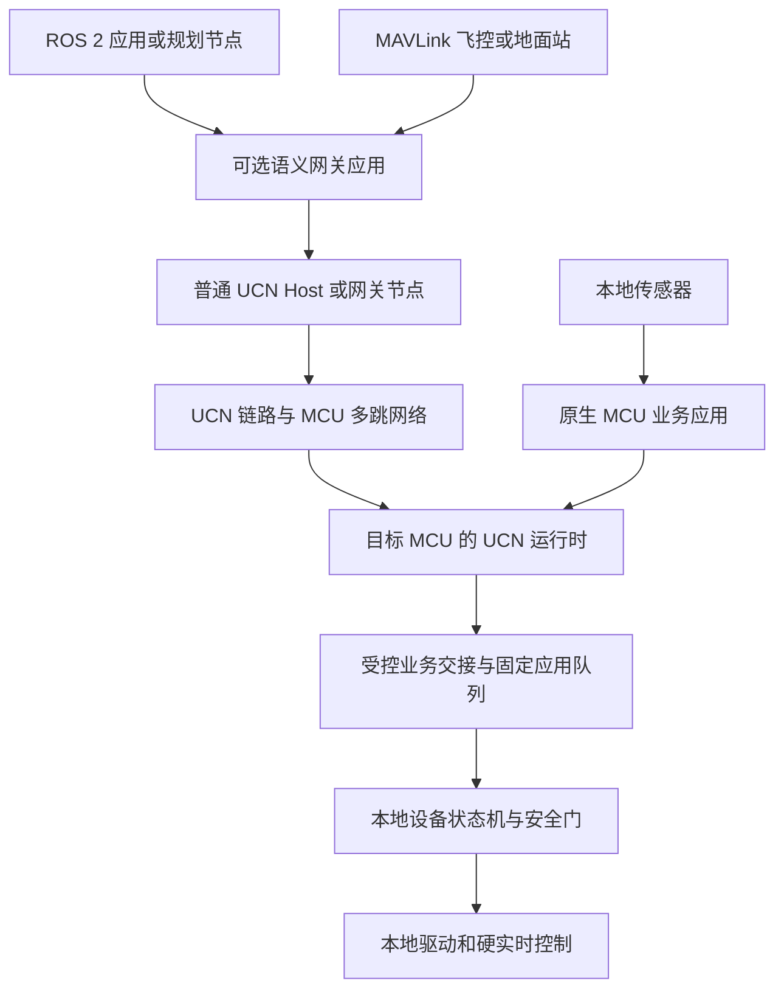
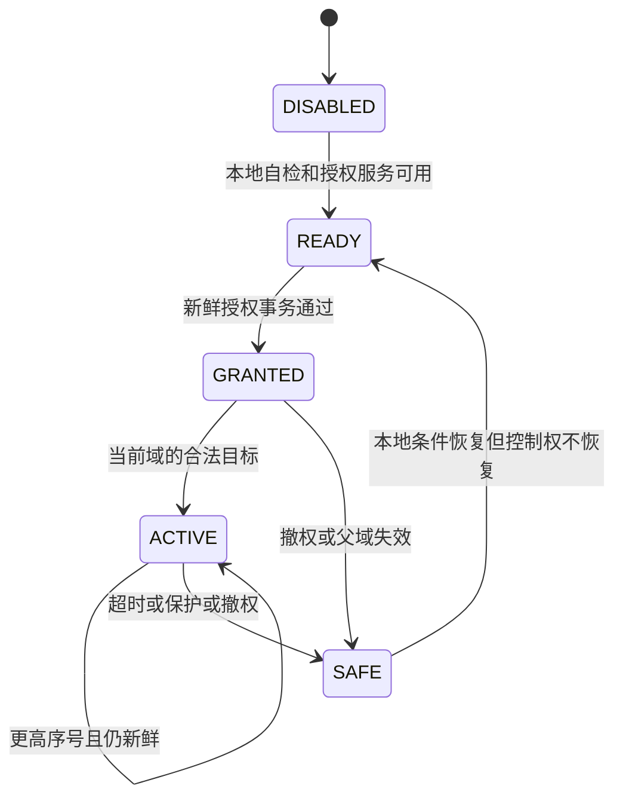
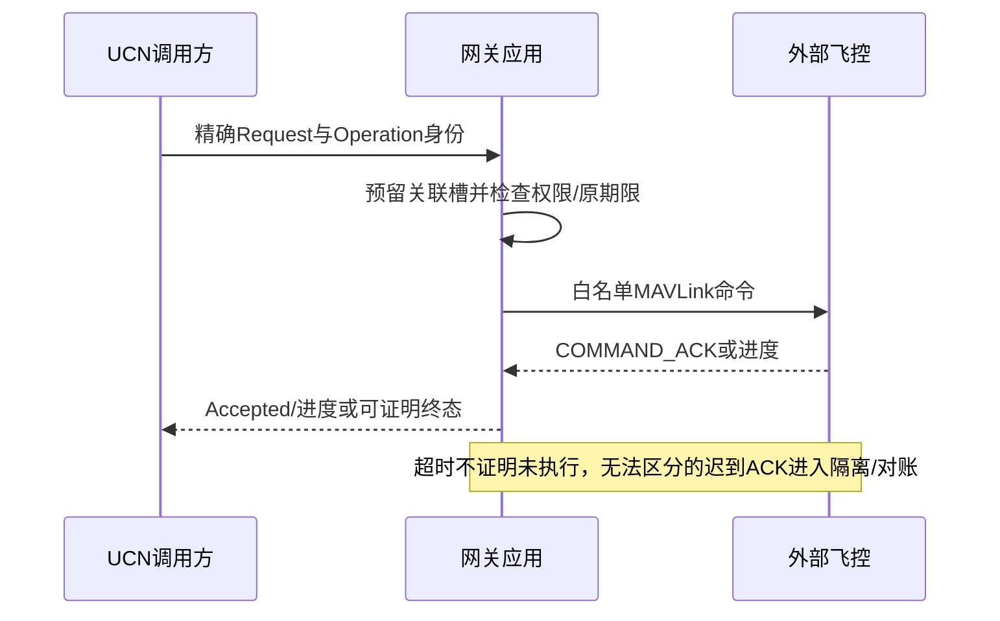

# UCN v6 无人机、机器人与其他设备详细对接方案

> 日期：2026-11-06。
> 状态：DESIGN PROPOSAL / SELF-REVIEWED / AWAITING USER REVIEW / NOT IMPLEMENTED。
> 范围：原生接入、MAVLink/ROS 2 网关、业务消息、安全和验收设计；不是产品使用完成声明。
> 本轮只写文档，不修改 C/Rust、Wire、API/ABI、Registry、Record、CMake 或测试，不操作实机。
> 核心约束：MCU-first、固定资源、可裁剪；普通 UCN 协议头新增 **0 B**。

## 1. 先看结论：设备适配留在核心之外

UCN 负责把授权消息送到正确的节点和服务，设备应用负责解释消息、决定能不能执行、
驱动具体硬件。无人机、机械臂、移动底盘、温度传感器不需要各自一套 UCN 核心。

推荐组合是“原生 MCU 接入 + 可选语义网关”。需要保留原 MAVLink 报文时，另外启用
受限隧道；不是让所有业务默认套两层协议。ROS 2 采用白名单语义映射，不把整个 DDS
网络透传进 MCU Mesh。

后续用户另选的[rmw_ucn详细设计](UCN_v6_rmw_ucn_ROS2中间件后端详细设计方案.md)
在ROS的RMW接口下实现UCN后端，使ROS节点继续使用原接口；本篇保留的是原生设备/
MAVLink和精简业务Schema的适配层，二者不混同。没有ROS的MCU仍不必加载RMW或CDR。

原生MCU的易用调用方式由[原生发布订阅及统一用户API方案](UCN_v6_原生发布订阅与统一用户API简化详细设计方案.md)
细化：优先Publisher/Subscription，保留最小send；业务Schema与控制安全仍归本篇，
不因接口变短就省略来源、控制权或实际执行前的时效检查。当前只是接口候选，不改代码。

本文沿用已有 MCU-first 思路，但旧知识库和旧 ROS 2 架构文档中的 v4/v5 API、性能数字、
Q0 用法不作为当前实现依据。当前源码、共同合同和明确的实现范围优先。

### 1.1 三种接入方式怎么选

| 方式 | 适用情况 | 消息在 UCN 内的形态 | 主要代价 |
| --- | --- | --- | --- |
| 原生接入 | 可修改 MCU/设备固件，需要最短路径和最少开销 | 产品定义的精简业务 Payload | 需要完成 BSP、消息与设备应用接线 |
| 语义网关 | 已有 MAVLink/ROS 2 系统，需要明确业务与权限映射 | 转换后的同一种精简业务 Payload | 网关承担转换、授权、关联和故障对账 |
| 完整 MAVLink 隧道 | 必须保留原报文与端点生态，暂时不做字段转换 | 完整 MAVLink 2 packet 作为 UCN Payload | 保留内层头/CRC/签名，命令关联与安全限制更严格 |

不采用的方案：向 Core 增加“无人机模式/机器人模式”、把 ROS Topic 字符串放进每帧头、
为所有普通 Data 增加设备类型、单位、坐标、时间戳或请求号。这会让无关节点永久支付费用。

### 1.2 本方案要达到什么，不承诺什么

目标是让同一套 UCN 支撑遥测、参数、配置、任务、带时效的控制目标和设备诊断。
不是让通信协议替代飞控、导航、关节控制器或安全控制器，也不承诺任意无线多跳的硬实时。

本方案不改变当前外审/生产/实机 HOLD；不授权安装 ROS 2、修改 PX4、接入真实执行器，
也不代表专用网关、消息包或示例已经实现。所有产品配置和消息布局在本文中均为候选。

## 2. 当前仓库能复用什么，哪些仍是工作

核对基线：`v6-simplified-rust@03eb7eb03098bfc7abd63f16e911e9d8fe45d26f` 加当前完整工作树。
HEAD 不是最新工作树内容的完整快照；本篇不把历史提交或自审数字当成设备对接证明。

| 部分 | 当前源码/合同事实 | 本方案不能据此声称 |
| --- | --- | --- |
| 公共通信入口 | C 有 init/start/step、Endpoint、publish、查询/取消接口 | 所有高级 Intent 已经接入同一公共入口 |
| Driver 边界 | C 有 RX publish、TX completion、Link event；Rust 有有界 Adapter | 各芯片 UART/CAN/无线 BSP 已经全部验收 |
| 安全与身份 | 已有 Session、Binding、ACL、Replay、Foundation 发布/回读语义 | 已有生产密码、密钥注入或合格的飞控身份系统 |
| Rust 运行时切片 | 已有认证入网/能力、路由 Data、RPC/Journal、邻居热接纳等链路 | 任意组合已经统一为完整产品 Node |
| C 模块 | 有各叶 Owner 和私有 Composition，部分 Control 分派已接线 | C 与 Rust 所有自动 Runtime 已等价闭环 |
| 时间/群组/簇 | 已有相关模块和部分软件闭环 | 硬件精度、群控、主备接管或跨簇生产链路已放行 |
| 专用桥接 | 已有 Host/Bridge 分层目标 | 已有可直接运行并验收的 MAVLink/ROS 2 适配包 |

源代码与共同合同入口：

- [C 公共 API](../../../include/ucn/ucn_core.h)、[C Driver 事实接口](../../../include/ucn/ucn_driver.h)。
- [Rust Runtime 导出与 Feature](../../../rust/crates/ucn-runtime/src/lib.rs)。
- [公共 API/内部 SPI 设计](UCN_v6_逻辑模型与伪代码/25-统一公共API与内部SPI冻结候选.md)。
- [C/Rust 共同合同](UCN_v6_C_Rust共用合同收口/README.md)。
- [邻居围栏与热续接合同](UCN_v6_C_Rust共用合同收口/19-邻居围栏真实排空与耐久后继Capability热交接合同.md)。

## 3. 总体分层、连接和信任终点



箭头是分层的数据流，不授权业务 Owner 直接调用 Persistence/Security/Adapter Owner。
跨 Owner 的 Requirement、View、Event、Proof 仍只由本机 Coordinator 路由。

| 层 | 负责 | 明确不负责 |
| --- | --- | --- |
| Core/Runtime | 帧、身份/会话、路由、传输、调度与退休 | 飞行模式、关节编号、ROS 名称、业务单位 |
| Product Port/Driver | 硬件收发、DMA/ISR、原子事实和完成 | 密码认证、业务执行、宣称对端动作已完成 |
| Device Application | 消息编解码、控制权、范围/时效、本地执行 | 绕过 Core 的 ACL/Replay/生命周期 |
| Gateway Application | 外部协议转换、映射、限流、事务关联 | 冒充原始 Principal、代替目标安全门 |
| 本地安全/控制 | 限幅、保护、看门狗、失联策略、闭环 | 依赖网关永远在线或无线永不丢包 |

网关是普通受控节点，不因运行 Linux、ROS 2 或连接地面站而获得隐式优先级、准入、
路由或 Cluster 权限。没有网关时，MCU 网络及其已配置的本地安全逻辑仍须独立工作。

## 4. 两种完全不同的“适配”

### 4.1 下行介质适配

把 UCN 完整帧送过 UART、CAN/CAN-FD、USB、无线或其他承载。负责 framing、MTU、
物理地址、缓冲所有权、非阻塞 submit、精确 completion 和 Link generation。

UART 不保证一次 DMA 就是一帧；CAN-FD 的 DLC/padding 与 Classic CAN 的 Carrier
分片不同。参考参数不替代真实控制器/SDK 验收。这里不解析飞行或机器人业务。

### 4.2 上行业务适配

把“速度目标”“读参数”“电池状态”等业务与 UCN Service 对接，或与 MAVLink/ROS 2
互相转换。这里才知道单位、坐标、设备状态和执行结果。

接上 CAN 线不等于支持 DroneCAN/CANopen，接上串口不等于支持 MAVLink。若对端已经
使用其他协议，必须有明确解析器/网关，不能把两种帧未经区分地塞给同一个 Decoder。

## 5. 原生接入：从启动到一次业务执行

### 5.1 一个设备如何划分节点和服务

通常一个 MCU 运行一个 UCN Node；它管理的 IMU、电池、电机或多个 RTOS 任务通过
不同 Service 区分。设备序列号/Principal、网络地址、Service ID、物理 CAN ID/串口号
属于不同命名空间，不能互相强制转换。

同一机器人包含多个 MCU 时，每个 MCU 可以是独立节点。大型 Linux 主机也可成为普通
节点，但不会替代这些 MCU 的本地协议状态与失联安全。

### 5.2 初始化和启动顺序

```text
产品初始化：
    固定目标平台、Profile、Feature、容量、消息 Manifest、密钥与身份配置
    分配静态 Node/应用队列/Driver/Provider 存储
    校验 Layout、编译 Manifest、接口版本、必需功能和资源
    配置真实 Port/Provider；应用执行器保持未授权状态
    依当前装配恢复所需耐久状态，发布当前有效身份与 Session
    注册已实现的 Service、策略、Link 和 Driver
    启动唯一协议调度；完成产品自检后才开放业务能力
```

这是目标集成顺序，不是把尚未统一的 C/Rust 高级入口写成已有的一次函数调用。
某能力未接线时返回不支持，不能 Advertise 为可用，更不能降级到明文或无时效控制。

### 5.3 运行时收发与应用队列

```text
Driver/ISR：
    收到完整帧及物理元数据 -> 发布原子 RX Fact -> 通知协议任务
    TX 有可信结果 -> 发布精确 token completion

协议任务：
    用固定预算运行 step
    Wire -> 当前 Security/Replay -> ACL/Capability -> 本地 Service 或中继
    低层 Endpoint 回调只检查和交接到预留的固定应用槽，随后返回

原生 SDK 应用 Executor（如果启用）：
    协议 gate 外领取事件，交接前复验原依赖/时效
    调用应用 Subscription/Service 回调；只提交有界 deferred 命令

设备任务：
    领取应用槽 -> 再验控制权/期限/状态/范围 -> 执行或拒绝
    如需结果，将真实业务结果交回协议发送入口
```

低层协议回调内不等待电机到位、不访问慢 Flash、不递归 publish 或修改 Node 生命周期。
新Facade的应用回调在协议gate外，可通过有界post入口发布结果/请求或逻辑close，
但不直接操作Owner、不递归step/dispatch、不在自身回调里等待close完成。直接采用
最小Endpoint而不装Facade的产品仍用第一种限制，不能以函数都叫callback就混用。
本地应用队列已满时明确拒绝，不能先说接纳成功再静默驱逐待执行命令。

从协议回调复制数据只完成缓冲交接，不等于设备执行。跨任务传递的是固定数据和精确
事务关联，不保存 callback scope、借用 Payload 指针或 Owner 私有可变指针。

### 5.4 当前公共 DTO 的限制不能被忽略

当前 C `ucn_endpoint_message_t` 包含 Source Address/Binding、Service、Payload 和接收时间，
不是完整的原始 Principal/Session/授权决策凭证。应用不能看见地址就自行宣称认证成功。

受保护设备接入必须由真实 Security/ACL/use-time 门禁产生受控交接，并把产品所需的
当前身份、会话、策略及授权关联保存在本地不可伪造的映射/交接上下文中。若现有入口不能
提供这条证据链，应阻塞该产品路径；不能让 Driver、Payload 中的 sender 字符串或裸
`authorized=true` 替代它。是否需要扩展只读应用 API，留给后续独立接口审查，不改 Wire。

## 6. 业务消息如何设计，避免再造通用大头

### 6.1 一个 Service 尽量对应一种固定语义

使用产品静态 Manifest 固定 `Service + 方向/Role -> Schema/版本/策略/处理器`；OneWay
通道固定单Schema，RPC按现有Role绑定确定的Request与Result/Error类型对，不另加
通用类型字段。普通状态不必
每帧重复设备名、Topic、JSON key、类型字符串、单位、Schema Hash 和版本。

不同语义或不兼容 Schema 使用不同候选 Service 映射，或在明确的应用协商中切换；不得
按收到的长度猜版本。Service 数值在产品 Manifest 分配，本文符号不是新注册的协议 Opcode。

| 候选符号 | 业务 | 形式 | 默认传输意图 |
| --- | --- | --- | --- |
| APP_HEALTH_V1 | 电池/温度/故障摘要 | OneWay Data | BestEffort/Latest，按需限频 |
| APP_VECTOR3_MM_V1 | 固定坐标的三维位置 | OneWay Data | Latest，可选同步采样时间 |
| APP_BASE_TWIST_V1 | 底盘速度目标 | OneWay Data | Latest、严格短时效、授权控制权 |
| APP_PARAMETER_READ_V1 | 读取指定白名单参数 | Request/Result | 有界请求；通常可重复 |
| APP_PARAMETER_SET_V1 | 绝对值配置更新 | Request/Result | 去重；确需耐久再启用 Journal |
| APP_TASK_V1 | 任务接纳/查询/取消 | Request/Result 与独立进度 | 有限事务，不能把接纳当完成 |
| APP_DIAGNOSTIC_V1 | 低权限统计/日志块 | Request 或 Transfer | Q2/Q3限流，不挤占控制份额 |

名称只描述业务；不会要求核心识别 APP_BASE_TWIST 或加载机器人 SDK。

### 6.2 精确 Payload 示例一：设备健康摘要，16 B

以下布局为应用候选，使用显式 big-endian 编解码，不传输 C/Rust struct padding。

| offset | 字节 | 类型 | 字段与含义 |
| ---: | ---: | --- | --- |
| 0 | 4 | u32be | voltage_mv，毫伏 |
| 4 | 4 | i32be | current_ma，正方向由该 Schema 固定 |
| 8 | 2 | i16be | temperature_centi_c，摄氏度乘100 |
| 10 | 1 | u8 | device_mode，产品冻结合法枚举 |
| 11 | 1 | u8 | health_flags，未定义位必须零 |
| 12 | 4 | u32be | fault_bitmap，产品冻结含义 |

精确长度16；非法枚举、保留位或数值超出已声明传感器量程时拒绝，不把未知温度编码成0。
若传感器允许缺测，必须在 Schema 中冻结有效位或保留哨兵；本示例要求字段均有效，
不能完整测得时不发该 Schema，改报已有的故障/有效性消息。

### 6.3 精确 Payload 示例二：三维位置，12 B

`x_mm:i32be || y_mm:i32be || z_mm:i32be`，共12 B。坐标基准、原点、轴向和可用范围
在 Manifest 固定；帧中不重复 frame_id 字符串。

这个12 B Schema的参考系/原点在一个完整端到端Origin Session内不可变。动态改变时，
默认使用另一个明确绑定新Schema/参考系的Service；或者让受影响双方围栏旧业务与旧
Origin Session，清理旧应用交接，再发布真实的新Session并安装一致的新配置。新配置
下必须能按Service或认证Session区分并拒绝所有旧在途帧，旧Service不得立即复用。

只有“配置代际增加+消费者ACK”或本地drain不够：网络里仍可能有未收到、重放窗口尚未
见过的合法旧帧。不能证明旧帧隔离时，停止该服务；若确需同Service/Session动态换原点，
另选在该业务Payload内携带精确参考系/配置代际的专用Schema，并单独计算这项费用。
这不增加普通Header，也不能按长度猜版本。

### 6.4 精确 Payload 示例三：带控制域的底盘目标，20 B

| offset | 字节 | 类型 | 含义 |
| ---: | ---: | --- | --- |
| 0 | 4 | u32be | control_epoch，目标设备本次授权控制域 |
| 4 | 4 | u32be | setpoint_sequence，该控制域内严格递增 |
| 8 | 4 | i32be | vx_mm_s |
| 12 | 4 | i32be | vy_mm_s，不支持侧向运动的底盘必须为0 |
| 16 | 4 | i32be | wz_mrad_s |

前8 B只由这个需要独立控制权/排序的应用 Schema 支付，不加入普通 UCN Header，也不
强迫传感器消息携带。序号耗尽必须停止并重新取得控制域，不回绕。

`control_epoch` 不是 UCN Session/Cluster Term，也不是持久化全局 Epoch。它只在目标
当前完整授权上下文内唯一，必须同时绑定当前目标启动实例、控制者 Principal、Session、
Binding、Service、策略代际和原始截止期；任何父域改变即失效。目标重启后默认无控制权，
必须完成由本端新鲜 challenge 绑定的新授权，不能仅靠 RAM epoch 重新从1开始接旧命令。
若不能证明启动 challenge 新鲜，则保持禁用，而非假定一个随机数绝不会重复。

新鲜challenge只证明这次授权事务新鲜，不会自动进入20 B目标的认证内容。**同一仍
可接纳旧数据的完整Origin父域内，control_epoch绝不重用。** 例如业务控制任务重启，
但UCN Root/Session未变：重新授权即使有新challenge，也不得把epoch重置为1并接受
旧的`epoch=1, sequence=100`未见过在途目标。

首期由独立产品安全Owner保存每服务单调分配高水位；其生命期覆盖业务任务重启和
撤权重授，不把该字段塞入普通Core。每次grant预留新的非零epoch，旧值不回收，
耗尽保持禁用。产品安全Owner自己重启/状态丢失时，只允许以下可证明方式之一恢复：

- 先围栏所有受影响旧Origin上下文，安装真实新的端到端Session/Binding认证域，
  证明所有旧目标不能在新域通过；此时才开启新的控制epoch分配域。
- 或从受保护耐久高水位恢复并严格单调分配control_epoch；原授权仍撤销，必须重授。
- 若产品确需其他模型，另审携带可认证控制代际的专用业务Schema，并单独计算费用。

仅重启应用、更新本地映射/启动实例、重新收到grant ACK或本机drain均不够。不能证明
隔离就禁用远程控制。20 B候选在上述前提成立时保持20 B，不给其他消息加代际字段。

### 6.5 RPC、时间和分片不重复包裹

- Request/Result 复用共同合同的条件 Envelope：Request 为9 B，Result/Error为11 B；
  普通 OneWay 为0 B，不再套一个应用 request_id/type/flags 通用头。
- 需要业务持久 ID 时使用现有 Operation 身份/Journal；不要再用 MAVLink seq、ROS 请求
  序号或 Driver Token 代替它。各命名空间只有本地精确关联，不能强转为同一个 ID。
- 选择已实现的 Timed 组合时复用16 B Envelope，不再重复 capture_time 字段；若当前
  Runtime 不支持该组合，则拒绝，不凭空添加第二种时间格式。
- 需要 Transfer 时使用现有 Setup/Fragment/SACK，不给每片重复加业务 Schema 说明。
- 未定长数组必须有已冻结的最大长度；不得从网络长度分配无限内存或直接反序列化指针。

## 7. 控制命令：授权、时效与真实执行

### 7.1 三种权限必须分开

1. 网络准入：这个节点能否建立有效 Session。
2. Service 权限：这个身份能否读/写这个业务服务和动作。
3. 设备控制权：当前谁可以驱动这台设备、在什么模式和时间范围内。

通过前两项也不能直接跳过第三项。Cluster Head、最高算力节点、ROS 发布者或有密码的
地面站，都不因此自动获得设备控制权。

### 7.2 控制权候选状态机



控制权取得/释放是低频应用事务，使用精确 Request/Result 和本地状态检查。目标在可信
本地单调时钟上捕获授权起点、构造有上限的半开期限；重复请求不刷新期限。发送端收到
延迟授权结果不代表又得到完整租期；只有目标本地的原截止期具有执行裁决效力。

控制者更换、网关重启、Session/Binding/策略变化时撤销旧域。旧 TX 物理排空与新 Session
ACTIVE 不会自动恢复旧设备控制权；恢复必须重新授权。

### 7.3 连续目标不应按命令重试排成旧动作队列

底盘速度、姿态目标等连续流采用 Latest、有限队列和严格新鲜度。目标只接纳比当前
control_epoch 内最后已接纳 setpoint_sequence 更大的值；拒绝重复和乱序，不刷新看门狗。

接纳水位`last_admitted`与设备应用水位`last_applied`分开：入队前验证序号更大，资源/
值域/授权/时间都通过后才提交接纳水位。设备任务再次检查同域且序号大于last_applied，
成功采用后更新last_applied。不能把“序号必须大于last_admitted”再用于执行同一条
已接纳命令，否则所有有效命令都会被自身水位拒绝。新Latest覆盖未执行旧目标后，旧项
不得反向执行；被拒绝或仅入队的消息不能提前刷新控制执行看门狗。

只有通过身份、范围、序号、时间与本地状态门禁的新目标，才更新“最近有效控制输入”。
Heartbeat、重放包、未知 Service、认证失败和被限流消息都不能给控制看门狗续命。
本文的“最近有效控制输入”以设备实际采用的last_applied对应时刻为准；协议接纳时间
另记，不因为业务任务阻塞但网络不断入队就保持执行授权。

第一次收到一个包并不证明它刚被采样。跨网络的运动目标必须采用可验证的年龄/Domain
规则；若没有可信时钟映射，只能保证本地接收后的保留时长，不能承诺源端年龄。
默认禁用要求严格源端时效的远程控制；产品若选择受控本地链路降级，必须另审其时间与
安全前提，不能在 PREFERRED 下静默放行过期控制。

### 7.4 一次动作和完成层级

| 事实 | 只能说明 | 不能说明 |
| --- | --- | --- |
| 本地提交成功 | 有限资源接纳请求 | 已经上链路或对端收到 |
| Driver completion | 本机物理提交达到该 Driver 定义的结果 | 目标业务已运行 |
| 传输 ACK | 对端到达指定传输接纳点 | 已解锁、已停机、已到位 |
| 业务 Accepted | 设备接受请求或准备尝试 | 物理动作完成 |
| InProgress | 设备报告仍在执行 | 最终成功 |
| 业务 Completed | 精确请求对应的终态证据已成立 | 设备以后永远保持该状态 |

掉电后执行是否发生无法证明时，保留 IN_DOUBT。只有执行器副作用与 Journal 可原子提交，
或执行器支持按精确 ID 查询/对账，才能提供更强的执行结果保证。网关 Journal 本身不能
把一个不能对账的外部飞控变成 durable exactly-once 执行器。

## 8. 无人机、机器人及其他设备的产品配置

| 配置候选 | 先开放的业务 | 必需边界 | 默认不开放 |
| --- | --- | --- | --- |
| 无人机遥测 | 电池、姿态、位置、故障、参数只读 | 合法来源、Schema/坐标/时间、限频 | 解锁、模式切换、执行器直控 |
| 无人机高层任务 | 经过白名单的任务/航点/任务状态 | 飞控本地状态检查、命令关联、取消与超时对账 | 用通信接管姿态内环、承诺任意多跳飞行控制 |
| 移动机器人底盘 | 状态、有限速度目标、停机请求 | 控制权、速度/加速度限制、本地失联保护 | 无期限 Twist、连接恢复后自动重播旧速度 |
| 机械臂/关节设备 | 状态、参数、经过本地规划的高层目标 | 关节/工作空间限制、本地碰撞/驱动保护 | 经网关逐PWM/电流环闭环 |
| 传感器/仪表 | 固定单位的测量值、故障、参数 | 量程/有效性、采样含义、固定 Schema | 自动开放写参数和校准 |
| 电源/BMS/继电器 | 状态和明确的受限动作 | 危险动作独立授权、互锁、执行反馈 | 按任意网络输入直接通断负载 |

这些是产品裁剪建议，不是芯片资源或设备安全认证。相同业务可以由不同设备实现，
不同设备只装需要的 Service；不因此引入新的 Core 模块。

远程停机请求只能作为额外控制通道；不能把 UCN、普通无线或网关的送达当作合格急停链路。
飞控/机器人失联后的具体行为由设备产品安全设计决定，本文不统一规定返航、刹车或断电。

## 9. MAVLink 语义网关：把业务转换，而不是冒充飞控

### 9.1 系统角色与两种方向

```text
已有飞控 -> MAVLink 解析/身份与白名单 -> 网关 UCN Service -> UCN 用户/设备
UCN 用户 -> 网关 UCN Service -> 目标/动作授权 -> MAVLink 命令 -> 已有飞控
```

网关可以运行在独立 MCU 或主机进程；是否同板不改变信任边界。实现必须固定支持的
MAVLink版本、dialect/XML摘要、目标固件版本、允许 msgid/command、帧长和扩展字段规则。
使用对应生成器的解析器，不以 UCN 的 big-endian Decoder 解析 MAVLink 原始 Payload。

MAVLink 多字节字段按 little-endian 序列化；转换为本方案原生业务后才用对应的
big-endian Schema，不能直接 memcpy 原始结构体。[MAVLink序列化说明](https://mavlink.io/en/guide/serialization.html)。

### 9.2 目标与身份映射

本地固定映射必须区分：

`受信输入通道/认证域 + 外部设备绑定实例 + sysid + compid -> UCN服务与设备绑定`。

sysid/compid/HEARTBEAT 是协议寻址/存在提示，不是设备密码身份。遇到重复 sysid、
更换飞控、连接重建或无法确定启动实例时，进入隔离，撤销相关业务与控制权；不按
“最近收到的设备”自动改写目标。[Heartbeat官方定义](https://mavlink.io/en/services/heartbeat.html)。

外部设备没有可验证身份时，应显式标为“产品信任的本地物理端口代理设备”；其可信上限
来自该端口和网关，而不是伪造一个与原生 UCN Principal 等强的设备身份。

### 9.3 白名单映射示例

| 外部消息/服务 | 可映射业务 | 转换要求 |
| --- | --- | --- |
| HEARTBEAT | 低频存在/模式提示 | 不映射为 UCN Authority、控制授权或执行器看门狗续期 |
| ATTITUDE 类消息 | 固定姿态服务 | 明确单位、角度定义、参考系、采样时钟；不猜测时效 |
| LOCAL_POSITION_NED 类消息 | 固定参考系位置服务 | 明确原点/重置代际，按映射转换到约定坐标 |
| 电池/系统状态 | APP_HEALTH或设备专用状态 | 有效性、缩放、未知值显式转换；不把未知置0 |
| 参数微服务 | 白名单参数读/写 | 参数名到固定ID，类型、范围、权限、读回一致性 |
| COMMAND_INT/LONG与ACK | 精确设备动作和状态 | 每个命令单独白名单，区分Accepted/InProgress/终态 |
| Mission等多阶段微服务 | 后续独立适配 | 不当作一个COMMAND_ACK事务泛化处理 |

只看到消息类型名字不够：各固件的具体支持、坐标、参数和执行条件必须在产品映射中冻结。
解锁、模式切换、导航和执行器动作默认关闭，只能按设备逐项审查后启用。

### 9.4 命令关联与迟到 ACK

MAVLink COMMAND_ACK 不携带 UCN OperationId。网关必须保存固定关联槽：UCN精确请求键、
目标完整绑定、命令值、参数、当前外部连接实例、原截止期、状态和允许的重试规则。

默认按“目标设备实例+command”串行化，不并发发送无法区分 ACK 的同类事务。即使串行化，
上一事务的迟到/重复ACK仍可能撞上下一同类请求，上一事务成功、拒绝或取消也不证明
线上ACK排空；仅增加本地 connection_generation 不能证明线上包属于哪个实例。

**所有已发送事务的lane复用均要有隔离/关联证据，不只是超时事务。** 原始COMMAND_ACK
没有UCN OperationId或完整参数；新外层seq/签名时间也不证明它属于哪一次业务请求。
精确事务模式仅在设备协议能给出可验证请求关联，或受审的隔离/对账流程能消除歧义时
启用。缺少证据时，该动作适配返回Unsupported，或在已可能发送后保持IN_DOUBT/lane隔离，
不得把下一普通ACK当新请求的结果。固定等待几秒、成功终态或本地重开串口都不是证据。

允许另行定义的“可重复目标状态”业务只能报告目标当前观测/一致性，不承诺某一请求
造成了动作；必须冻结幂等、观测新鲜度与参数变化规则。它不能被包装成精确一次性动作。
Manifest为有限的command集合预留lane，隔离后不靠换槽抹去历史；容量满明确拒绝。



官方命令协议中，通常的 Accepted 不保证动作完成；长运行命令有进度和终态机制。
本方案保留这种区别，不把 UCN 可靠投递包装成飞控执行成功。
[MAVLink命令协议](https://mavlink.io/en/services/command.html)。

MAVLink侧需要重试时由该微服务唯一管理，次数和期限受产品冻结；UCN侧的传输重试只
重发精确请求，网关重复收到同Operation不再创建外部执行。两层不能各自生成新动作。
不可证明幂等/对账能力的危险动作不自动重试，超时只报告状态不确定。

### 9.5 取消、重启和配置写入

取消只记录请求并向支持的外部机制传递；未收到可信取消终态，不能宣称动作已撤销。
网关重启后先恢复/核查耐久关联，将已可能提交而未知的外部动作置IN_DOUBT，不重复执行。
若产品选择不使用耐久关联，必须明确“不保证网关重启后的去重”，并禁用需要该承诺的动作。

参数“已发送”“已接纳”“读回等于目标”“已耐久保存”是四种不同结果。不能按最后一次
遥测恰好相同就断言本请求完成；需固定相同请求关联与设备微服务的完成证据。

## 10. MAVLink 完整报文隧道：保留，但不作为省开销默认

### 10.1 隧道准确做什么

将一个完整 MAVLink 2 packet 作为受限 Service 的 OneWay业务内容，目标网关校验后恢复
原字节。默认一包一消息，不附加通用 tunnel header；通道/dialect/方向由固定映射确定。
超过有效 Payload Budget 时使用既有 Transfer，不能假定完整最大报文总能放进单帧。

完整 packet 包含原头、Payload、CRC和可能的签名，不删除签名来省字节，不改写签名覆盖
的 sysid/compid/seq/内容。完整签名不等于加密，机密性另由 UCN/物理链路策略保证。
[MAVLink签名说明](https://mavlink.io/en/guide/message_signing.html)。

### 10.2 透明不等于不设权限

隧道固定绑定一个外部通道与目标集合；进入和退出两侧都按方向/msgid/command白名单
校验。命令可在内层Payload指定目标，不能只检查外层UCN目的地。广播动作默认拒绝。
不认识dialect或不能完整判断目的/动作的命令拒绝，不以“原字节转发”为理由放行。

密钥配置类消息如SETUP_SIGNING不进入普通隧道、日志或广播；设备密钥注入使用独立
产品维护流程，不能把线上设置密钥当成通用业务。[MAVLink密钥管理规则](https://mavlink.io/en/guide/message_signing.html)。

### 10.3 一条链路只选一个命令所有者

隧道模式保留端点MAVLink微服务的命令/重试语义；UCN只是承载，不能同时由语义网关
再执行相同命令。每个方向和通道在Manifest中互斥选择隧道或语义转换，防止双发。

MAVLink端到端签名能保留其原认证域，但不会自动赋予MCU内的UCN ACL原操作者身份。
如目标只是透明网关，应明确最终MAVLink设备及其策略是动作权限的最后裁决点。

## 11. ROS 2 语义网关：有限映射，而不是全图复制

### 11.1 部署关系

本节只讨论显式语义网关；替换ROS通信后端的接口/Graph/类型/QoS设计由
[rmw_ucn方案](UCN_v6_rmw_ucn_ROS2中间件后端详细设计方案.md)独立负责，不在本节假装已有实现。

ROS 2在网关进程外部运行；网关作为ROS参与者及普通UCN节点。Core不链接rclcpp/rclpy、
DDS或ROS消息生成器。小MCU不保存Topic字符串、全ROS Graph或DDS发现状态。

网关只建立已配置的Topic/Service/Action映射，禁止收到新名称就动态创建无限订阅、
服务、缓存或UCN Endpoint。多个机器人用固定命名空间与目标绑定隔离，不自动合并同名Topic。

### 11.2 Topic、Service、Action不能互相冒充

| ROS接口 | 适用的UCN语义 | 必须补的边界 |
| --- | --- | --- |
| 遥测Topic | OneWay/Latest Data | 类型、方向、频率、有效性、参考系和时间 |
| 速度目标Topic | 专用目标Service的Latest流 | 控制权/序号/时效/本地限幅，不缓存旧动作给后来者 |
| 读参数Service | Request/Result | ROS请求关联映射到精确UCN请求；容量满显式失败 |
| 写参数Service | 受权Request/Result | 去重/耐久按需，不能假定DDS可靠就只执行一次 |
| 长任务Action | 任务接纳、进度、取消、结果 | ROS Goal与UCN Operation本地关联，分别处理取消请求与完成 |

网关关联键至少包含受信输入上下文、ROS完整Service请求身份或Action Goal UUID、当前
网关启动/映射代际、精确UCN请求键与摘要、目标完整绑定、原期限和状态。只存请求号或
Topic名称不够。迟到ROS future/Action反馈只有精确键仍匹配才可更新；槽generation推进
后旧回调拒绝。丢失关联或重启无法恢复时报告不确定，不把新Goal与旧Operation自动拼接。

默认只桥必要字段，例如不把完整ROS Header、长frame_id、所有协方差和未使用字段每次
复制到MCU。删除字段必须保持业务语义：若算法依赖协方差，就采用包含它的专用Schema，
不能把缺省0伪装成完全确定。

### 11.3 身份：Topic名和发布者名称不是授权凭证

安全部署可使用受支持RMW的DDS-Security/SROS 2配置，固定enclave、证书与权限，失败
采用强制策略，不静默无安全启动；具体发行版和RMW能力由产品测试冻结。
[ROS 2官方安全说明源码](https://raw.githubusercontent.com/ros2/ros2_documentation/jazzy/source/Concepts/Intermediate/About-Security.rst)。

但同一安全enclave可能容纳多个节点；普通订阅回调不当然给出可供UCN验证的逐操作者
身份。网关不能因消息来自`/cmd_vel`或某个node_name，就把Payload中的用户名当授权者。

默认安全模型：目标MCU信任具有明确角色的网关Principal，网关对其允许的上游发布者负责。
若必须区分多个操作者，采用隔离的安全上下文/入口、产品认证会话或专用应用签名消息，
并明确绑定方法。不能宣称DDS认证身份自动穿透协议转换后仍被UCN端到端验证。

### 11.4 防止环路与数据自激

每条映射固定一个方向；同一语义如需双向，必须定义不同输入/输出端点及精确关联。
来自UCN重新发布的ROS样本不能再次被同网关当新上游输入。默认采用单向图和独立
命名空间，而不是为每个普通UCN帧加bridge_id或hop-list。

多个网关向同一执行器发目标时，目标的单一控制权门裁决；只选出Cluster Head不够。
重启不自动重播运动命令；配置或地图类静态数据的重放也必须服从产品版本策略。

## 12. QoS 映射与有界资源

ROS 2 QoS中的deadline描述发布间隔期望，lifespan描述样本过期；与UCN“执行前截止”
不是同一个合同。reliable也不证明业务副作用完成。
[ROS 2官方QoS说明源码](https://raw.githubusercontent.com/ros2/ros2_documentation/jazzy/source/Concepts/Intermediate/About-Quality-of-Service-Settings.rst)。

| 输入/业务 | 网关策略 | UCN侧候选 |
| --- | --- | --- |
| 高频状态 | 固定采样/限频，KeepLast有限深度，丢弃旧值 | Latest/Q1，按Service固定公平份额 |
| 连续控制目标 | Volatile、最新值、不允许历史补发 | Latest/Q1，严格时效与控制权 |
| 配置/查询 | 有界关联槽、有限超时 | Request/Result，Q2，按需Reliable |
| 日志/大块 | 限速与有限Transfer窗口 | Q3，不能借空关键控制保留份额 |
| 协议控制 | 由UCN内部协议产生 | Q0内部保留，外部业务不得自行提权 |

ROS可靠输入遇到UCN BestEffort出口时是语义损失；必须显式配置并向用户声明，不能把
跨桥链路称为“端到端可靠”。不兼容QoS、缺少必需模块或不足预算时明确拒绝，不静默降级。

传感器可用小队列/BestEffort；动作命令不使用TransientLocal补发。DDS保留历史不等于
UCN耐久Operation，ROS服务/Action也不自然提供外部执行器的掉电exactly-once。

网关所有映射、事务槽、日志、数组、重试、Topic和队列都有编译期或启动期固定上限。
Host可以使用其生态运行时内存，但必须有产品总量上限；这不改变MCU核心固定容量合同。
每次step有分类预算和持久轮转游标，持续ROS或MAVLink洪泛不能饿死Token退休/超时/撤权。

## 13. 时间、坐标和数值转换必须有完整来历

### 13.1 时间不能按字段宽度硬转

以下时间互不等价：MCU本地uptime、UCN Domain、ROS system/steady/sim time、飞控启动
时间、MAVLink签名时间戳、Driver收包时间、传感器采样时间。未建立有界映射时不相减。

网关重发不能把原样本的capture_time改成“现在”，否则过期控制会被洗成新消息。入口没有
源采样时间时，只能标注“网关接收时刻”和已知局部界，不能制造源端实时性证明。

确定的桥内排队/转发经过时间计入年龄，时钟映射/采样/量化等误差计入uncertainty，
二者分别列账；不能只在uncertainty中模糊提一次排队，随后用新capture_time把原年龄
清零。原生Timed或RMW有限Lifespan均保留相同原始事件的锚点，后续交接继续累计。

接纳前和业务副作用前分别检查；目标执行时须满足已有时间合同的严格半开年龄界，
总年龄不得漏掉桥内排队，组合uncertainty不得漏掉时钟映射误差和必要的采样不确定度。总误差未知时
不能生成DOMAIN_TIME_VALID或声称REQUIRED实时满足；模拟时间倒退/暂停必须撤销对应映射。

### 13.2 ROS坐标与飞控坐标

每条映射冻结轴向、左右手、参考系原点、重置代际、单位、四元数顺序和角速度定义。
ROS常见约定见[REP-103官方源码](https://github.com/ros-infrastructure/rep/blob/master/rep-0103.rst)，
`map/odom/base_link`的不同语义见[REP-105官方源码](https://raw.githubusercontent.com/ros-infrastructure/rep/master/rep-0105.rst)。

例如明确声明输入为NED、输出为同原点ENU时，位置变换才是`(e,n,-d)`；不能在未知
参考系时机械交换轴。若输入机体FRD、输出FLU，则是`(f,-r,-d)`。姿态需要同时处理
世界/机体系旋转及四元数约定，不能只给某一分量改符号；用已知基向量/旋转做Golden。

当前位置原点改变不能让旧轨迹继续执行。原点、TF来源或配置代际不明时，拒绝运动目标。
产品可在启动配置中确定参考系以省逐帧字段，但必须有受控的失效和重新确认流程。

### 13.3 数值和信息损失

float转定点必须checked-range、明确舍入；NaN/Inf、溢出、未知值不能静默变0或截断。
度/弧度、毫米/米、电流方向和高度基准均需Golden。所有额外误差要进入产品接受界，
不把低开销编码说成无损。C/Rust共享同一字节向量，不用各自struct roundtrip证明正确。

## 14. 安全边界与网关威胁模型

### 14.1 语义转换会终止原端到端安全域

```text
外部应用 -- 外部协议认证域 --> 网关
网关 -- 网关自己的UCN Session/Principal --> 目标设备
```

网关解析/修改业务后，目标UCN验证的是网关Origin。两边都加密不意味着外部操作者到
执行器之间存在同一条端到端身份保证。网关必须进入可信计算基；被攻陷时其授权范围内
动作可能被滥用，因此权限必须最小化，目标仍做范围/状态/控制权检查。

若产品不信任网关，不能同时要求它任意转换密文：只能选择端到端原生UCN、不改字节的
受保护隧道，或仅对需要的应用命令采用额外签名/授权正文。后者只增加该业务Payload，
需另审认证格式、重放域和密钥，不自动成为普通Header字段。

### 14.2 产品权限表至少区分这些角色

| 角色候选 | 允许 | 默认禁止 |
| --- | --- | --- |
| observer | 读状态/有限诊断 | 写参数、控制、密钥配置 |
| maintainer | 白名单配置/维护流程 | 未经本地条件的运行控制 |
| operator | 已授权设备的指定高层动作 | 扩大目标范围、绕过模式/保护 |
| controller | 当前控制域内有限目标流 | 长期占有、换Session续旧租期 |
| provisioning | 离线/独立受控凭据注入 | 普通在线隧道、遥测日志转发密钥 |

角色只在应用Policy/现有ACL授权组合中存在；不是新增Core角色位。设备安全规则必须
在目标端最终检查，不完全依赖网关白名单。Cluster Authority与这些角色互不等价。

### 14.3 入站校验顺序

```text
物理完整帧/来源元数据
 -> 严格Wire及当前Session/Binding
 -> 密码验证与Replay预留
 -> Service/方向/Opcode ACL与实际Capability/路径门禁
 -> 固定Schema/长度/资源预检及精确交接
 -> 在既有事务边界提交Replay，保存应用义务
 -> 设备任务再次检查时效/控制权/本地状态/范围
 -> 执行并报告精确结果
```

先后顺序必须遵循各现有Owner事务合同，不为本方案添加第二个Replay表。重复包可以
查询保留的回执，但不得再次执行；业务失败不能导致旧身份或旧操作被重新当新请求。

### 14.4 管理和日志

新映射/ACL/目标更换是受控配置事务：验证完整candidate、停止受影响接纳、排空真实
义务、撤销旧控制域，再发布新配置代际。表满不驱逐正在执行或IN_DOUBT的关联槽。

上述排空只处理本机真实Holder，不证明网络没有旧字节；改变业务含义时还必须执行6.3的
Service/Origin Session隔离或专用Payload代际绑定，不能让旧配置帧在新配置下获得新语义。

日志至少记录映射版本、设备绑定、请求身份、各完成层级、超时和权限拒绝；不记录密钥、
完整敏感业务或可复用凭据。日志预算固定，失败不阻塞协议任务；遥测诊断也受权限与限速。

## 15. 故障与恢复：不能把重连当成新鲜证明

| 情形 | 正确行为 | 禁止行为 |
| --- | --- | --- |
| MCU链路断开 | 精确失效相关路径/授权，本地安全策略处理 | 依赖Linux下发停机才进入安全态 |
| ROS/网关退出 | MCU通信独立；受其控制的业务按本地期限退出 | 恢复后重播最后速度或旧任务 |
| Driver结果Unknown | 保留原Token/缓冲义务，按合同隔离/对账 | cancel返回成功就宣称物理退休 |
| Session后继就绪 | 旧登记围栏、真实排空、新认证Capability、显式热接纳 | 删除旧槽/重建Root绕过Unknown |
| 外部飞控重启 | 撤销控制/关联，重新确认设备绑定和状态 | 只看同sysid就接上旧事务 |
| 网关配置更换 | 原配置事务排空，目标控制域重新授权 | 新映射继承旧Pending/结果 |
| 时间失锁/漂移未知 | 停止要求可靠源端年龄的控制，回报原因 | 用当前接收时间刷新过期Payload |
| 群控部分成功 | 各设备独立回执、报告部分/未知 | 一台ACK就称全体执行 |
| 簇主切换 | 重验网络Authority及应用控制权，重新授权 | 新Head自动获得所有执行器权限 |

### 15.1 热续接不得遗失外部动作义务

现有邻居drain仅证明特定Root内部Control/Data/App/relay/RX义务排空，不包括网关的
MAVLink事务、ROS Action或外部执行器。网关必须另有有界关联账本；在其未确定终态时
不能释放对应槽。网络Session更换与业务Operation对账是两条独立生命周期。

如果当前运行时不能在单一Ingress和有界调度下协调这些义务，保持该集成路径禁用；
不能让CapabilityRuntime、DataRoot、网关各自并发claim同一个Adapter RX队列。

## 16. 字节、CPU和内存费用怎样计算

### 16.1 不变的普通协议开销

本方案对Core Header、Protocol Opcode和安全Tag新增0 B。应用未启用设备集成时，
不得多链接MAVLink/ROS SDK，不增加普通节点Owner/队列字段，不运行额外后台任务。

当前C1固定费用公式为`9 + 2*w`，其中w是单个地址字节数；A0/A1/A2/A3分别为
11/13/15/17 B。O1的16 B Origin Tag、H1的4 B序号+12 B Tag按现有组合另计；
不是所有报文都固定携带这些组合，也不能为省字节违反产品安全下限。

依据：[当前Rust C1 Codec](../../../rust/crates/ucn-wire/src/c1.rs)、
[共同Origin/Hop合同](UCN_v6_C_Rust共用合同收口/18-直连多跳统一Origin与HopContext接线合同.md)。

### 16.2 同一示例的费用账

下表只算UCN逻辑帧，不算Carrier、PHY、总线仲裁、反向ACK、控制握手、丢包重传与切路。
假设A1 C1/O1/H1、OneWay、单帧、无其他Envelope，固定费用为`13+16+16=45 B`。

| 场景 | 纯业务或内层内容 | UCN逻辑帧 | 本方案额外普通Header |
| --- | ---: | ---: | ---: |
| 原生健康摘要 | 16 B | 61 B | 0 B |
| ROS语义转换后的同一摘要 | 16 B | 61 B | 0 B |
| 原生底盘目标 | 20 B | 65 B | 0 B |
| 目标另选现有Timed Envelope | 20+16 B | 81 B | 0 B |
| 完整未签名MAVLink 2隧道，内层Payload为P | P+12 B | P+57 B | 0 B |
| 完整已签名MAVLink 2隧道，内层Payload为P | P+25 B | P+70 B | 0 B |

MAVLink2的12/25 B来自原协议头/CRC/可选13 B签名，不是本方案新造费用。
P取实际序列化后的长度（含其原规则的尾零裁剪），不同消息语义不能直接拿P等同原生
摘要大小。[官方报文布局](https://mavlink.io/en/guide/serialization.html)。

RPC在以上相同基本组合内按既有Request9/Result11 B另算；Timed、RPC、Transfer等
是否允许同时组合，以已冻结合同与实际Runtime支持为准，不能将任意数字相加就宣称可发。

### 16.3 有效预算与吞吐

```text
可用业务字节 = 当前path_frame_mtu
             - 当前Contract实际头
             - 当前Origin/Hop安全费用
             - 实际启用的RPC/Timed/Fragment等条件字段

单段所需字节率 = Σ(该段实际经过的消息率 × 实际帧长度)
               + 控制/ACK/重试/Carrier费用
```

不能把逻辑Payload预算与CAN-FD数据区、UART字节率、空口净带宽混为一谈。隧道最大
packet、ROS大消息或日志可能触发Transfer；额外Setup、SACK、缓存和时延都应单独计费。
Header为0新增不等于转换、密码、排队或多跳开销为0。

### 16.4 网关单独付资源，普通节点不付

网关按产品配置预留：映射表、外部Parser、输入/输出环、固定请求关联、结果墓碑、
设备绑定、权限与限流、转换scratch及可选Journal适配。每项有容量上限/表满策略。

资源账分别列Core、启用的模块、Device App、Driver、Gateway、栈/中断余量。本文
不预先给几KB必定足够、固定吞吐或控制时延保证；真实ELF/任务栈水位和链路测量后才能承诺。

## 17. 配置和未来目录建议：不是本轮创建代码

### 17.1 每条映射必须冻结的配置

| 类别 | 必填内容 |
| --- | --- |
| 版本 | 产品Manifest、消息Schema、映射generation、外部SDK/dialect版本 |
| 端点 | 输入方向/通道、外部目标、UCN完整设备绑定、Service及允许动作 |
| 安全 | 信任终点、网关Principal角色、认证要求、密钥引用、目标ACL |
| 语义 | 单位/轴向/坐标原点、有效性、数值边界、允许信息损失 |
| 时间 | 源时间含义、映射/uncertainty、原始有效期、队列年龄与超时 |
| 资源 | 最大率/突发、Payload、队列/请求槽、日志和重试预算 |
| 完成 | 到达/接纳/动作终态、取消能力、重启/掉电对账、IN_DOUBT策略 |
| 恢复 | Binding/Session/配置/设备重启时哪些缓存与控制权必须撤销 |

以下是产品配置示意，不是当前已实现配置文件或自动解析器：

```yaml
mapping: robot_base_twist_v1
status: proposal_only
mode: semantic_bridge
direction: external_to_ucn
external_input: explicitly_authorized_ros_endpoint
ucn_service: APP_BASE_TWIST_V1
device_binding: configured_exact_device
schema: base_twist_i32_be_20
delivery: latest
traffic_class: Q1
control_right: required_current_target_grant
source_age: required_verified_bound
security: product_required_origin_authentication
queue: fixed_keep_latest
capacity_and_deadline: product_manifest_required
missing_required_fact: reject
```

不在示例里给未经测量的2ms、1kHz或固定最大节点数，避免被误当产品保证。

### 17.2 建议代码归属

将来按现有分层确定具体路径，不必现在为目录整齐先建空模块：

- 核心C/Rust仍留各自现有模块；不导入MAVLink/ROS类型。
- 板级Port/BSP属于产品或hardware参考工程，Vendor树不直接改协议逻辑。
- 业务Schema/独立字节向量放产品消息包；两语言共享描述和Golden，不各自发明格式。
- MAVLink语义/隧道网关为独立应用target；ROS 2桥为独立Host package。
- 集成测试分别覆盖原生设备、MAVLink Fake、ROS Fake及跨语言真实Runtime链路。

具体新增target/API、消息Service数值、Record Schema和构建依赖，均在后续任务单独审查，
本篇没有隐含授权把网关类型塞回Core。

## 18. 伪代码：边界清楚，但不假冒现有API

以下函数名均是集成逻辑示意，不是可复制编译的现有公共API。

### 18.1 网关外部输入

```text
on_external_message(input):
    rule = exact_configured_mapping(input.endpoint, input.protocol_type)
    require rule exists and direction matches and upstream trust is proven
    require rule generation current and quota and fixed correlation capacity available
    decode with pinned external schema; validate target, units, values and source time
    require target permission and required control grant and supported UCN semantics
    convert to fixed native business bytes; preserve actual age/uncertainty
    if request: reserve exact external<->UCN operation association before submission
    submit ordinary UCN message through the public/application boundary
    if definitely not accepted: release only unsubmitted logical reservations
    if submission uncertain: retain holder/association; report pending or in doubt
```

### 18.2 目标执行

```text
on_authenticated_device_handoff(message, exact_current_decision):
    require exact current identity/session/policy and correct service schema
    preflight fixed application capacity and command correlation
    retain only owned bytes and immutable exact association
    return acceptance of delivery, not completion of action

device_task():
    take one pending item under the application's bounded policy
    require item still names the current latest slot/generation, not an overwritten target
    require decision still current, control domain current, sequence > last_applied
    require source-age/deadline and target local safety conditions still pass
    if ordinary target: adopt current latest, advance last_applied and local watchdog
    if irreversible operation: use existing journal/executor handoff and reconciliation
    publish true progress/result without inventing an external completion fact
```

### 18.3 外部动作超时

```text
on_external_command_timeout(exact_association):
    do not report definitely-not-executed
    do not assign a new operation ID and re-execute
    freeze the ambiguous external command lane
    retain exact association or durable tombstone as product contract requires
    query/reconcile only if external protocol/device provides sufficient evidence
    otherwise return IN_DOUBT and require controlled recovery
```

## 19. 分阶段实施顺序和完成定义

本表是建议任务，不自动加入当前实现完成清单，也不改变现有RUST-SW/IMPL状态。

| 阶段 | 软件工作 | 放行条件 |
| --- | --- | --- |
| DEV-00 | 本方案评审、选一个设备和只读业务，固定信任/消息/资源合同 | 源码差距、Schema/权限、计划与不支持项清楚 |
| DEV-01 | 原生消息Codec、Manifest、固定应用交接、Fake设备 | C/Rust字节一致，失败无副作用，callback不阻塞 |
| DEV-02 | 单设备遥测/参数只读，实际协议Runtime软件连接 | 真实Security/Adapter路径，不伪造认证事实 |
| DEV-03 | MAVLink只读语义网关和受限隧道 | dialect/目标绑定、限流、安全和双层开销验收 |
| DEV-04 | ROS 2只读Topic桥和参数查询 | QoS/类型/单位/时间/环路/权限验收 |
| DEV-05 | 单设备受控写入和动作 | 控制权、Journal/关联、迟到ACK、取消/IN_DOUBT闭环 |
| DEV-06 | 多设备、重连/热续接与C/Rust互通 | 同sysid隔离、父域变化、固定槽耗尽和多方争用 |
| DEV-07 | 经用户另行授权的目标板/无负载实机 | 真实驱动/资源/时序、断链/掉电与安全措施 |
| DEV-08 | 有限执行器/飞控集成验证与产品审查 | 专用测试环境、安全门、原始证据及独立评审 |

在真实运行时闭环前先做Fake、Codec和只读业务。不能把Host模型中的动作成功，或历史
ESP32 UART测试，移作本方案飞控/机器人控制的安全证据。实机和代码都须后续授权。

DEV-04可以使用已合格的既有ROS RMW做显式语义桥，不以前置完成rmw_ucn作为条件。
DEV-01/02只依赖其实际采用的认证通信/交接能力，不强制等待API-08或所有高级模块。
跨方案依赖统一见[接口方案第21.1节](UCN_v6_原生发布订阅与统一用户API简化详细设计方案.md)。

## 20. 验收矩阵：普通绿灯覆盖不了的反例

| 类别 | 必测反例 | 正确结果 |
| --- | --- | --- |
| 原生Codec | 长度-1/+1、保留值、端序、NaN/范围、输出别名 | 拒绝且不交付；错误输出不部分写回 |
| 消息Manifest | Schema/版本/配置代际不一致，同长度不同含义 | 不猜解码，不Advertise可用 |
| MAVLink目标 | 同sysid不同端口/设备、compid冲突、设备重启 | 隔离，不改写原绑定或续控制权 |
| 外部命令 | 超时后旧ACK迟到，新请求同command | 不归错事务、不误报成功、不盲重发 |
| 外部命令终态 | 前一事务成功/拒绝/取消后，重复ACK抵达下一同command | 无精确关联/隔离证据不复用lane，不把ACK当新请求证明 |
| MAVLink重试 | 两边重试/重复COMMAND，已执行但结果丢失 | 原Operation关联保留，至多按可证明语义处理 |
| 隧道 | 内层广播/目标与外层不一致，未知dialect，SETUP_SIGNING | 按白名单拒绝，不当无条件透明通道 |
| ROS授权 | 伪造Topic/node_name/user字段，共享enclave多发布者 | 不升级成原始用户身份，按实际信任模型拒绝/约束 |
| ROS QoS | 不兼容、可靠输入/尽力出口、重启历史动作 | 明确报告，不静默丢语义或回放动作 |
| 坐标 | NED/ENU、FRD/FLU、原点跳变、四元数顺序 | Golden一致，配置过渡期拒绝运动目标 |
| 配置在途帧 | 原点更新已ACK，但网络旧同Service帧首次到达 | 由新Service/真实Origin Session或专用代际精确隔离，不依赖本地drain |
| 时间 | 模拟时钟倒退、未知漂移、网关长排队后重新盖时间 | 不洗新鲜度，REQUIRED拒绝 |
| 控制权 | 同时双控制者、epoch回绕、旧Session重放 | 目标唯一裁决，旧域不复活 |
| 控制域ABA | 业务任务重启而Session未变，新challenge后epoch从1重用 | 拒绝重用；持有高水位或真实新认证域，否则禁控制 |
| 两级序号 | 目标已入队，设备第一次执行同一序号；新Latest先被采用 | 依last_applied允许首次采用；旧值不倒序执行，入队不刷新执行看门狗 |
| 回调层级 | 原始Endpoint与Facade应用回调分别尝试publish/close | 前者不递归；后者仅有界post，不直接操作Owner或等待自身close |
| 执行门 | 入队时有效、真正执行时到期/保护生效 | 二次拒绝，无设备副作用 |
| 完成 | 只有提交/ACK/Accepted、没有物理完成证据 | 不报告Completed |
| 取消/掉电 | 已动作未存结果、取消未确认、网关重启 | IN_DOUBT或可验证对账，不二次执行 |
| 资源 | 洪泛、关联表满、队列满、Driver背压/Unknown | 有界、不断言假退休，不驱逐不确定事务 |
| 热续接 | 新Session/Capability但旧Root/外部动作未排空 | 各义务仍保留，不靠新建Root绕过 |
| 安全配置 | 证书缺失、加密要求不满足、网关被限制角色 | 失败关闭，不fallback明文或扩权 |
| 裁剪 | 未启用Bridge，最小Core编译/符号/资源 | 无网关依赖/状态/任务，普通Wire相同 |
| 双实现 | 同Schema独立raw Golden、C发Rust收及反向 | 不是仅各自roundtrip相等 |
| 无中心 | Host退出，MCU既有路径与本地保护 | 不依赖Host在线才维持基本通信与安全 |

软件阶段还须记录：入口、已启用组合、Fixture、固定Seed、源码/消息Manifest哈希、
拒绝时的输出与副作用哨兵、最大表容量和不支持项。实机阶段另记固件、接线、负载、
故障注入、延迟分位/最坏观测、丢失率、栈/CPU/功耗，不能互相替代。

## 21. 本轮文档自审与尚未决的产品选择

### 21.1 自审清单

- 普通Header、Registry、RPC/Timed/Transfer语义复用，无新通用设备大头。
- Driver/协议/应用/网关四层职责不混合；跨Owner仍经Coordinator。
- C/Rust已有能力与目标接口分开，代码入口不足明确列为阻塞，不伪造认证事实。
- 外部/UCN身份和事务域分开；语义转换不伪称端到端原用户认证。
- Accepted/Transport ACK与动作完成分开；外部命令迟到/重启/取消不制造成功。
- 控制权、源年龄、坐标、量纲和本地安全门同时存在；网络Leader不自动取得执行权。
- 资源固定、表满不驱逐、无并发抢RX；Unknown保留和外部对账独立。
- 所有新增消息、配置、目录、任务均标注候选，不声明产品或硬件GO。

内部独立可实施性检查识别了两项容易误写的边界，已纳入本文：配置确认不等于旧在途
帧消失；外部命令成功后同样可能收到旧重复ACK。两项分别收紧到6.3/14.4和9.4，并在
第20节列出区分性反例。这是文档内部检查，不是外审签字或代码修复证明。

2026-11-06追加三方案联合自审，补齐两类回调、分Role Schema、控制epoch跨业务任务
重启隔离、接纳/执行两级水位及桥内年龄分账。初次检查不代表整套方案已冻结，见
[联合自审报告](../../09-审计与整改/UCN_V6_原生API_RMW_设备对接三方案联合自审报告.md)。

检查器对新方案未自动glob收录，因此本轮另外显式扫描新文档、两级导航、任务表和
操作记录的本地链接/表格，检查22章连续、代码围栏成对和示例字节算术，不能把既有
文档门禁通过冒充新文档已经被完整覆盖。对src/include/tests/tools/rust/protocol/hardware
及构建配置共500个当前文件重算指纹，与编辑前一致；真实暂存区不变。
本轮不运行CTest/Cargo测试，因为没有源码或测试变更；不继承旧矩阵为本方案验收。

### 21.2 到产品实施前必须选择的参数

具体设备/固件版本、物理介质与拓扑、是否允许执行动作、产品失联策略、危险动作白名单、
最大目标频率/时效、控制授权期限、消息量程/参考系、外部身份根、网关可信等级、
容量和是否需要跨掉电去重，均在DEV-00按产品冻结。

这些不影响本篇分层方案成立，但缺失时不能给出“可飞/可驱动”“必达2ms”或“几KB通用”的
结论。本篇不替产品默认启用危险动作，也不新增通用字段去掩盖未确定的业务要求。

## 22. 参考与后续阅读

### 22.1 仓库内权威与历史资料

- [任务表](../../00-项目管理/00-任务表.md)：当前实现/外审/实机状态。
- [项目操作记录](../../00-项目管理/01-项目操作记录.md)：本轮仅文档及后续追溯。
- [模块边界与静态装配](UCN_v6_可裁剪模块边界依赖资源与静态装配详细设计.md)。
- [用户意图与策略](UCN_v6_面向用户意图的自动传输策略与配置接口详细设计.md)。
- [旧UCN与ROS 2协同思路](../../02-总体架构/UCN_ROS2协同整体架构.md)：仅作历史背景，
  不复用其中过期API、业务Q0许可或已实现判断。
- [最新邻居热续接自审范围](../../08-实现与验证/版本演进/UCN_V6S_RUST_SW_02_邻居围栏与耐久后继热交接自审报告.md)。

### 22.2 官方资料核对

核对日期2026-11-06；以下外部规范解释MAVLink/ROS自身语义，不授予UCN实现GO。
ROS文档站本轮返回访问防护，使用同项目jazzy分支官方源文档核对，未用第三方转载替代。
后续产品必须固定外部依赖版本，不把可变网页或分支当不可变供应链证据。

- [MAVLink Packet Serialization](https://mavlink.io/en/guide/serialization.html)：端序、头/CRC/签名长度、字段排序与尾零规则。
- [MAVLink Message Signing](https://mavlink.io/en/guide/message_signing.html)：认证范围、签名时间、密钥管理与禁止普通转发SETUP_SIGNING。
- [MAVLink Command Protocol](https://mavlink.io/en/services/command.html)：命令、Accepted、进度、终态与取消。
- [MAVLink Heartbeat](https://mavlink.io/en/services/heartbeat.html)：存在与组件信息，不是UCN权限证明。
- [ROS 2 QoS官方源文档](https://raw.githubusercontent.com/ros2/ros2_documentation/jazzy/source/Concepts/Intermediate/About-Quality-of-Service-Settings.rst)：History/Reliability/Durability/Deadline/Lifespan及兼容性。
- [ROS 2 Security官方源文档](https://raw.githubusercontent.com/ros2/ros2_documentation/jazzy/source/Concepts/Intermediate/About-Security.rst)：DDS安全、Enclave、配置和强制策略。
- [REP-103官方源码](https://github.com/ros-infrastructure/rep/blob/master/rep-0103.rst)：ROS单位与坐标约定。
- [REP-105官方源码](https://raw.githubusercontent.com/ros-infrastructure/rep/master/rep-0105.rst)：map、odom、base_link及参考系语义。
